# IP allocation

Actual production components with local fixture transport. No live resource reads or mutations. Creating/Submitting is held at the fixture boundary; denied, unavailable and immutable states are not presented as successful mutations.

Targets: `networking.k8s.io/v1/ipaddresses` (IPAddress, Cluster) · `networking.k8s.io/v1beta1/ipaddresses` (IPAddress, Cluster)
Ownership: controller

## inspect

Sections, help, source, keyboard, narrow layout and boundary evidence

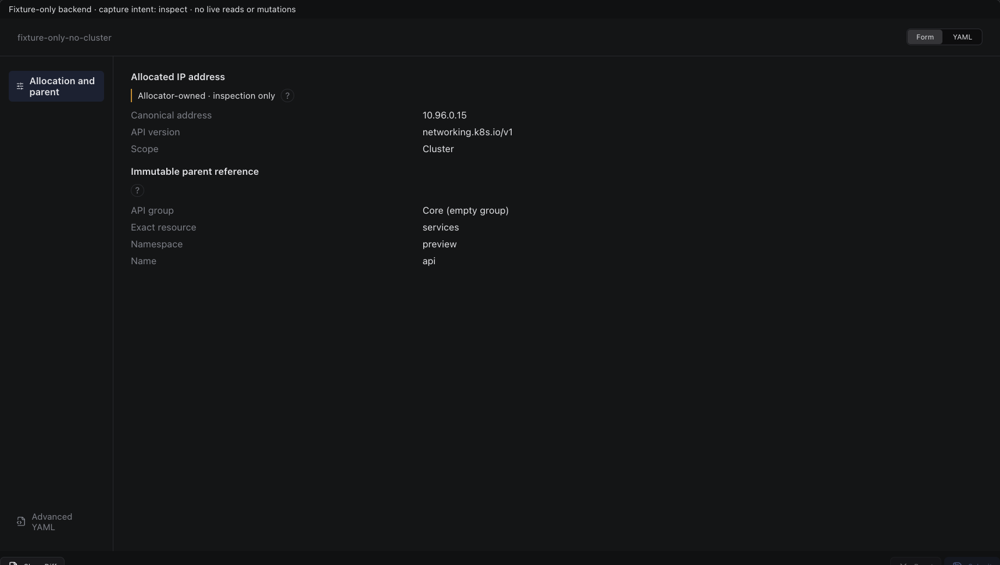

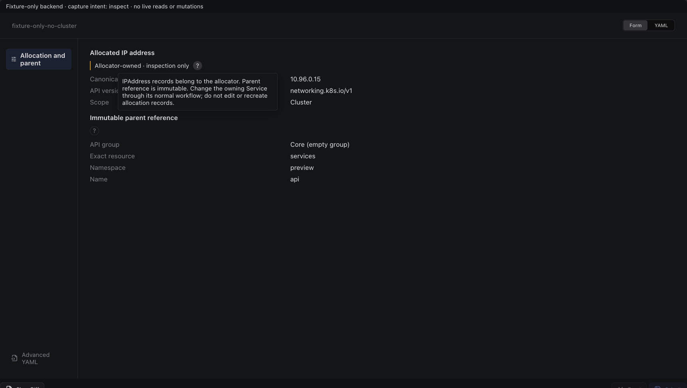

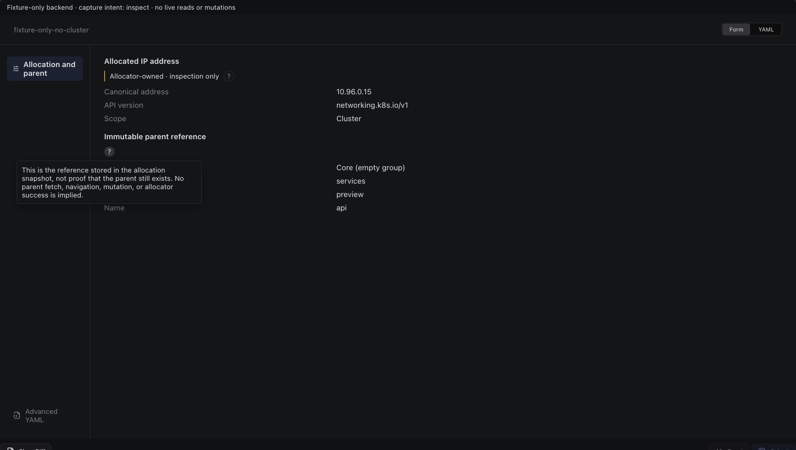

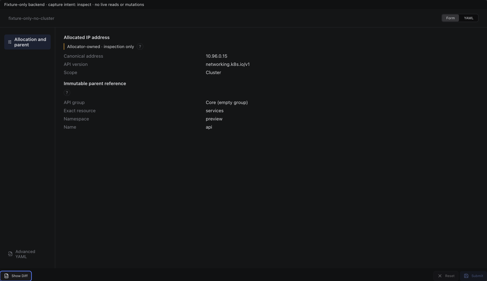

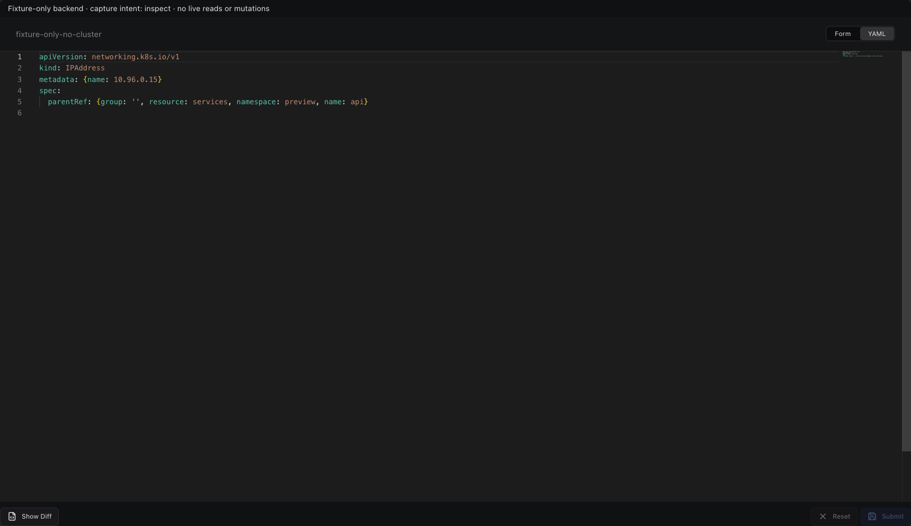

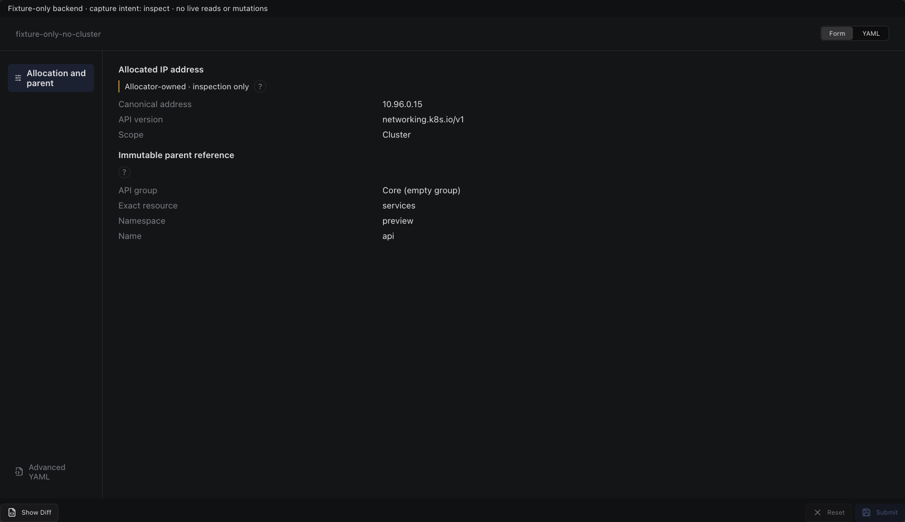

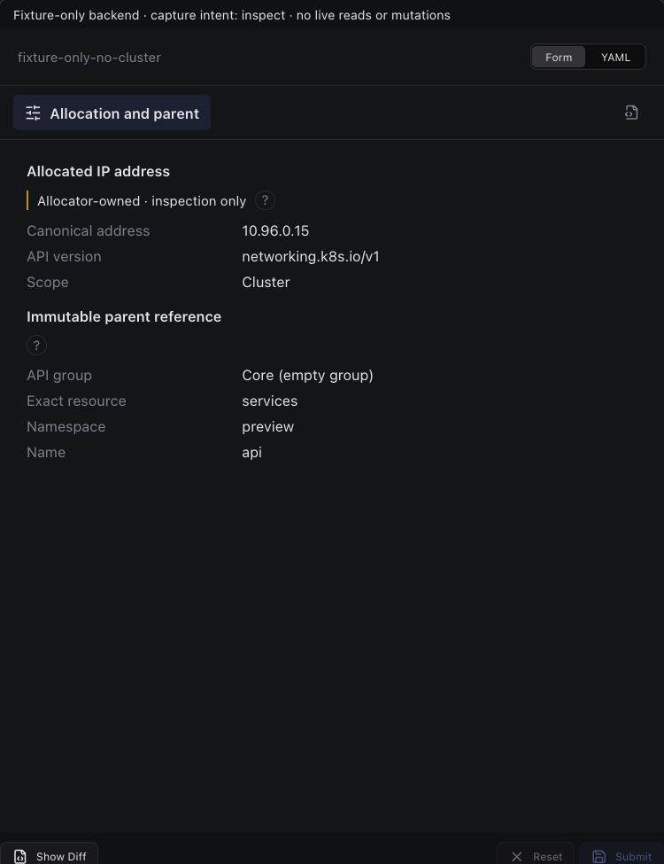

## edit

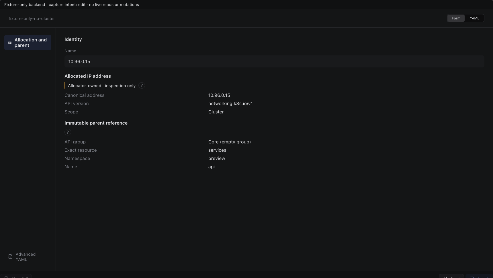

Sections, help, source, keyboard, narrow layout and boundary evidence

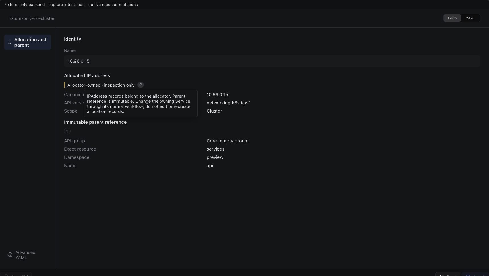

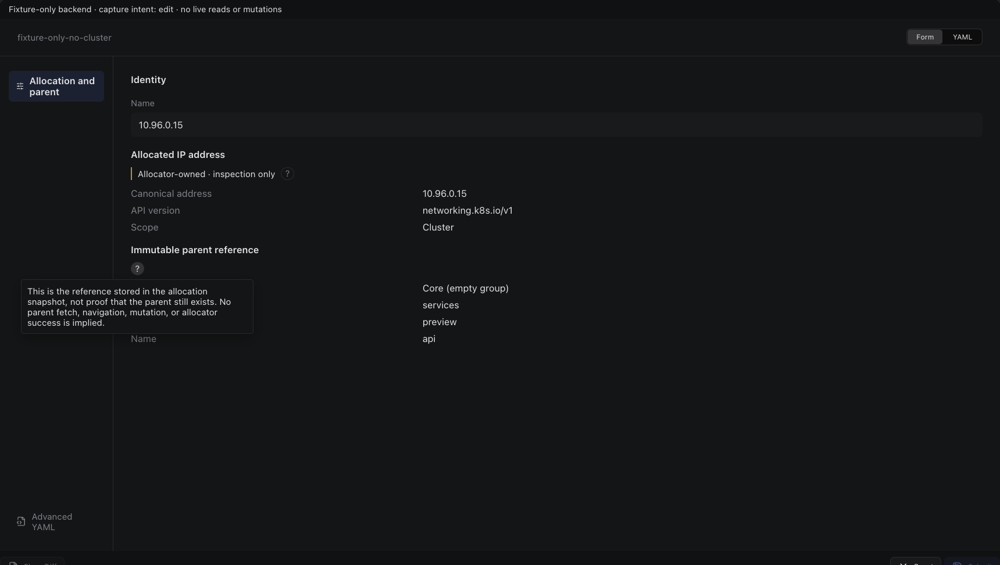

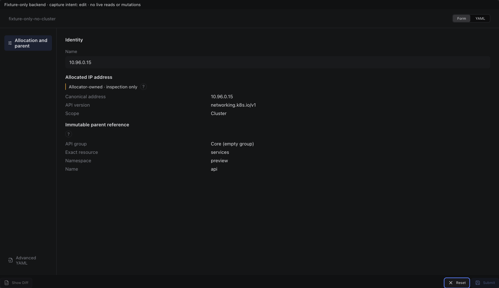

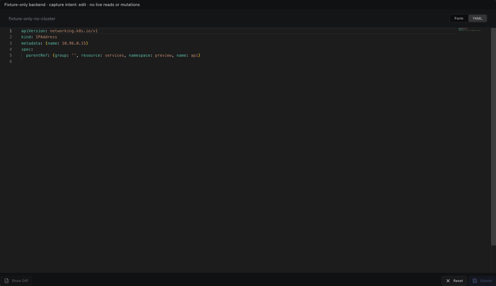

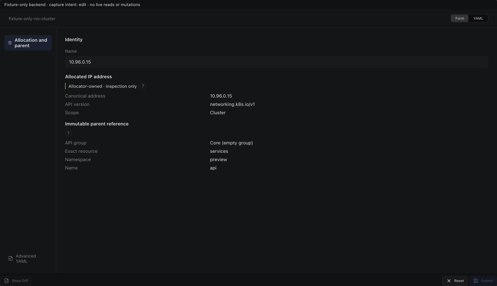

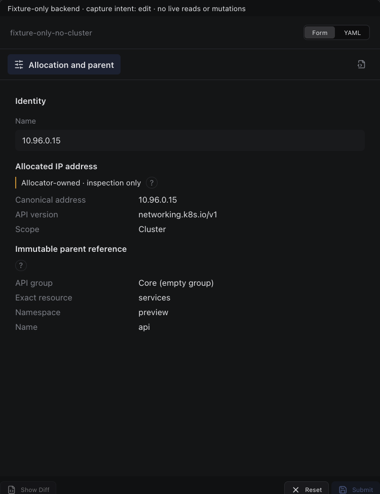

