# CSI node registration

Actual production components with local fixture transport. No live resource reads or mutations. Creating/Submitting is held at the fixture boundary; denied, unavailable and immutable states are not presented as successful mutations.

Targets: `storage.k8s.io/v1/csinodes` (CSINode, Cluster)
Ownership: controller

## create

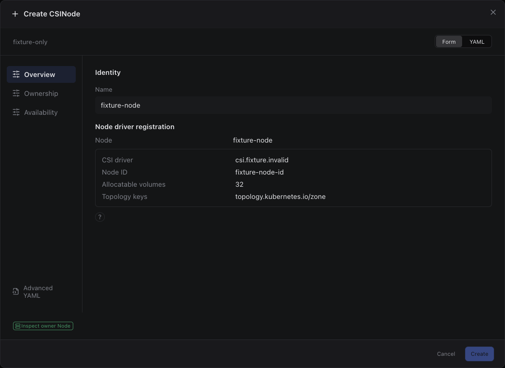

Sections, help, source, keyboard, narrow layout and boundary evidence

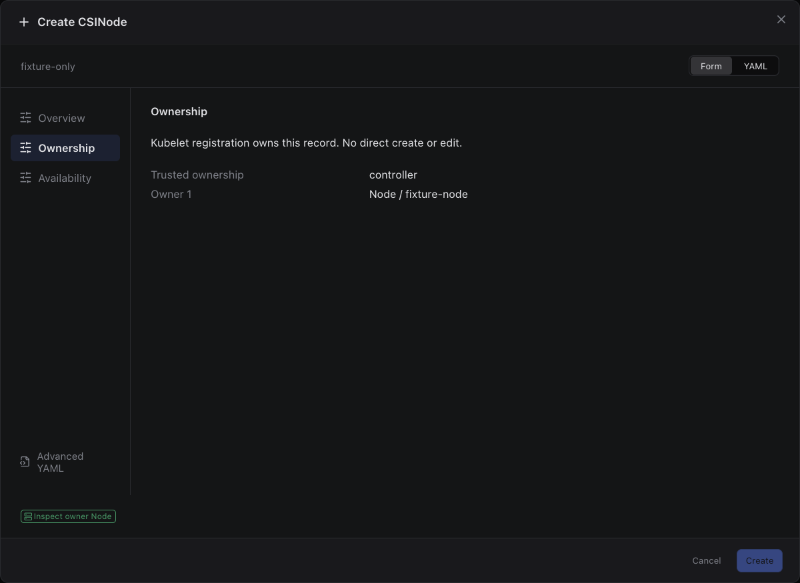

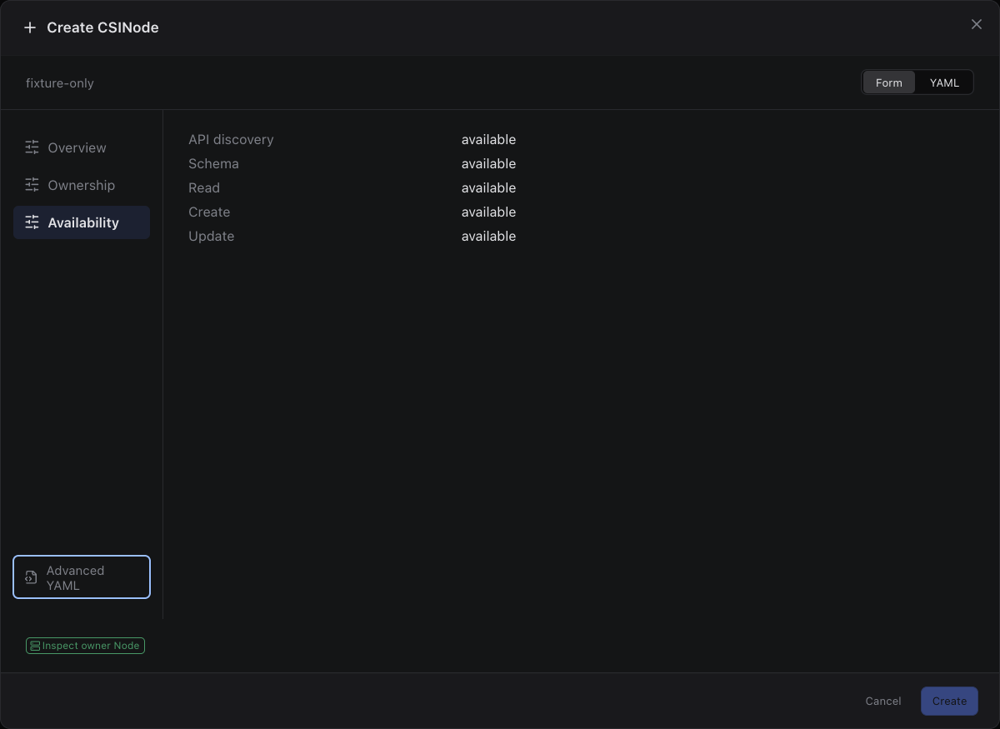

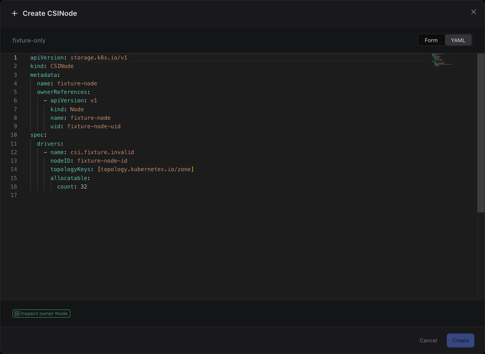

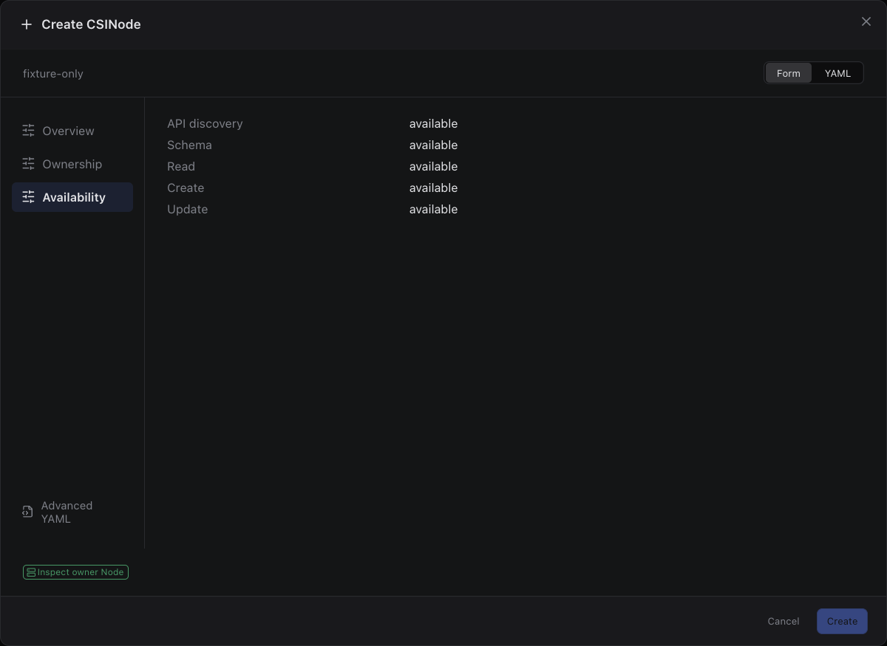

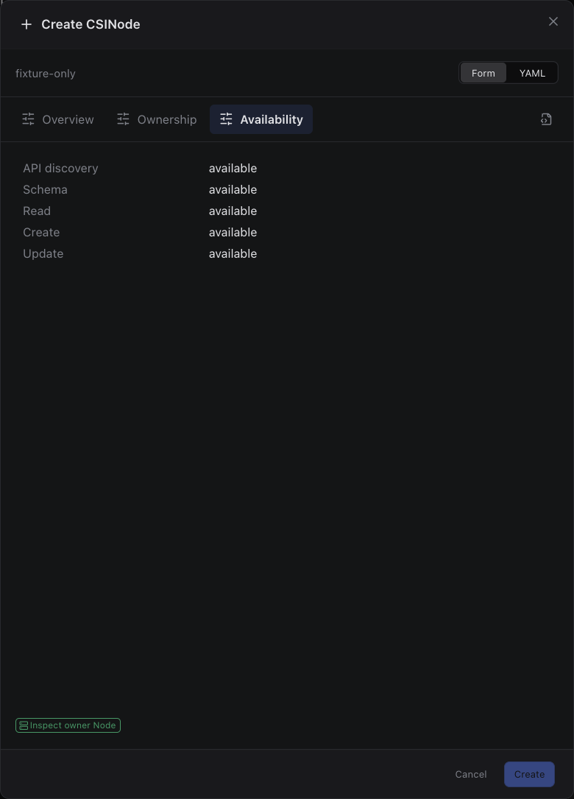

## edit

Sections, help, source, keyboard, narrow layout and boundary evidence

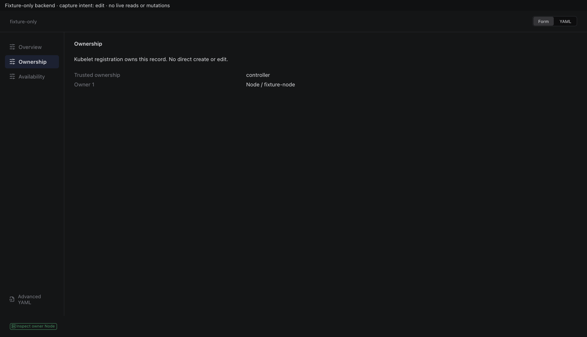

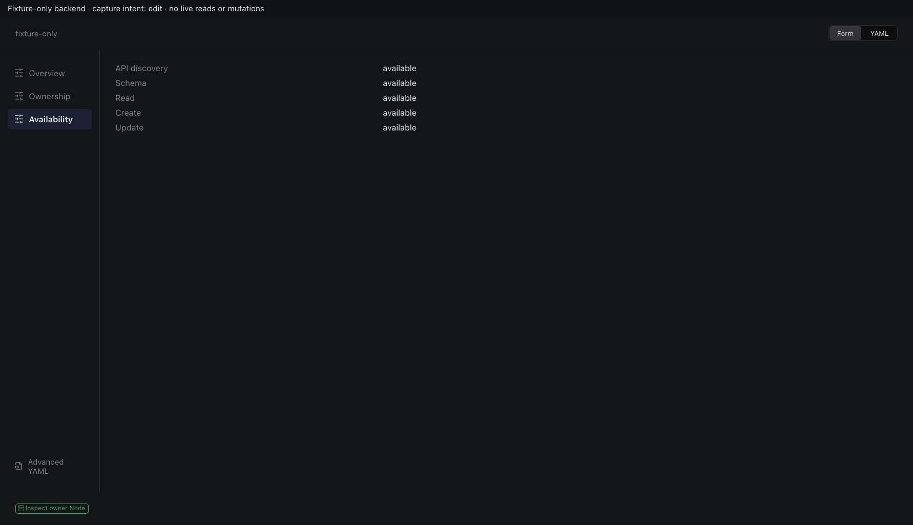

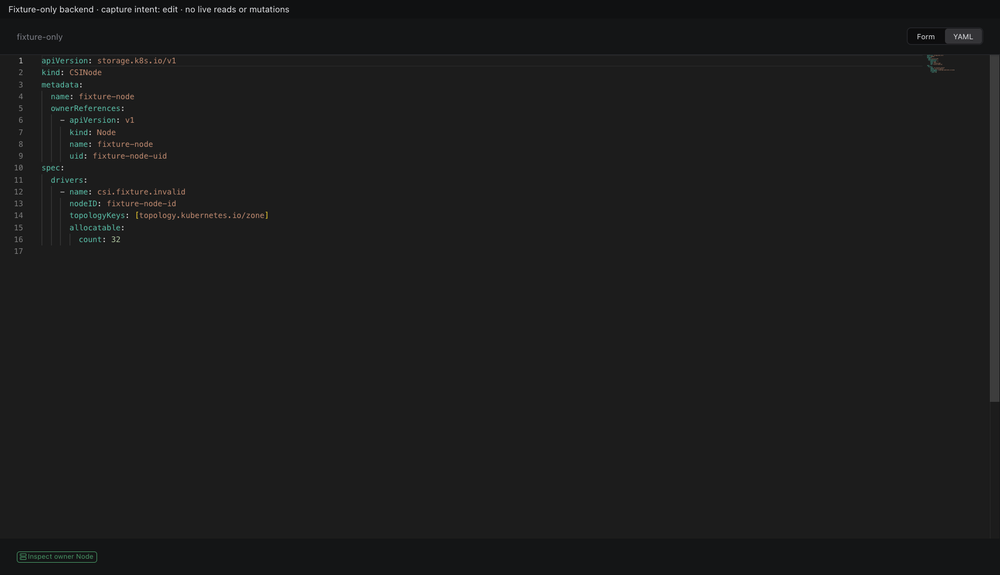

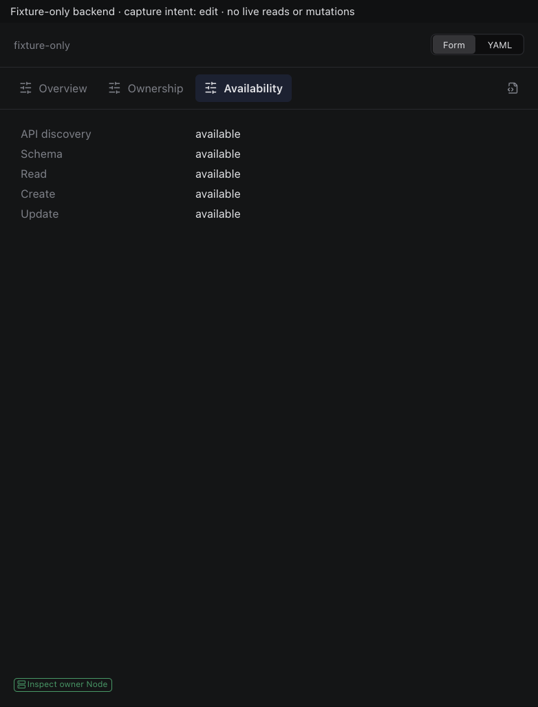

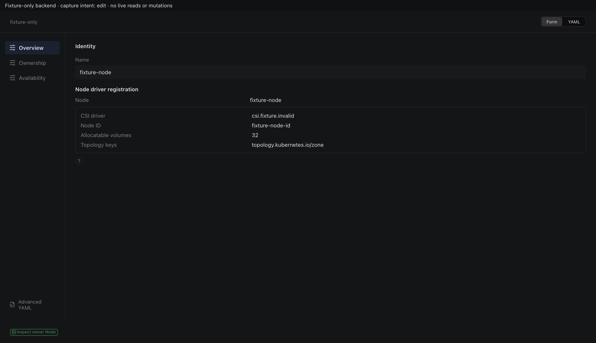

## inspect

Sections, help, source, keyboard, narrow layout and boundary evidence

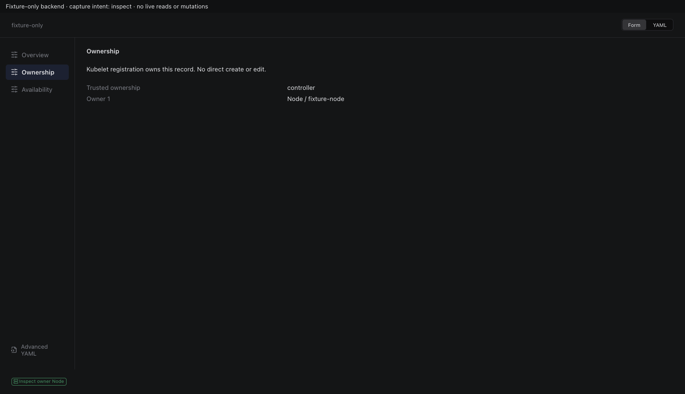

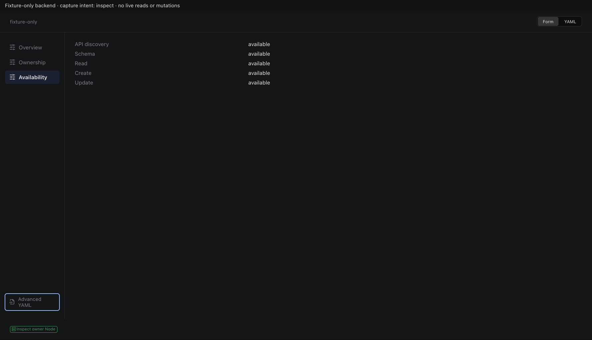

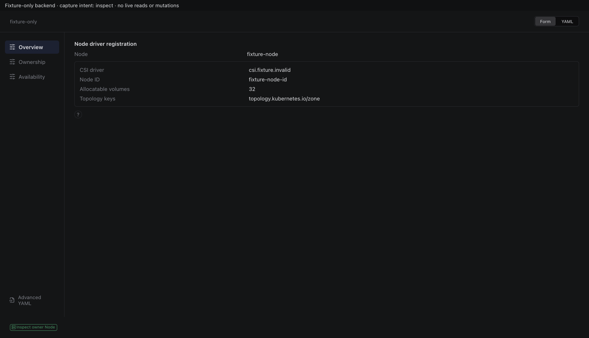

