# Pod certificate request

Actual production components with local fixture transport. No live resource reads or mutations. Creating/Submitting is held at the fixture boundary; denied, unavailable and immutable states are not presented as successful mutations.

Targets: `certificates.k8s.io/v1beta1/podcertificaterequests` (PodCertificateRequest, Namespaced)
Ownership: system

## edit

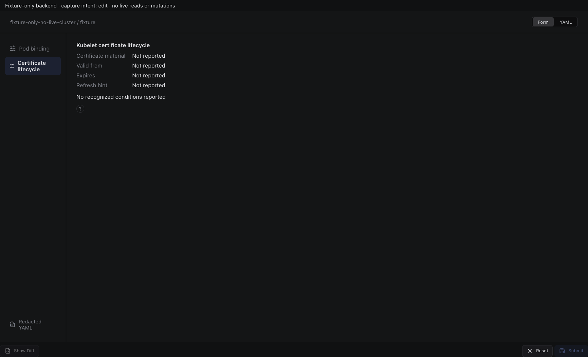

Sections, help, source, keyboard, narrow layout and boundary evidence

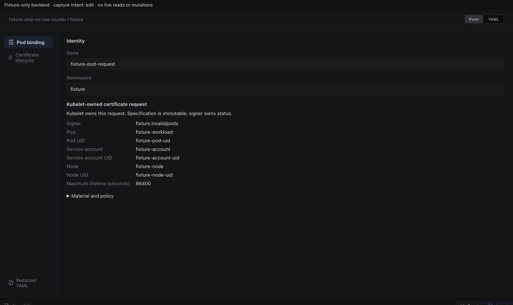

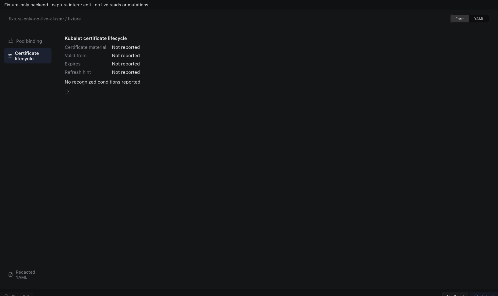

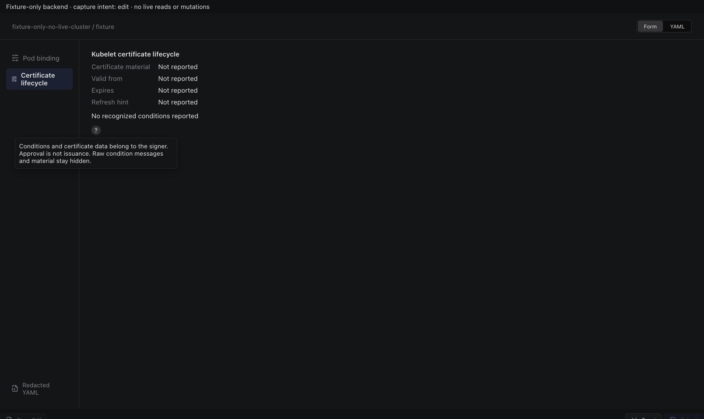

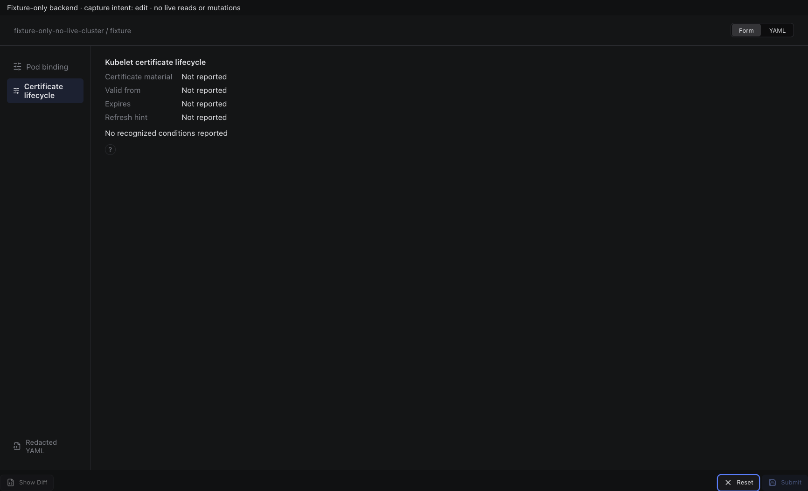

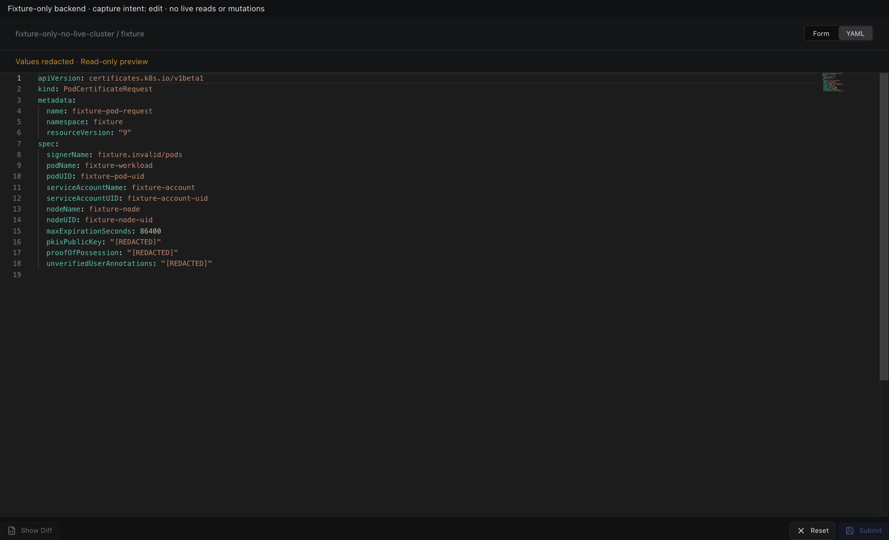

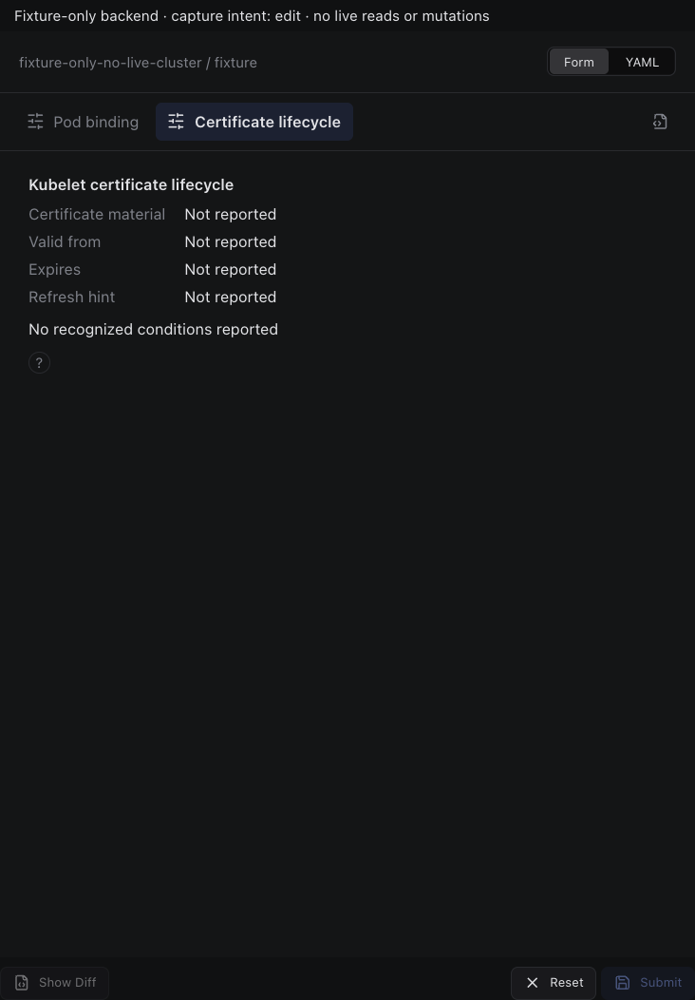

## inspect

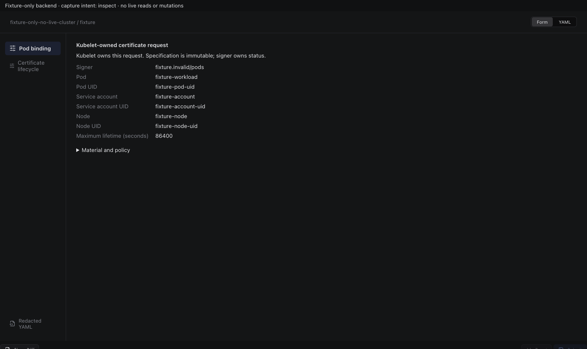

Sections, help, source, keyboard, narrow layout and boundary evidence

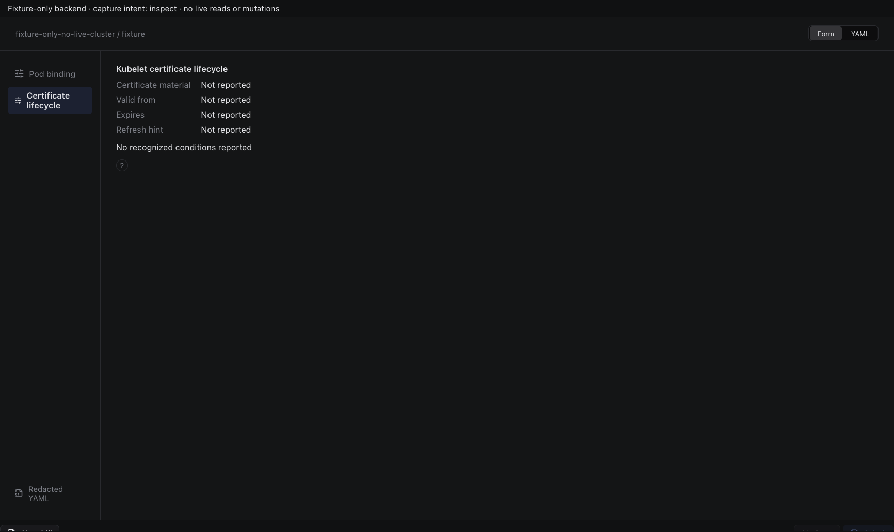

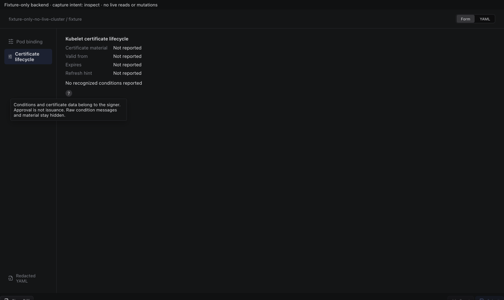

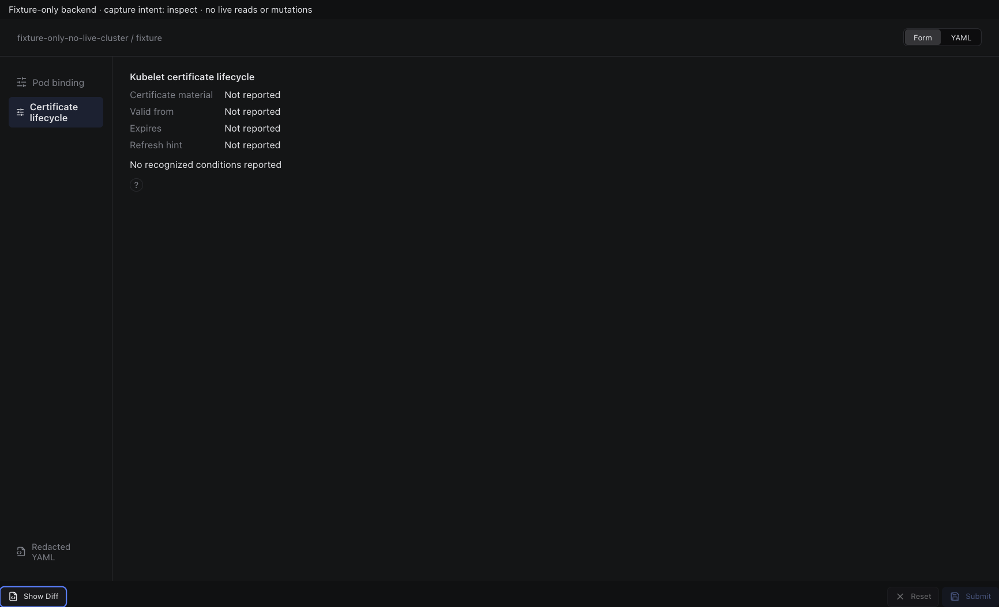

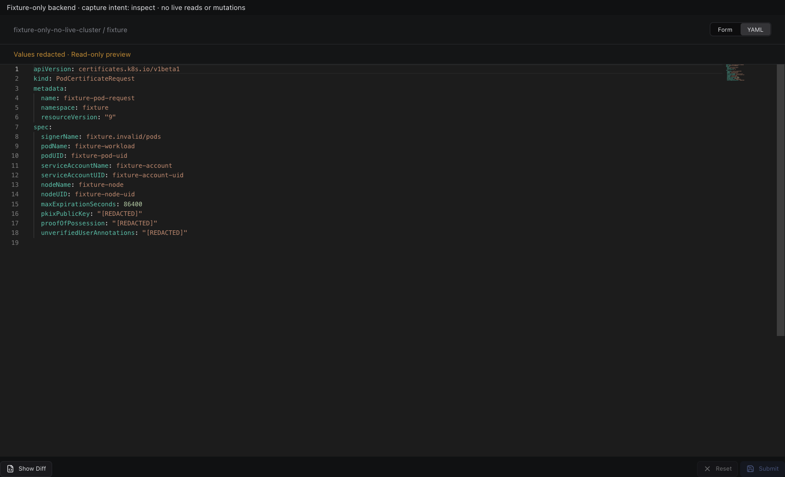

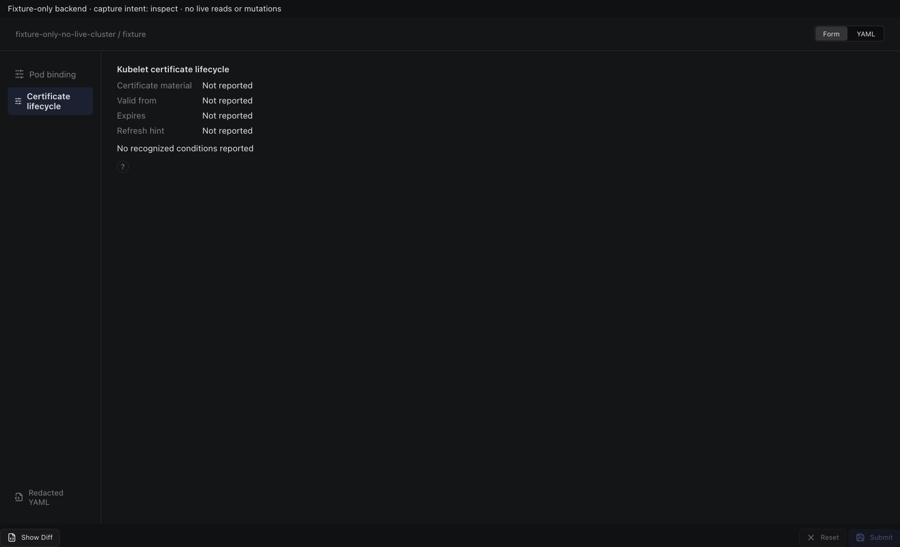

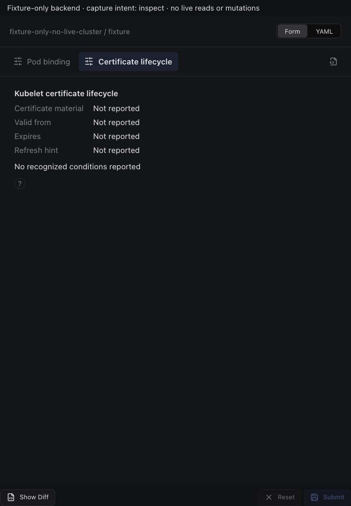

