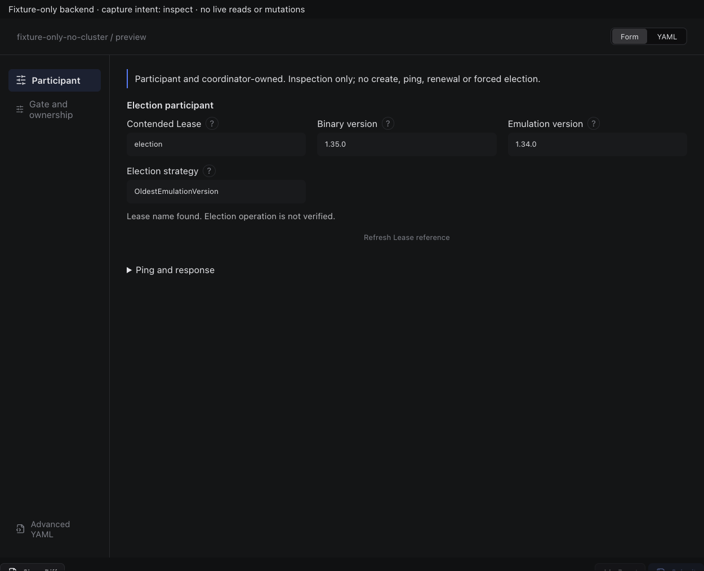
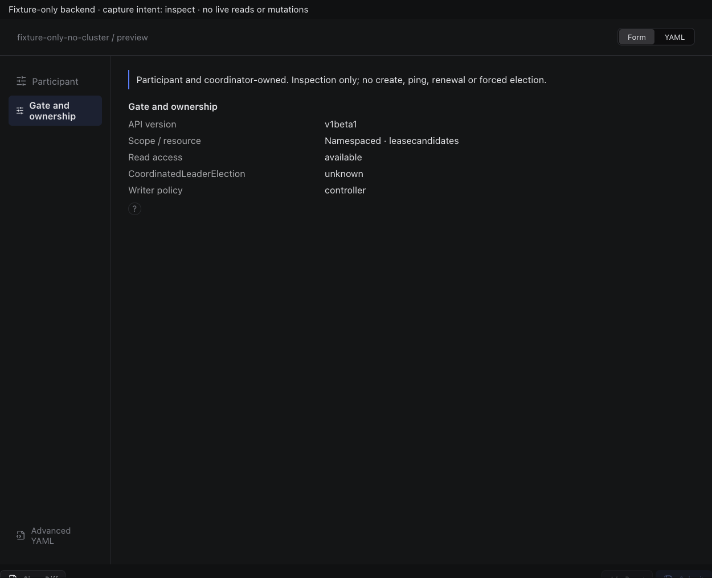
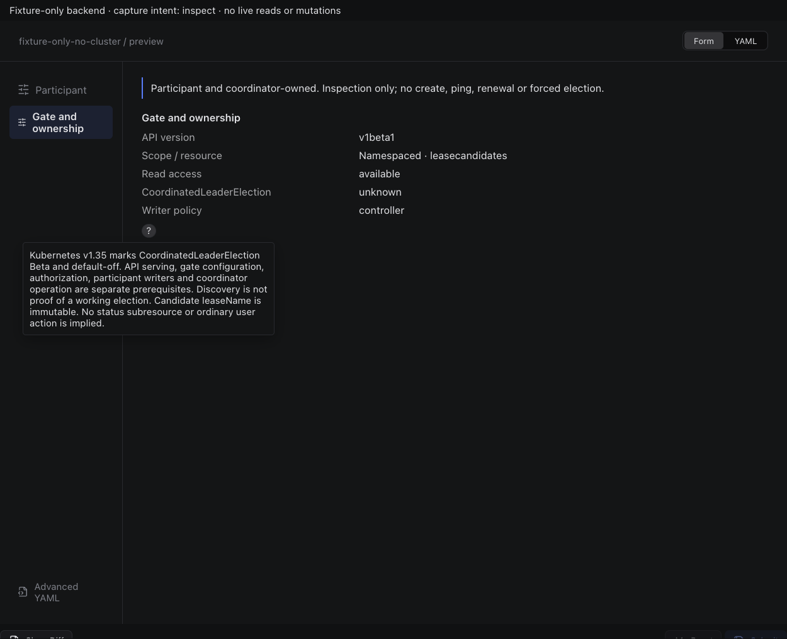
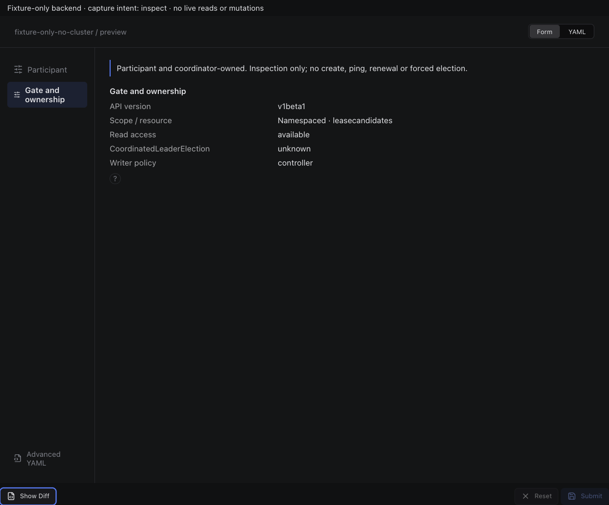
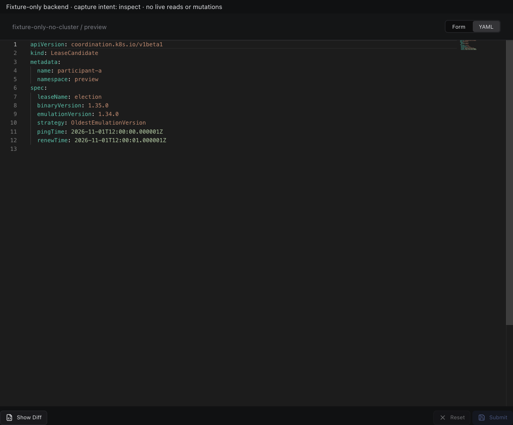
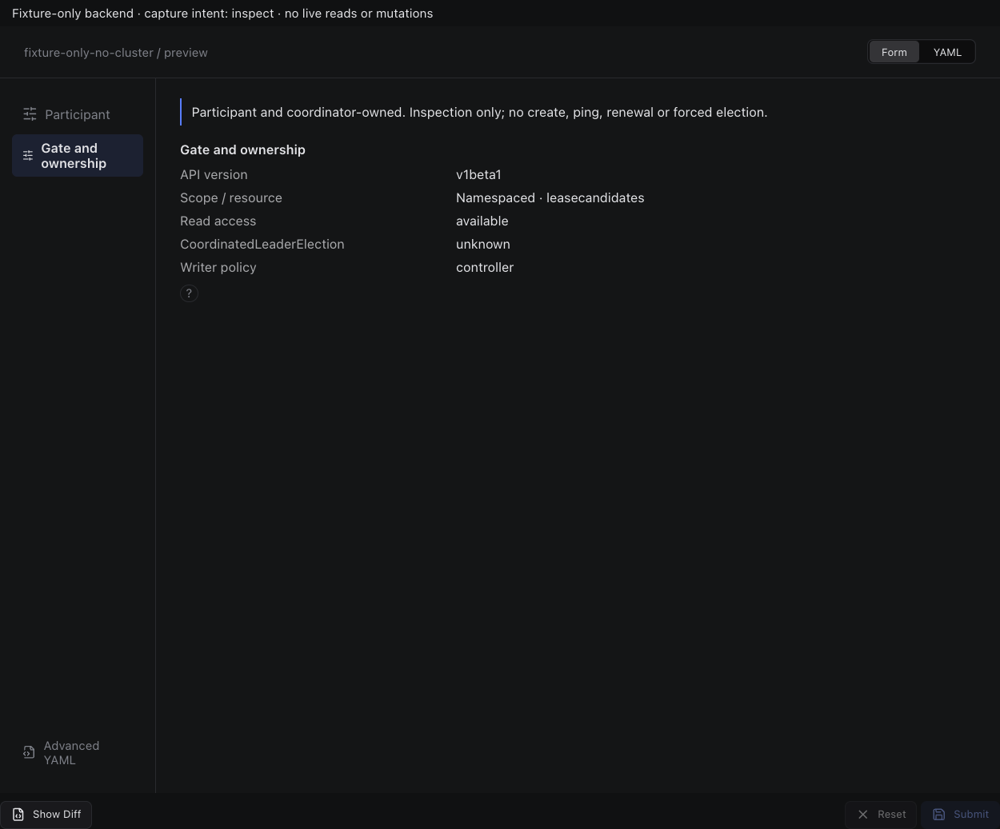
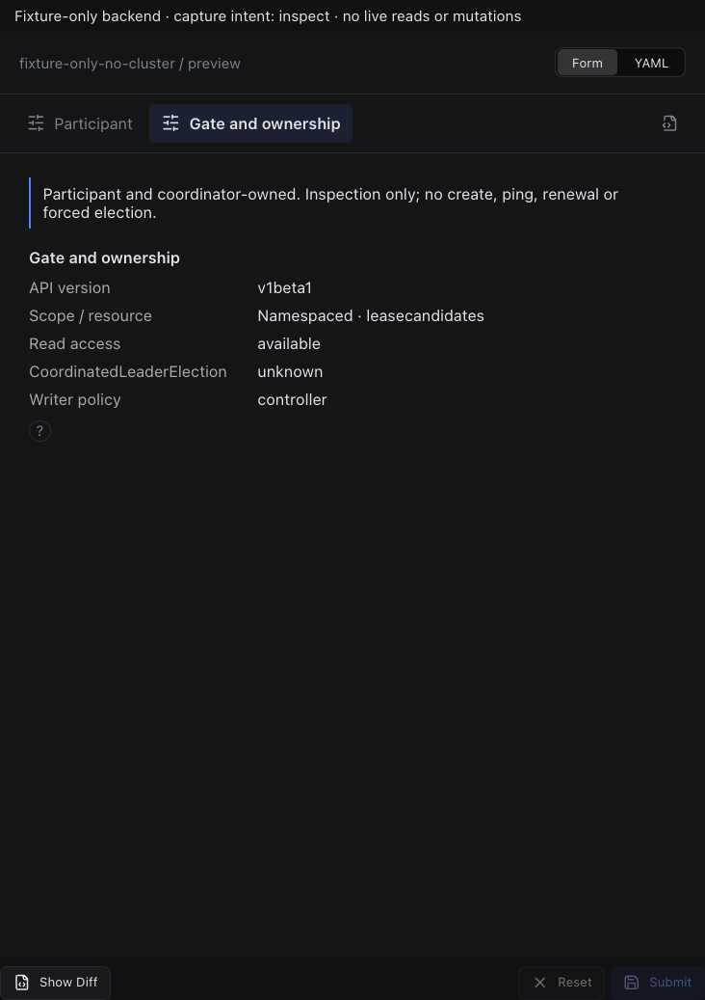
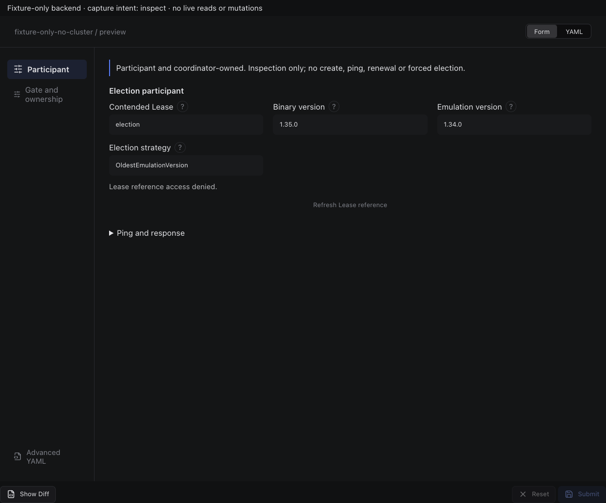
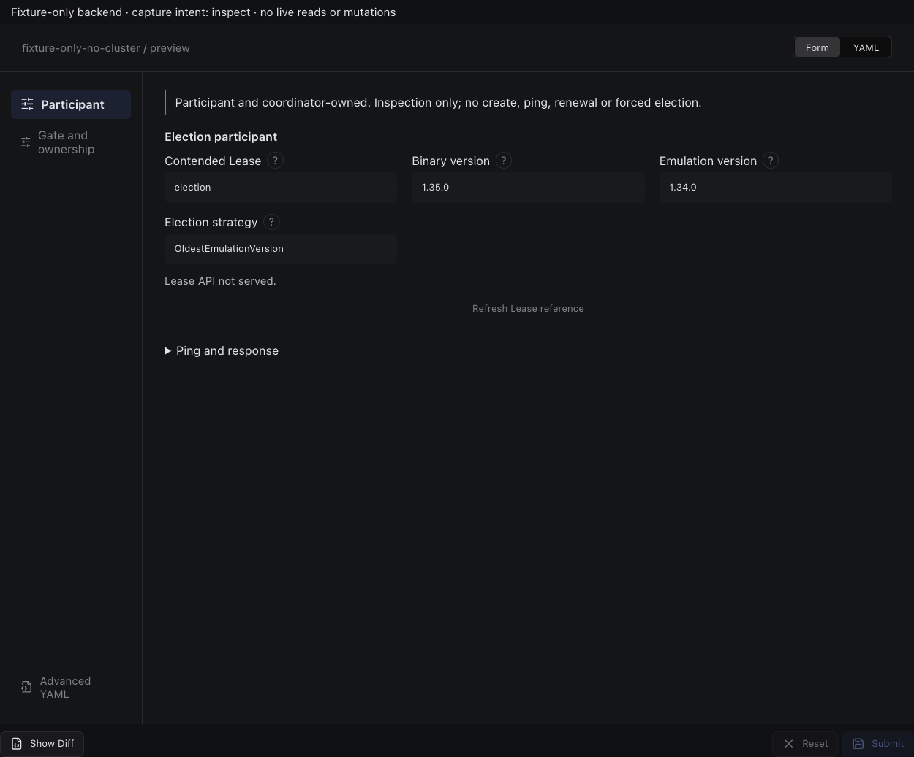

# Lease election participant

Actual production components with local fixture transport. No live resource reads or mutations. Creating/Submitting is held at the fixture boundary; denied, unavailable and immutable states are not presented as successful mutations.

Targets: `coordination.k8s.io/v1beta1/leasecandidates` (LeaseCandidate, Namespaced) · `coordination.k8s.io/v1alpha2/leasecandidates` (LeaseCandidate, Namespaced)
Ownership: controller

## inspect

Sections, help, source, keyboard, narrow layout and boundary evidence

