# Claim template

Actual production components with local fixture transport. No live resource reads or mutations. Creating/Submitting is held at the fixture boundary; denied, unavailable and immutable states are not presented as successful mutations.

Targets: `resource.k8s.io/v1/resourceclaimtemplates` (ResourceClaimTemplate, Namespaced) · `resource.k8s.io/v1beta1/resourceclaimtemplates` (ResourceClaimTemplate, Namespaced) · `resource.k8s.io/v1beta2/resourceclaimtemplates` (ResourceClaimTemplate, Namespaced)
Ownership: declarative

## create

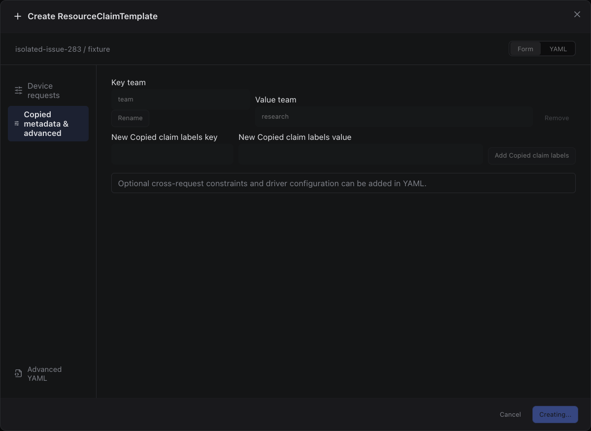

Sections, help, source, keyboard, narrow layout and boundary evidence

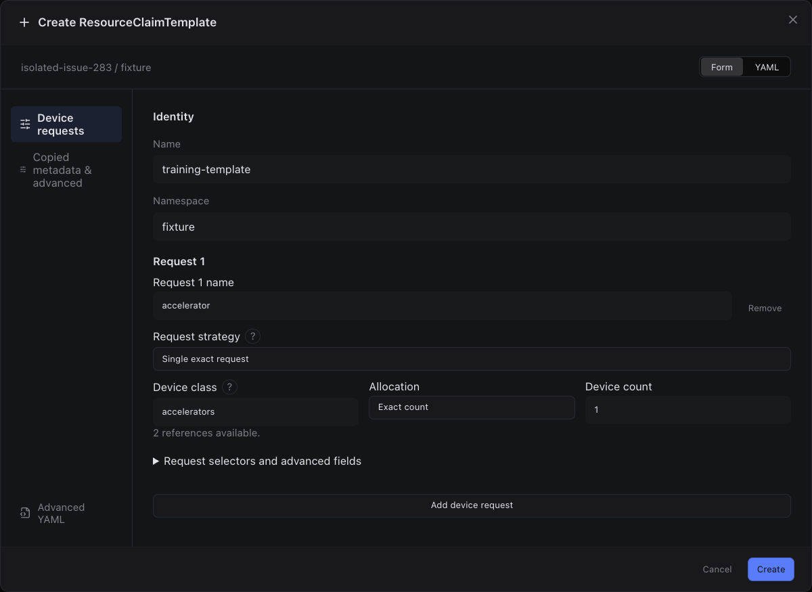

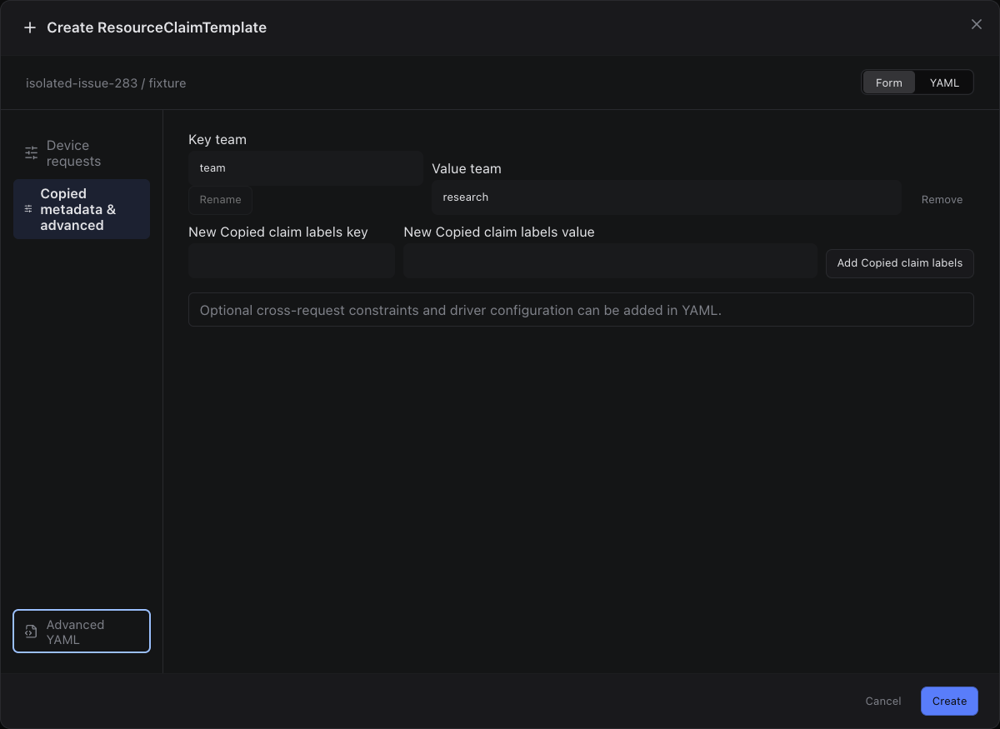

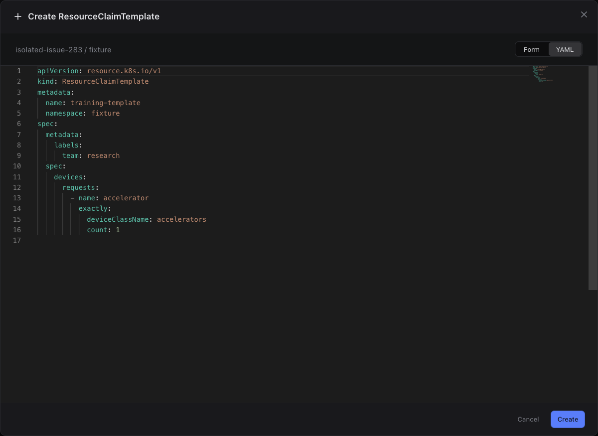

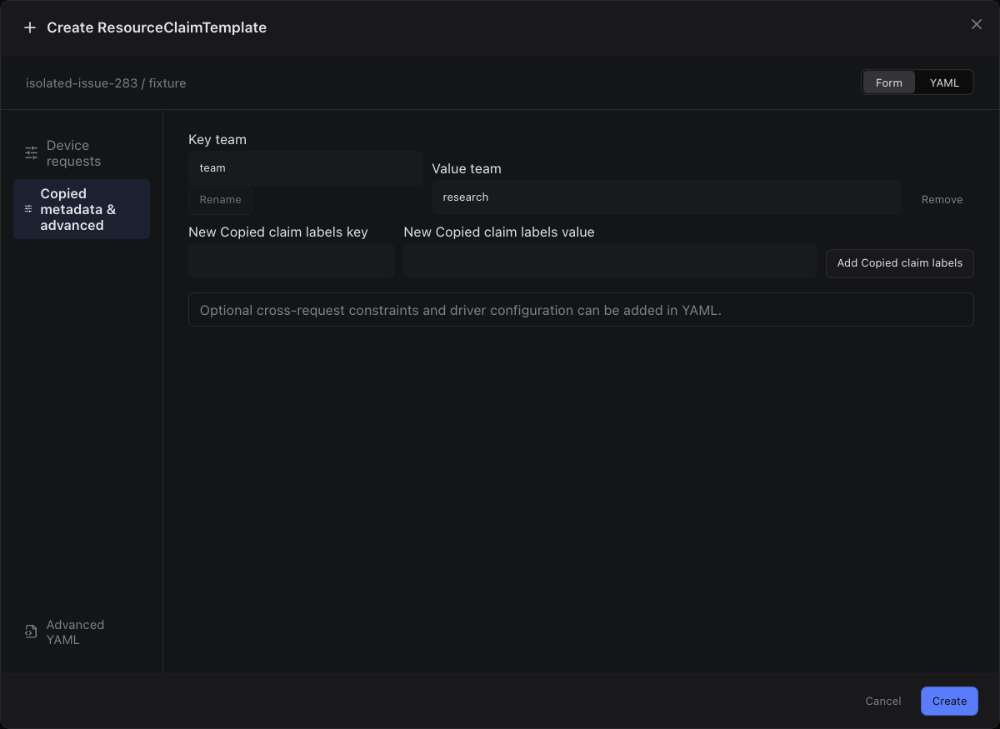

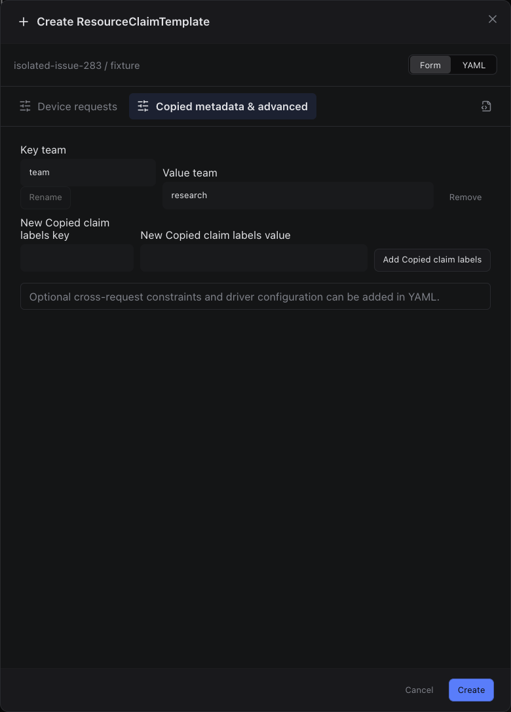

## edit

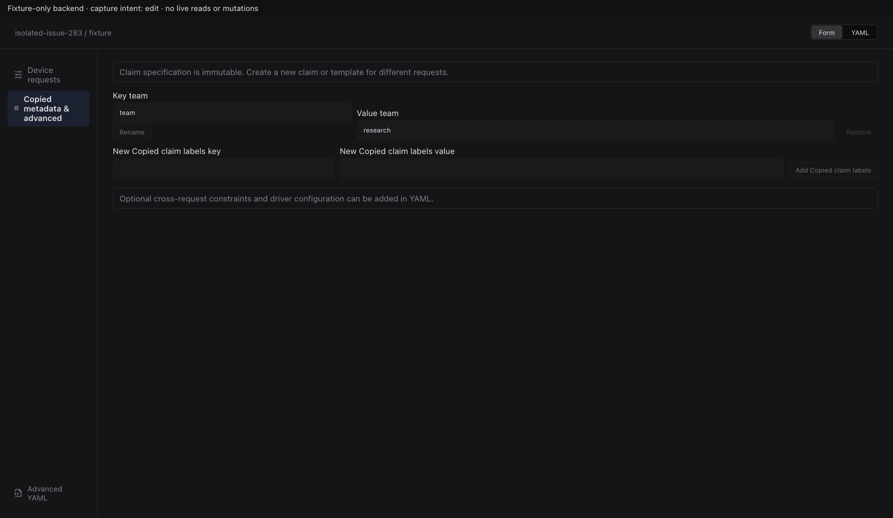

Sections, help, source, keyboard, narrow layout and boundary evidence

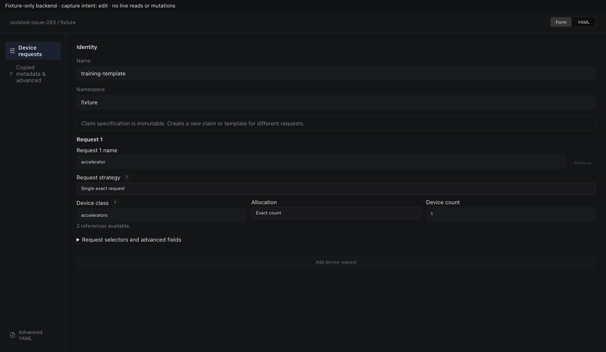

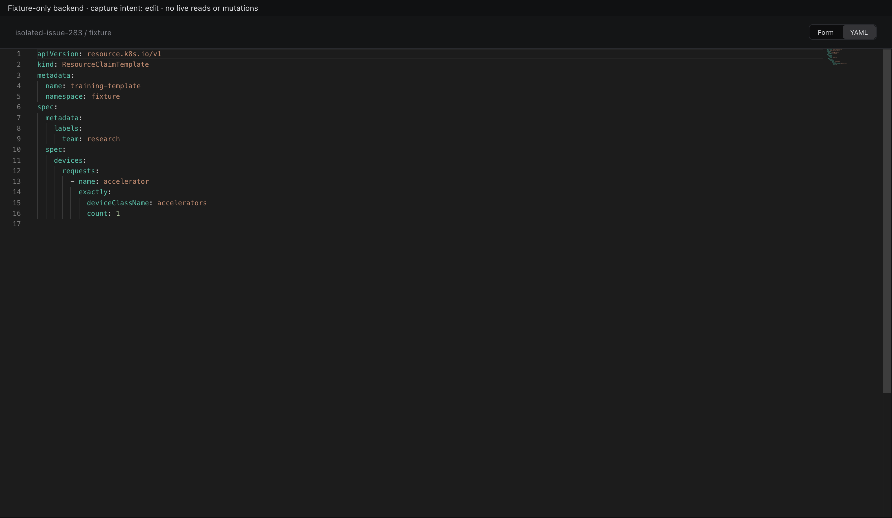

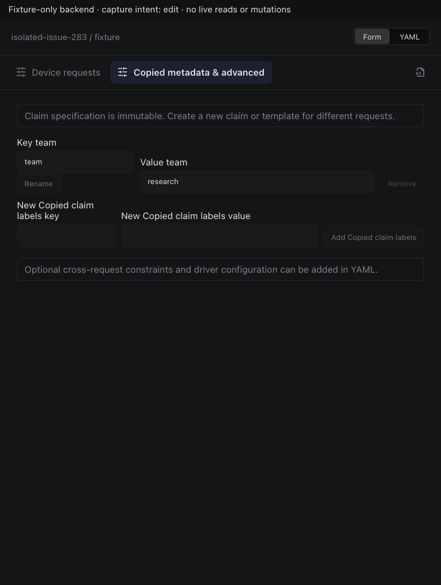

## inspect

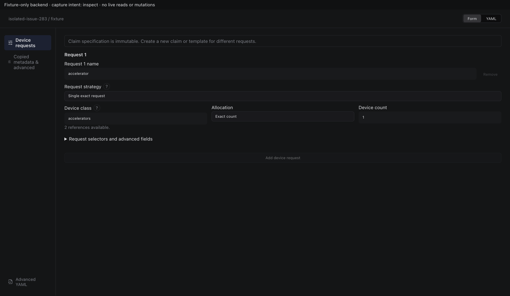

Sections, help, source, keyboard, narrow layout and boundary evidence

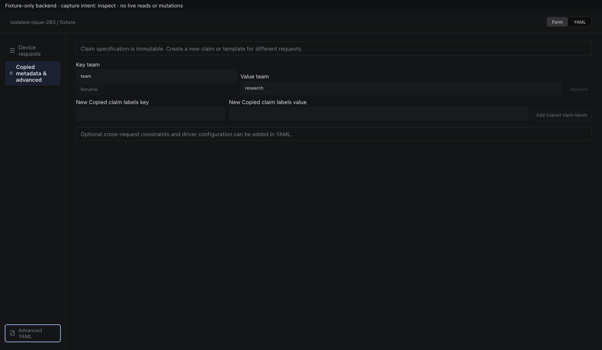

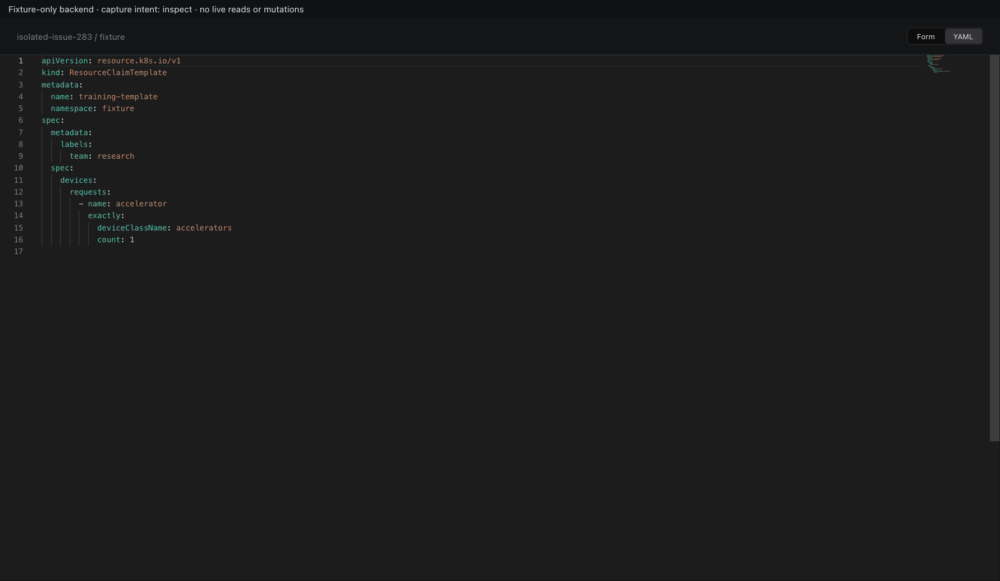

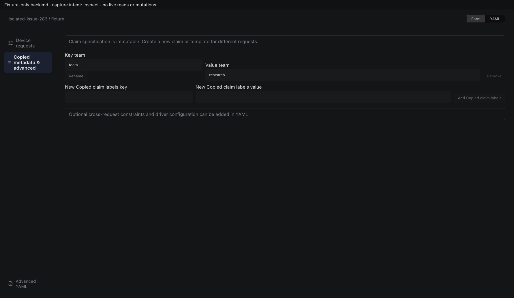

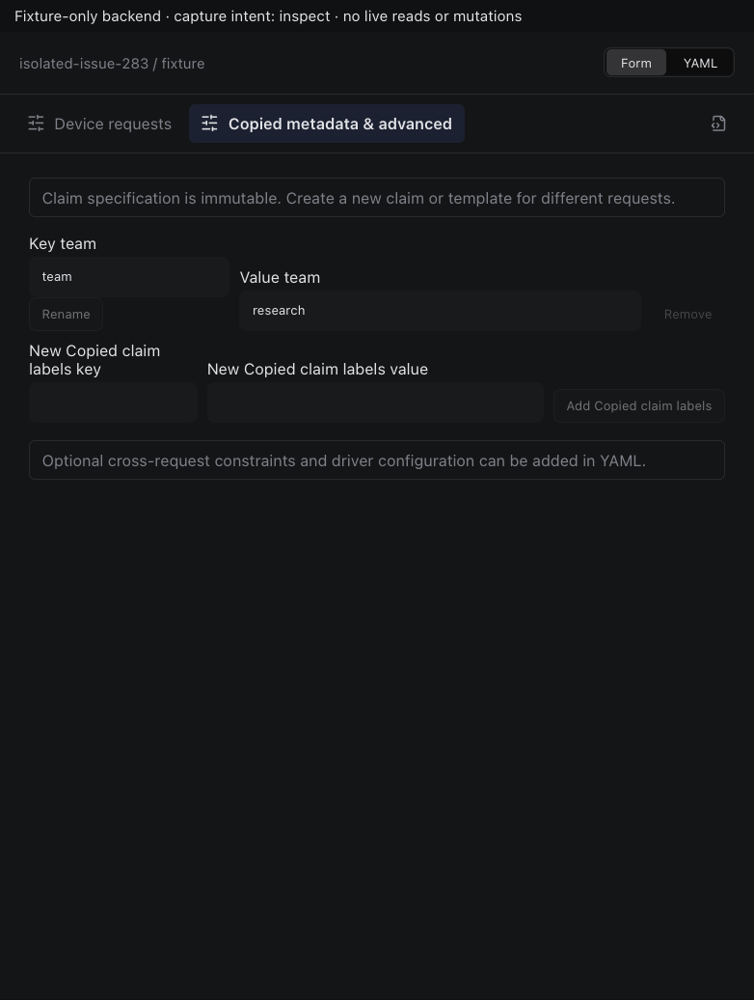

