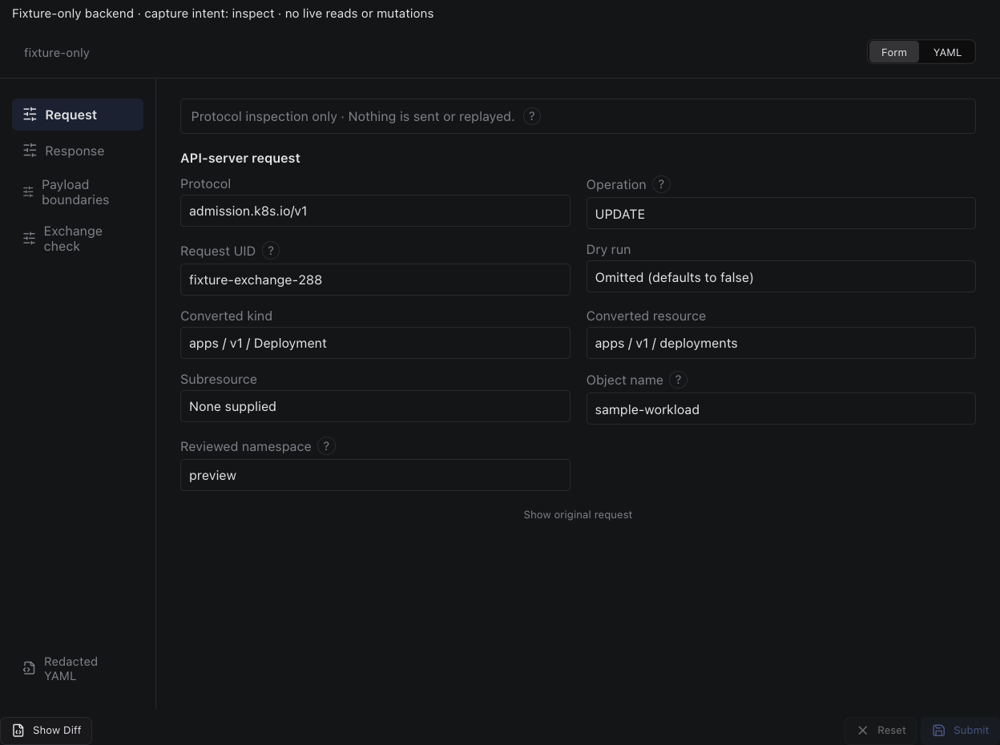
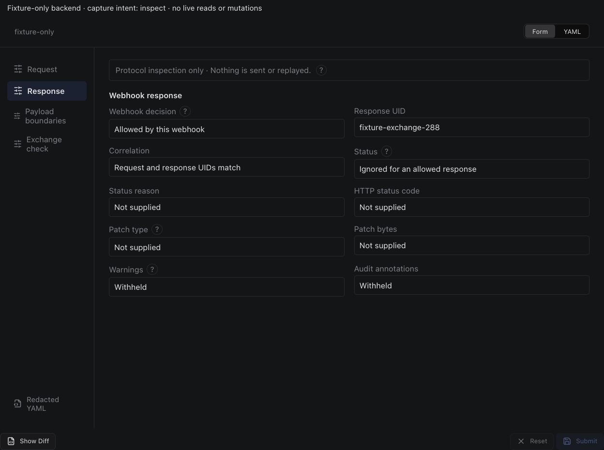
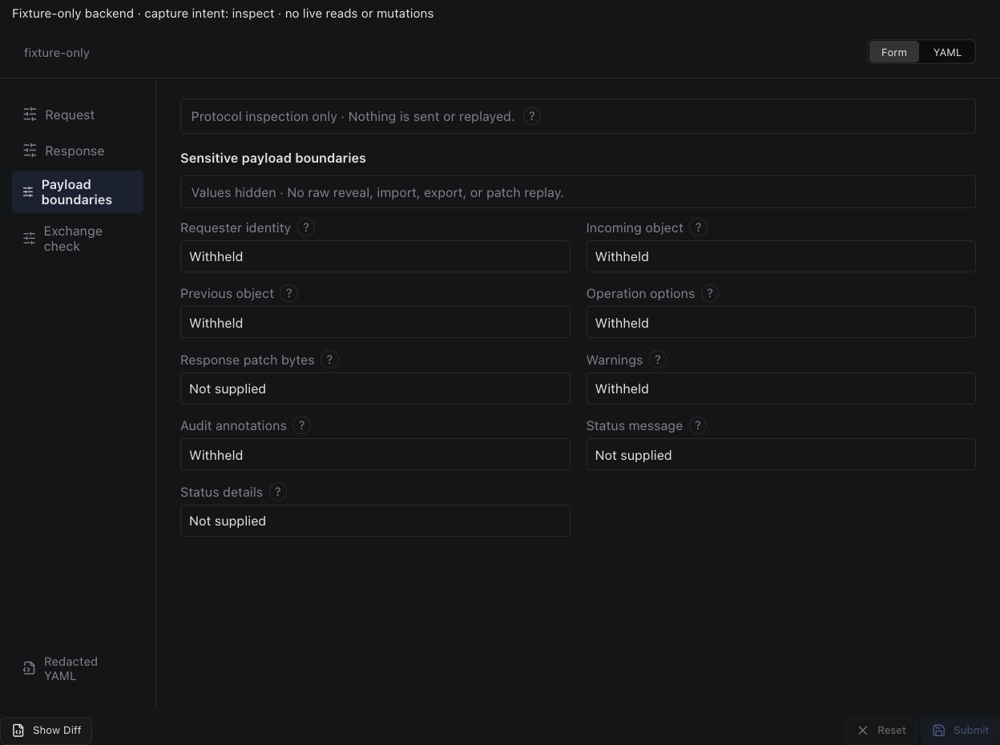
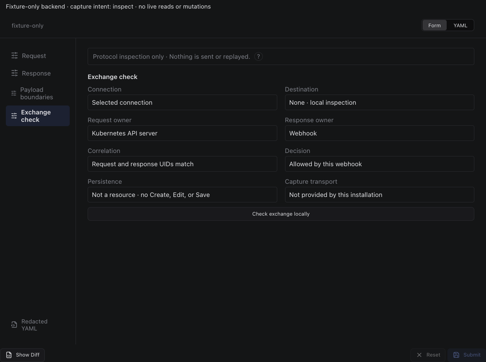
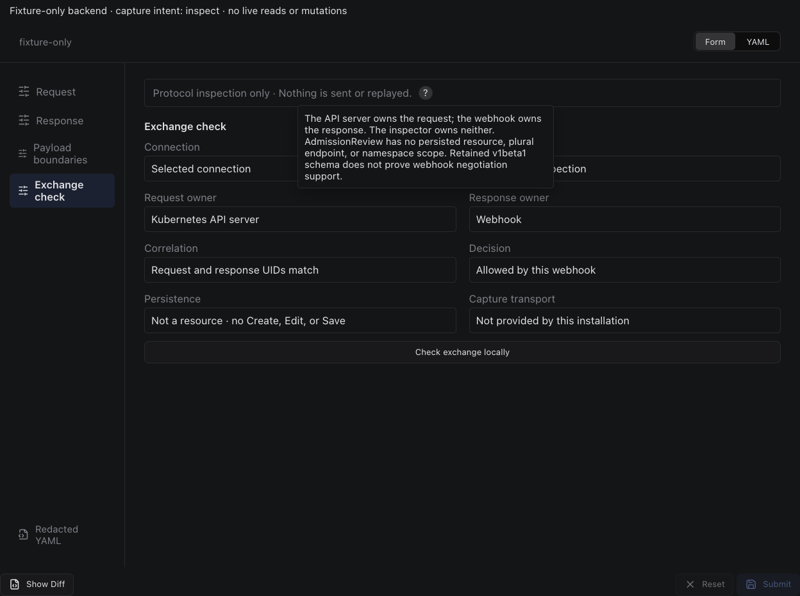
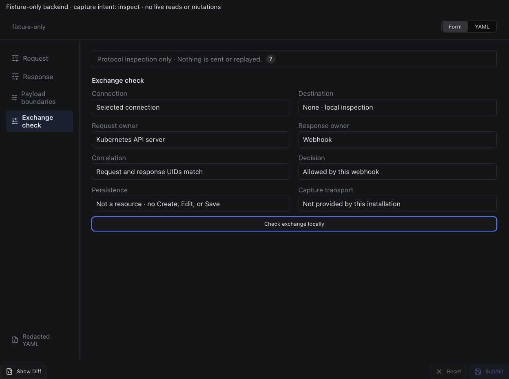
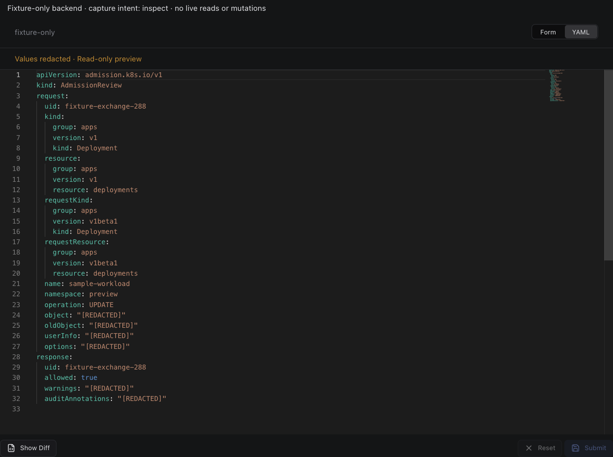
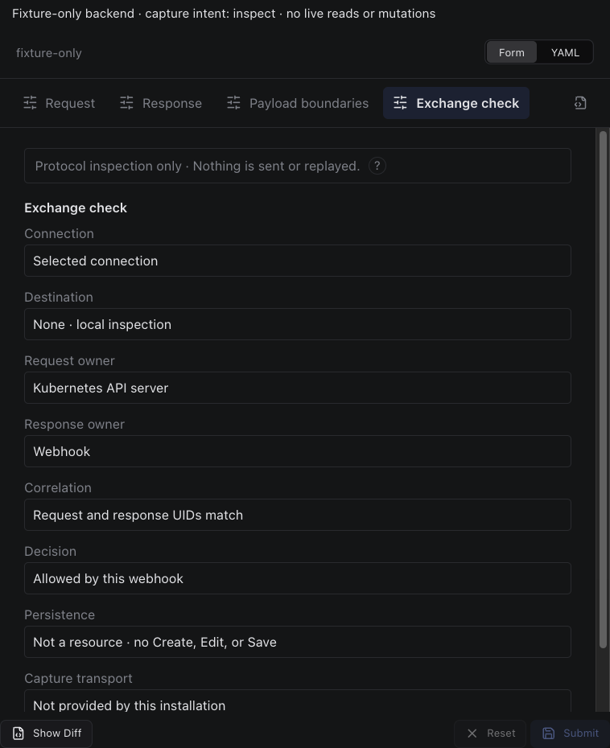
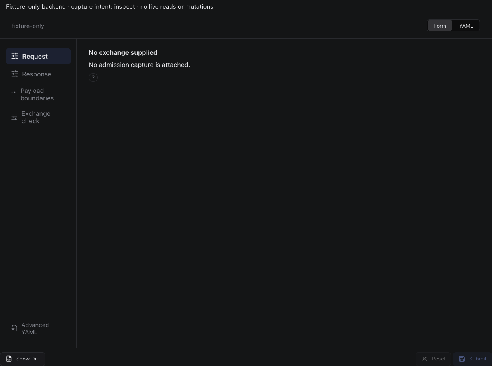

# AdmissionReview protocol inspector

Actual production components with local fixture transport. No live resource reads or mutations. Creating/Submitting is held at the fixture boundary; denied, unavailable and immutable states are not presented as successful mutations.

Targets: `admission.k8s.io/v1/` (AdmissionReview, Cluster) · `admission.k8s.io/v1beta1/` (AdmissionReview, Cluster)
Ownership: unknown

## inspect

Sections, help, source, keyboard, narrow layout and boundary evidence

