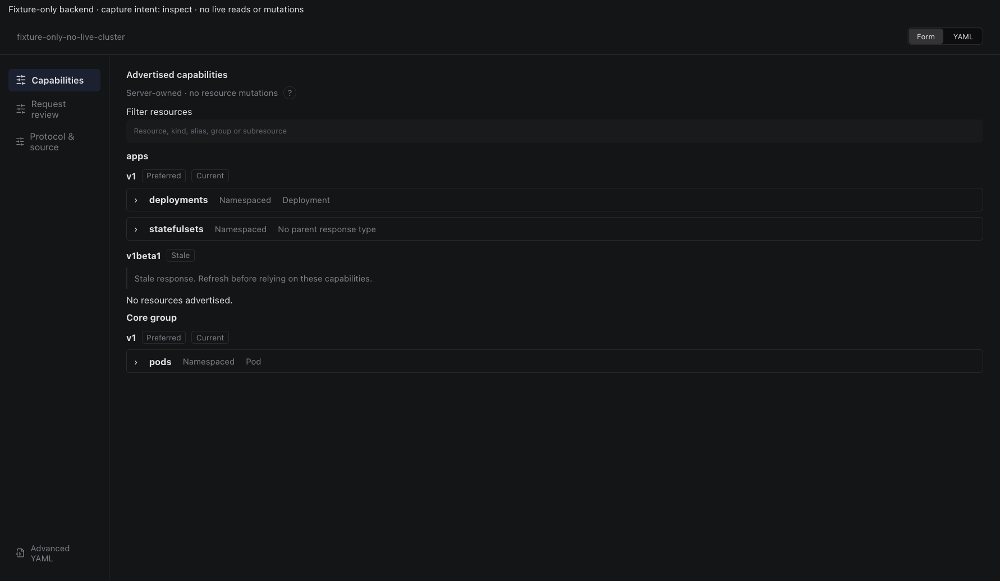
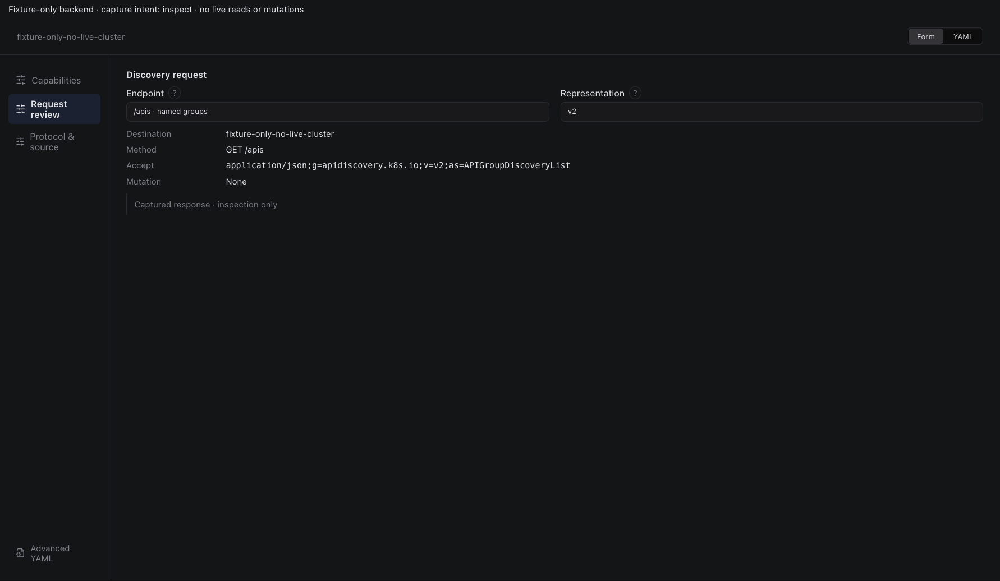
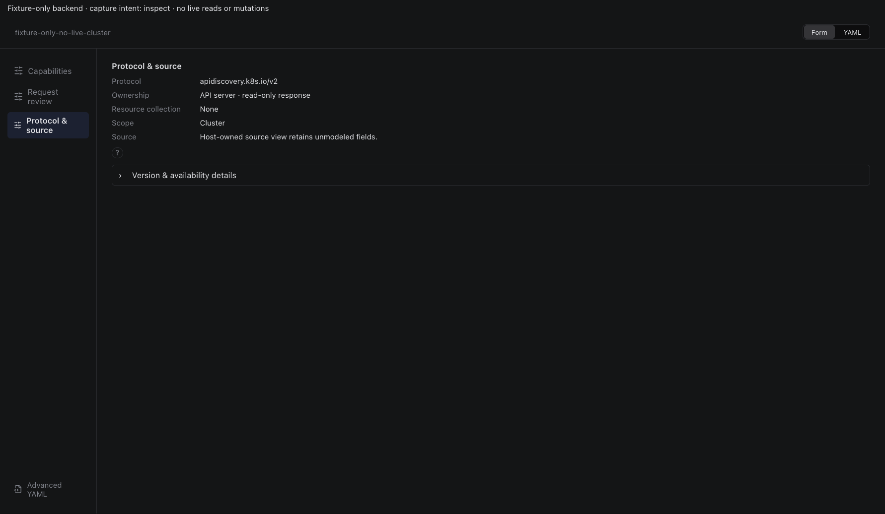
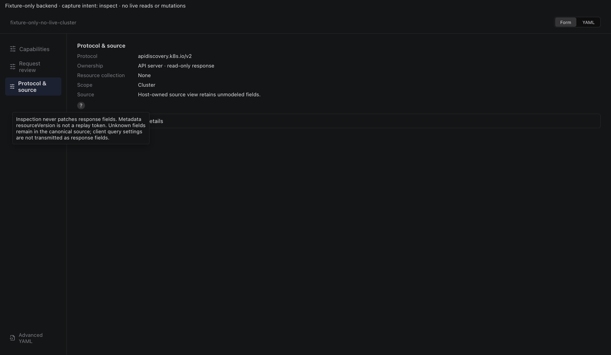
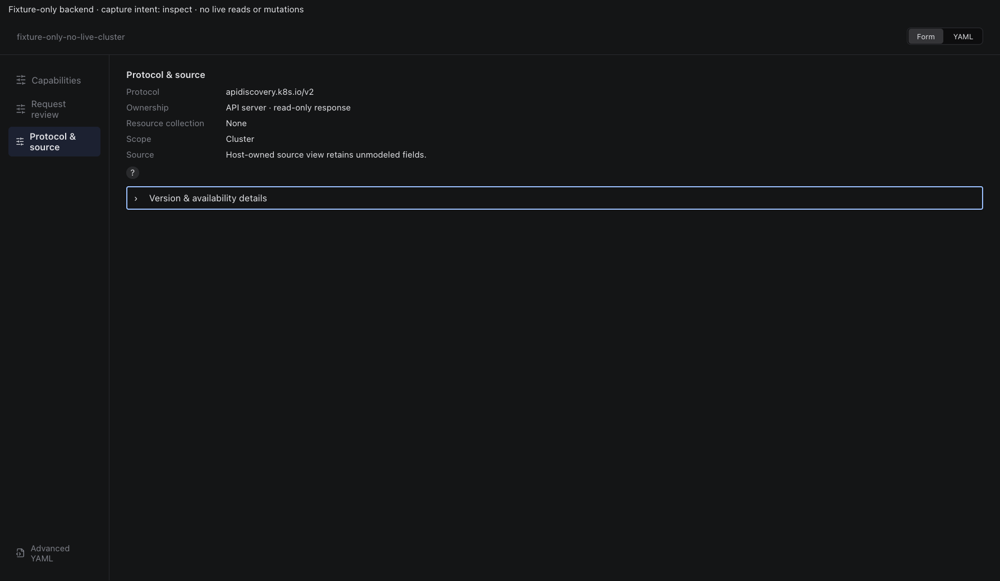
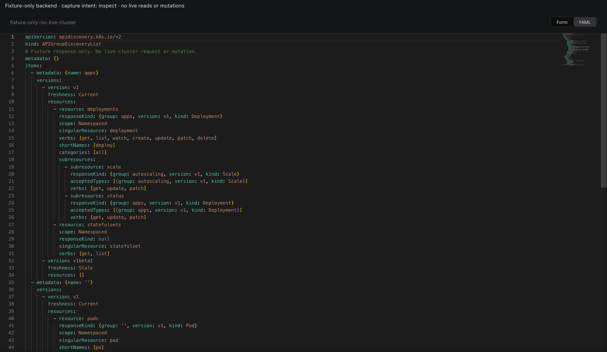
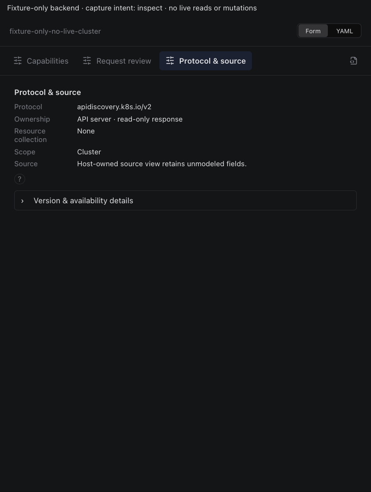

# API discovery inspector

Actual production components with local fixture transport. No live resource reads or mutations. Creating/Submitting is held at the fixture boundary; denied, unavailable and immutable states are not presented as successful mutations.

Targets: `apidiscovery.k8s.io/v2/` (APIGroupDiscovery, Cluster) · `apidiscovery.k8s.io/v2/` (APIGroupDiscoveryList, Cluster) · `apidiscovery.k8s.io/v2beta1/` (APIGroupDiscovery, Cluster) · `apidiscovery.k8s.io/v2beta1/` (APIGroupDiscoveryList, Cluster)
Ownership: system

## inspect

Sections, help, source, keyboard, narrow layout and boundary evidence

