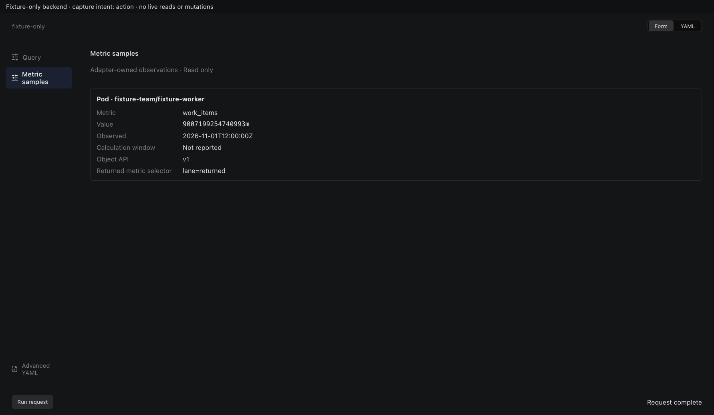
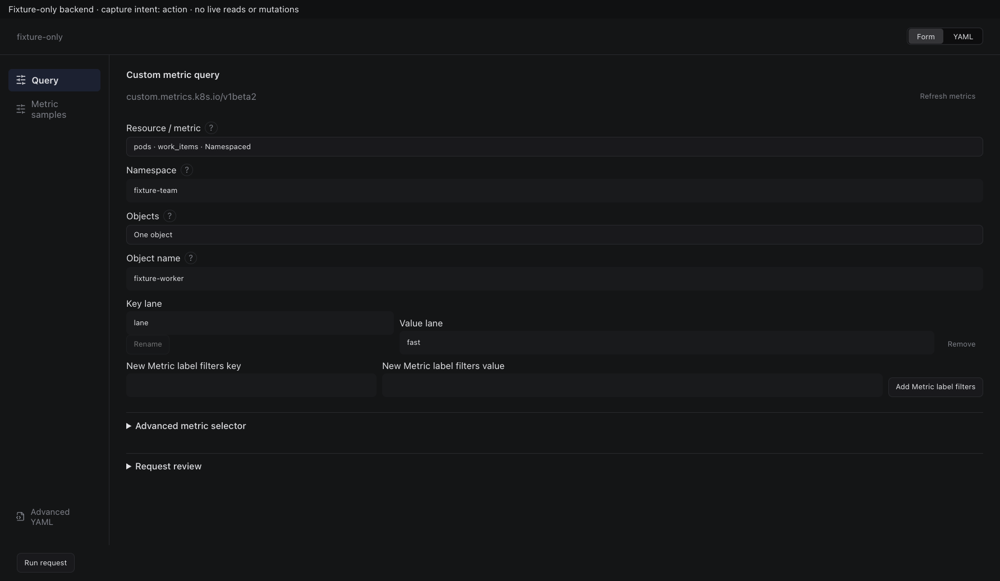
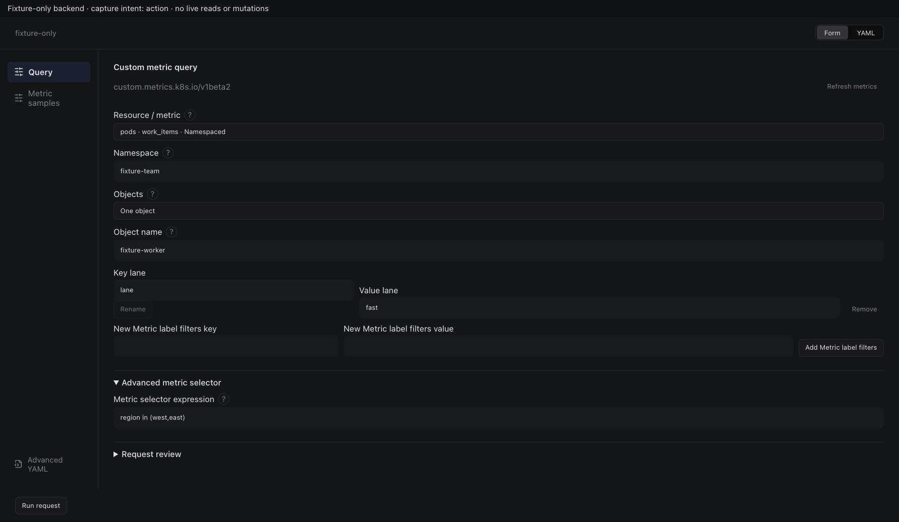
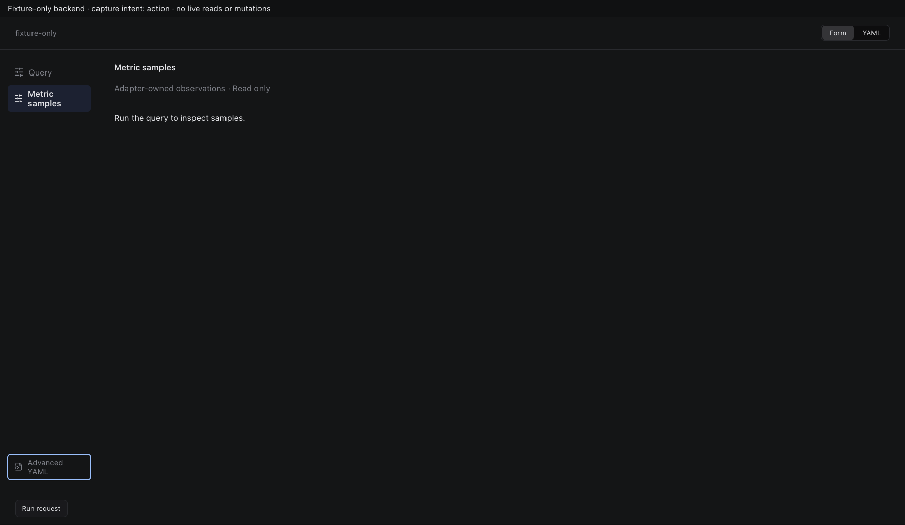
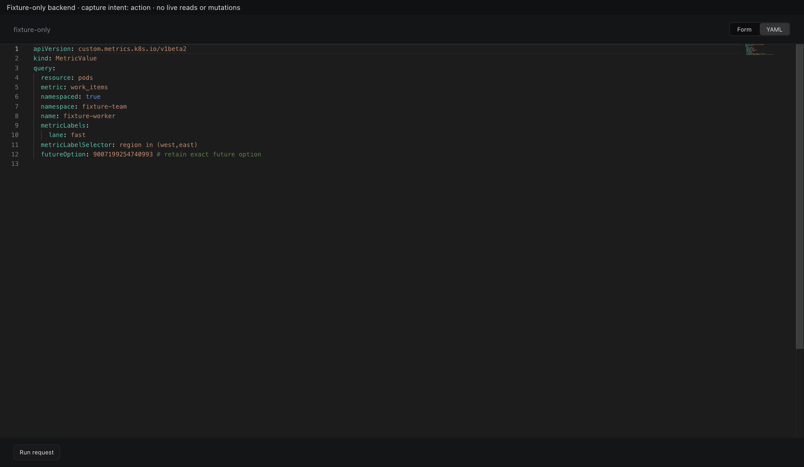
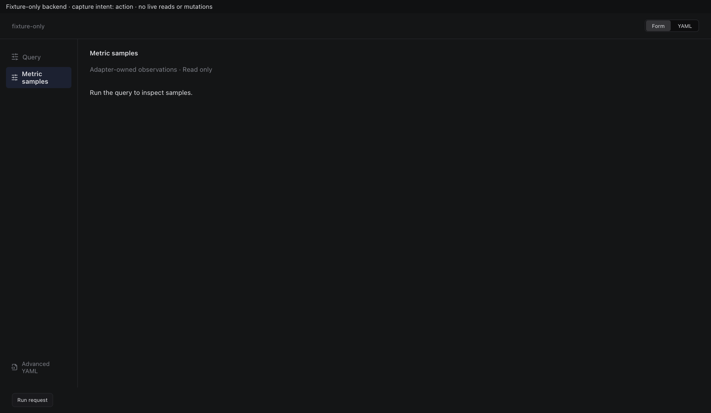
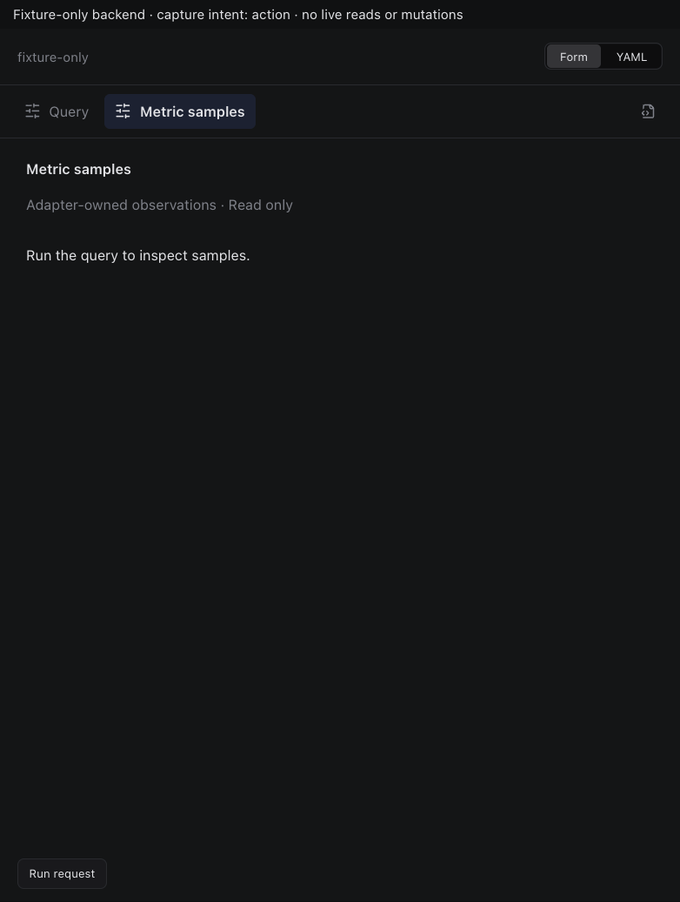
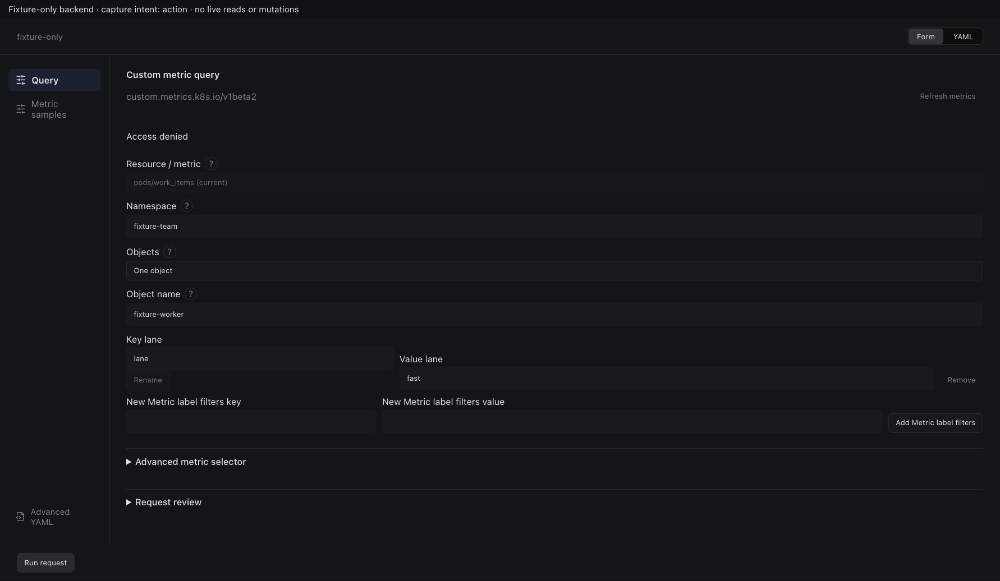

# Custom metric query

Actual production components with local fixture transport. No live resource reads or mutations. Creating/Submitting is held at the fixture boundary; denied, unavailable and immutable states are not presented as successful mutations.

Targets: `custom.metrics.k8s.io/v1beta1/` (MetricValue, Namespaced) · `custom.metrics.k8s.io/v1beta1/` (MetricValue, Cluster) · `custom.metrics.k8s.io/v1beta2/` (MetricValue, Namespaced) · `custom.metrics.k8s.io/v1beta2/` (MetricValue, Cluster)
Ownership: declarative

## action

Sections, help, source, keyboard, narrow layout and boundary evidence

