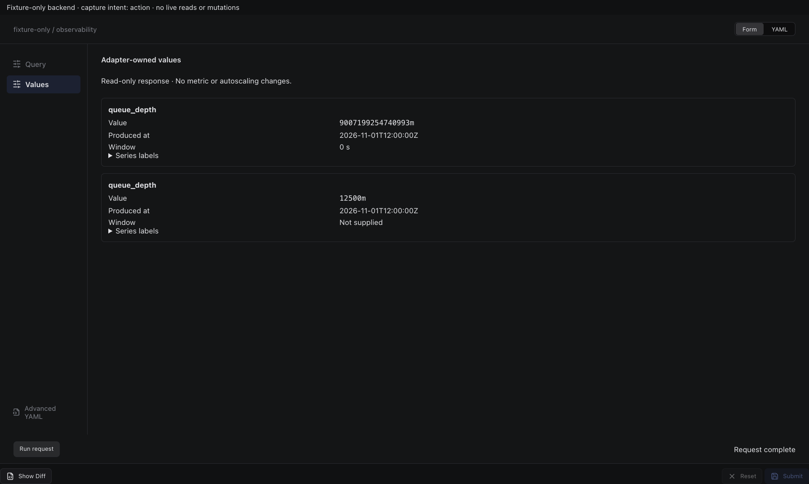
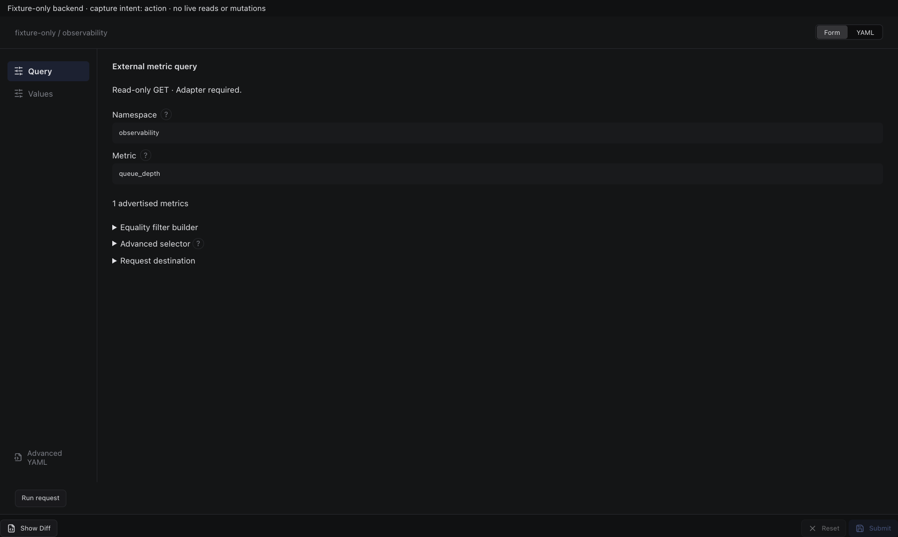
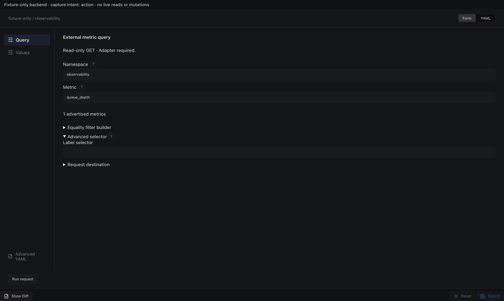
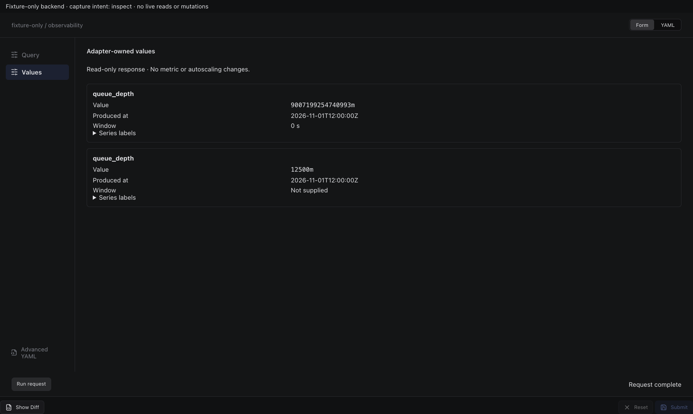
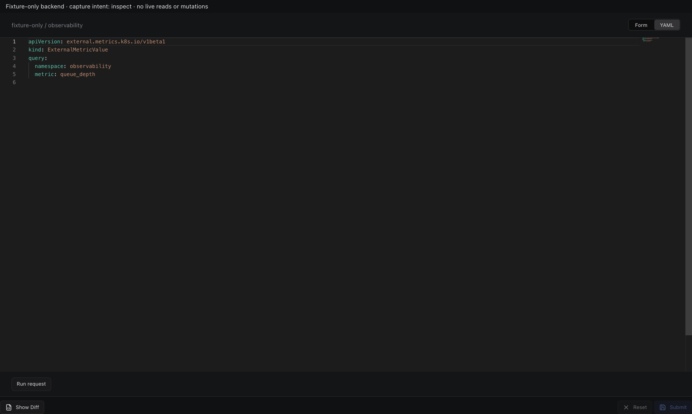

# External metrics query

Actual production components with local fixture transport. No live resource reads or mutations. Creating/Submitting is held at the fixture boundary; denied, unavailable and immutable states are not presented as successful mutations.

Targets: `external.metrics.k8s.io/v1beta1/` (ExternalMetricValue, Namespaced)
Ownership: unknown

## action

Sections, help, source, keyboard, narrow layout and boundary evidence

## inspect

Sections, help, source, keyboard, narrow layout and boundary evidence

