# XListenerSet

Actual production components with local fixture transport. No live resource reads or mutations. Creating/Submitting is held at the fixture boundary; denied, unavailable and immutable states are not presented as successful mutations.

Targets: `gateway.networking.x-k8s.io/v1alpha1/xlistenersets` (XListenerSet, Namespaced)
Ownership: declarative

## create

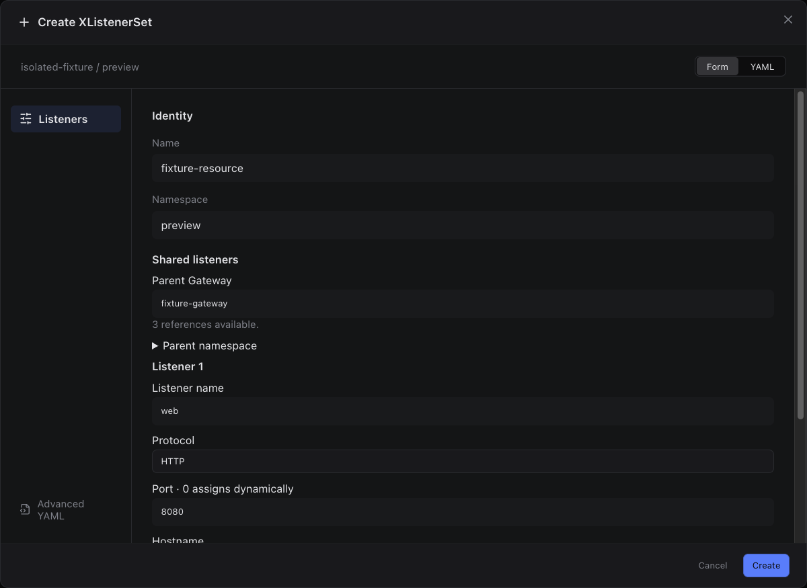

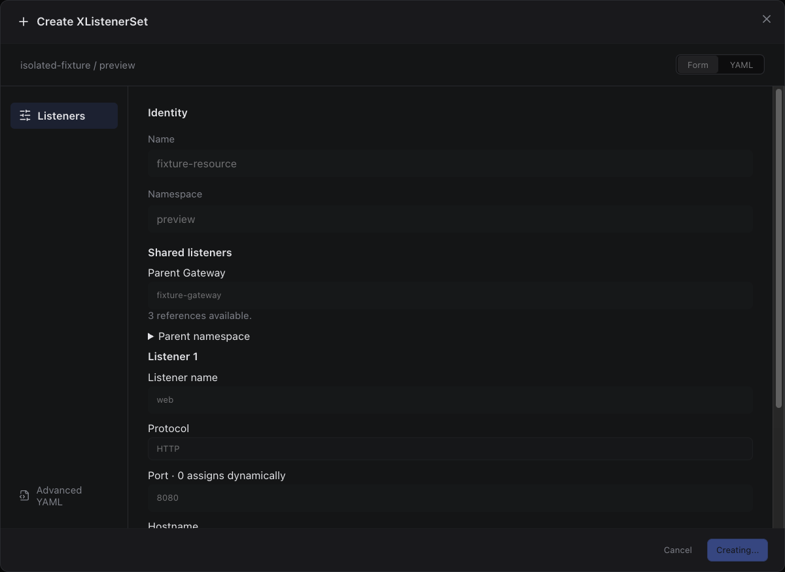

Sections, help, source, keyboard, narrow layout and boundary evidence

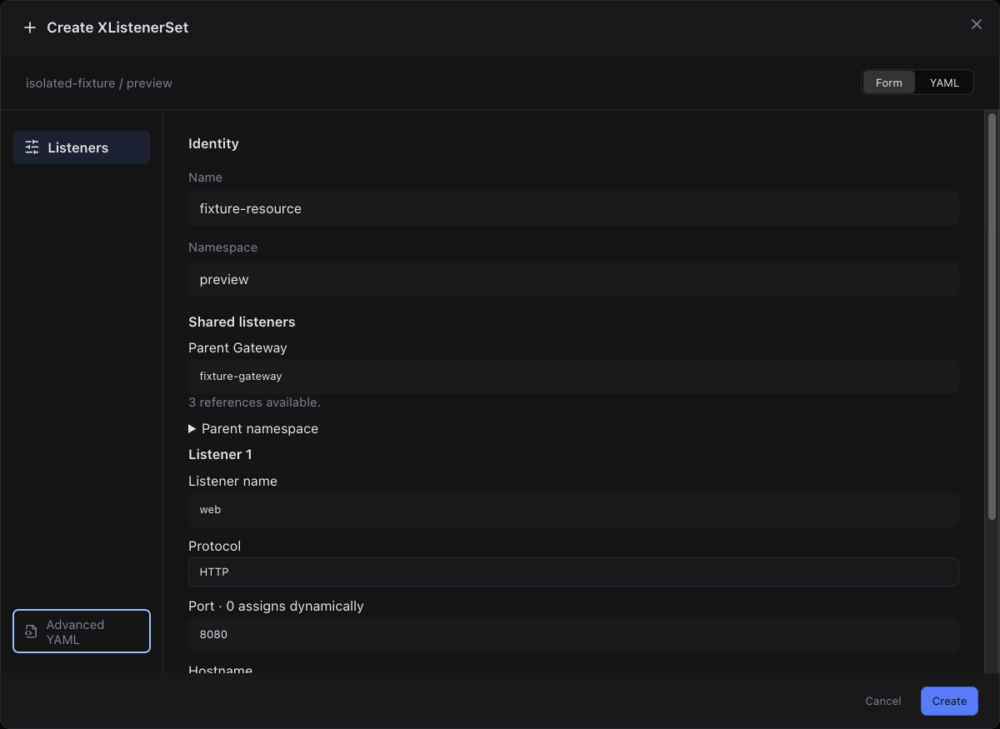

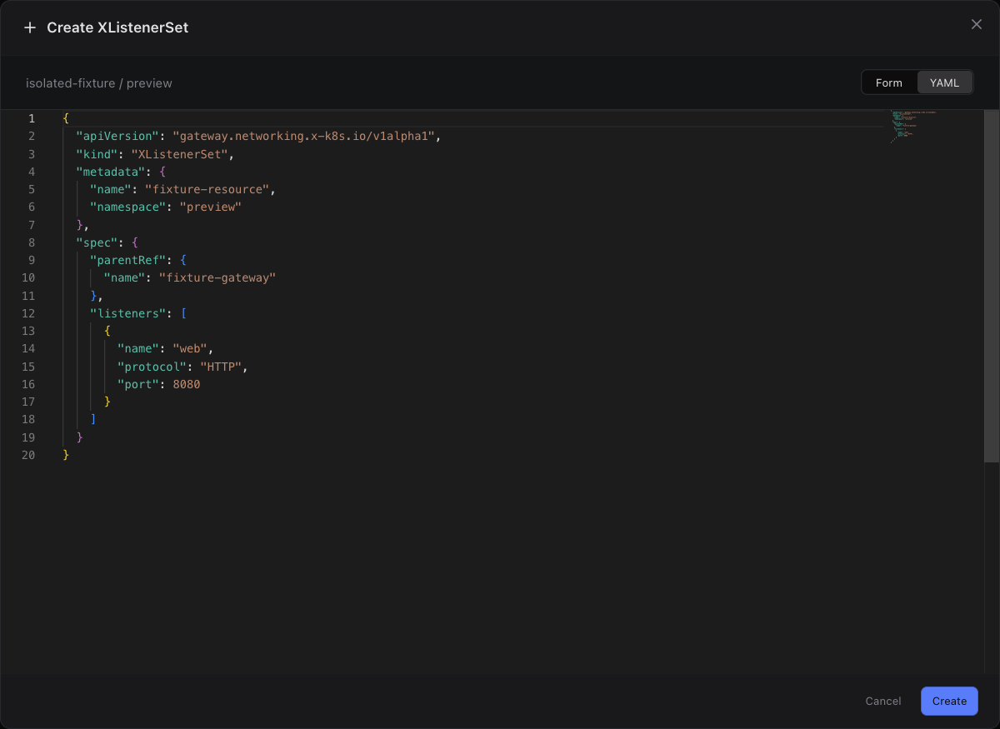

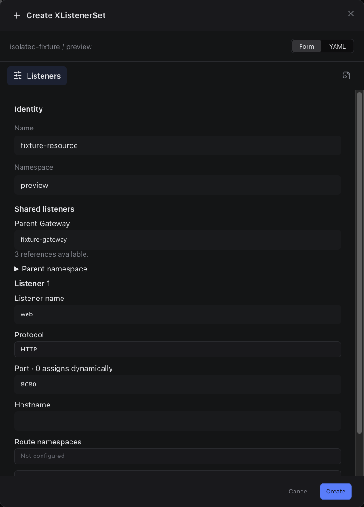

## edit

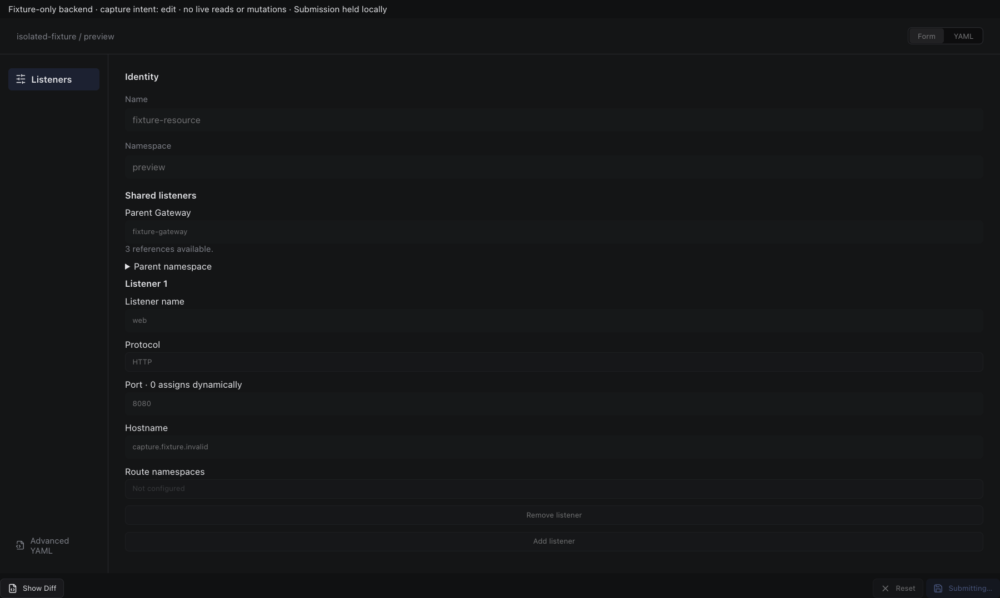

Sections, help, source, keyboard, narrow layout and boundary evidence

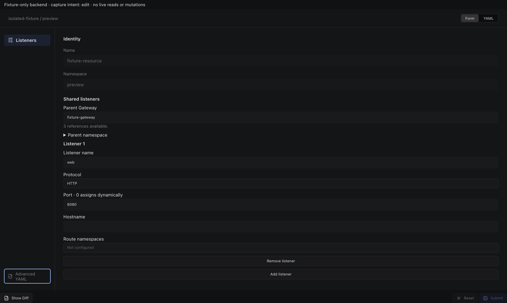

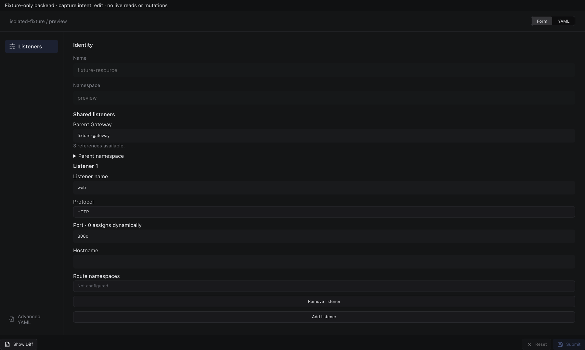

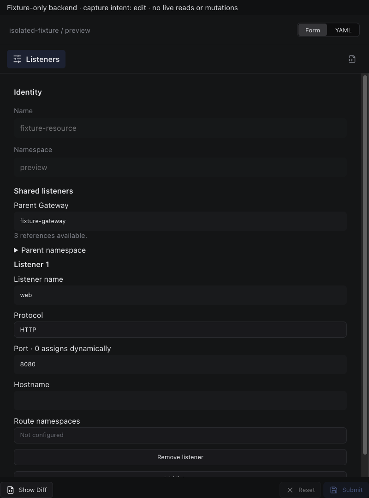

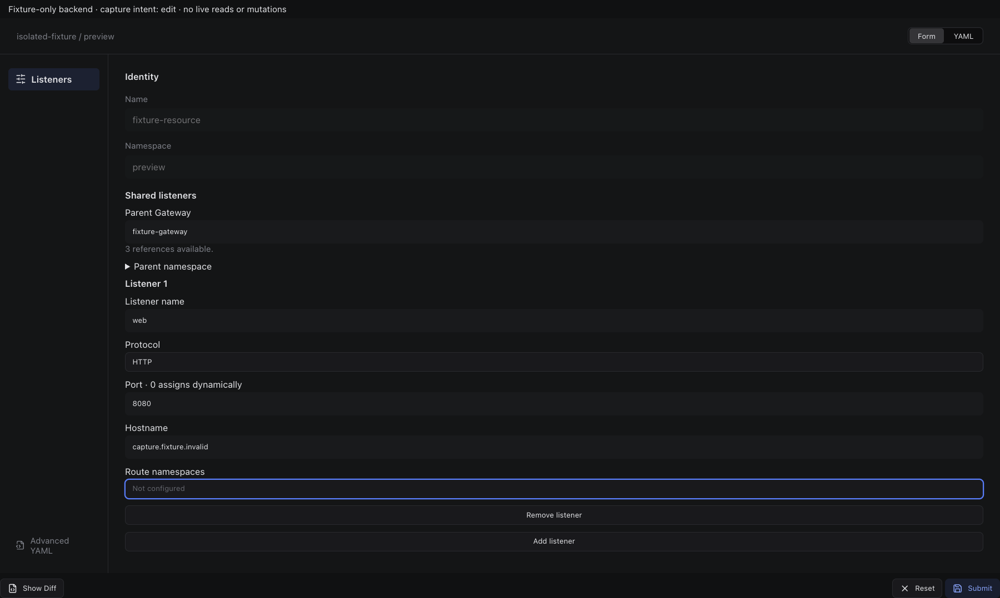

## inspect

Sections, help, source, keyboard, narrow layout and boundary evidence

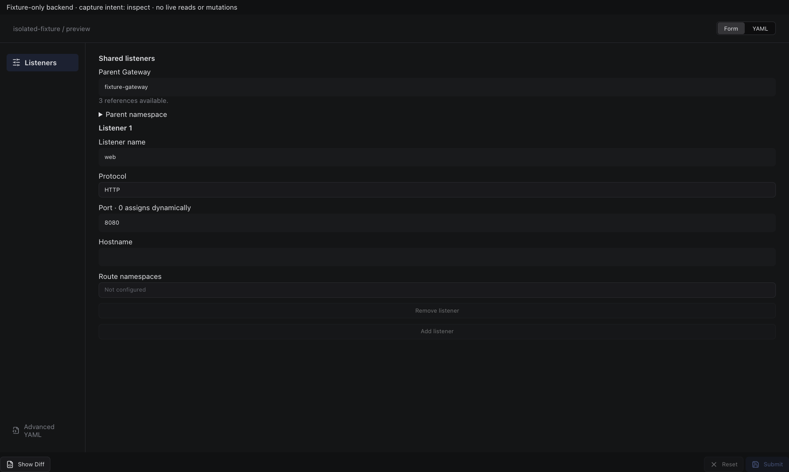

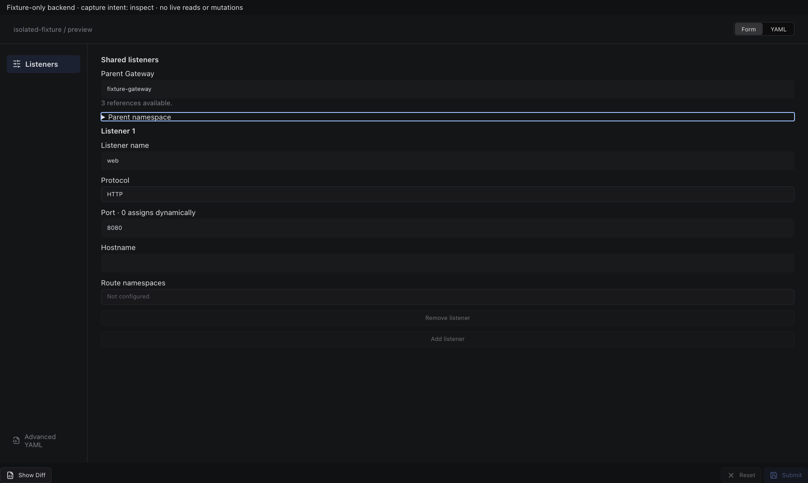

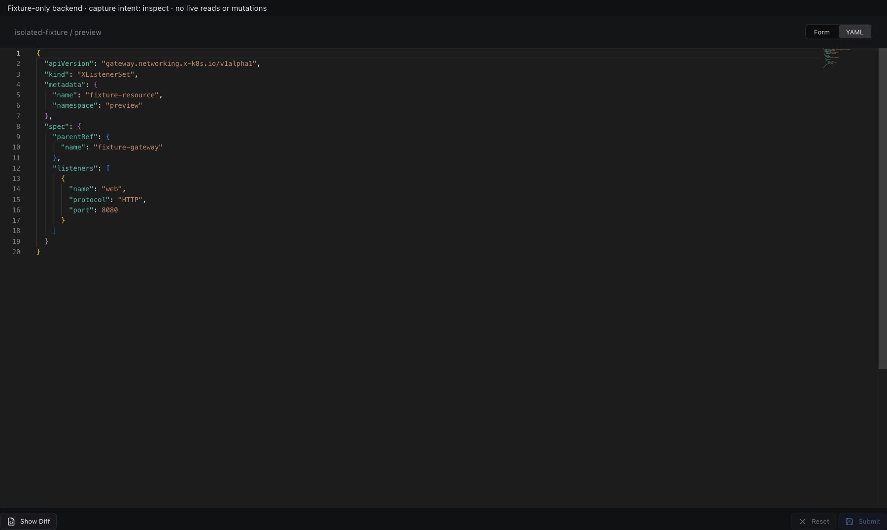

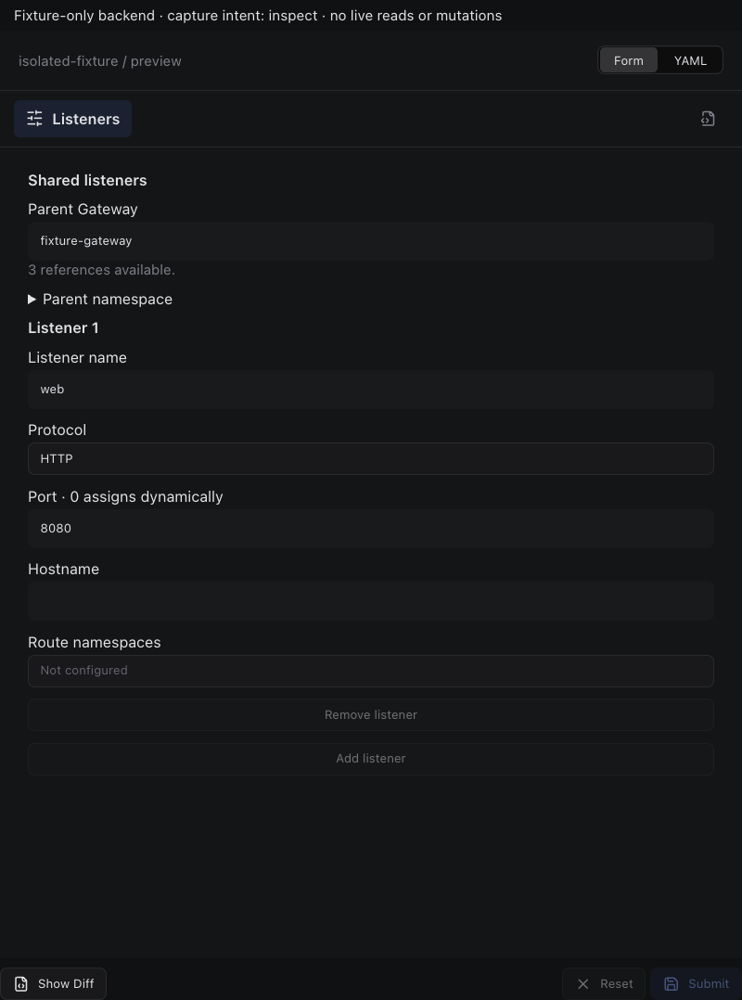

