# ClusterIssuer

Actual production components with local fixture transport. No live resource reads or mutations. Creating/Submitting is held at the fixture boundary; denied, unavailable and immutable states are not presented as successful mutations.

Targets: `cert-manager.io/v1/clusterissuers` (ClusterIssuer, Cluster)
Ownership: declarative

## create

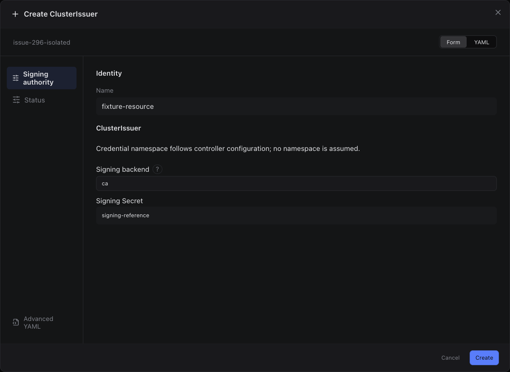

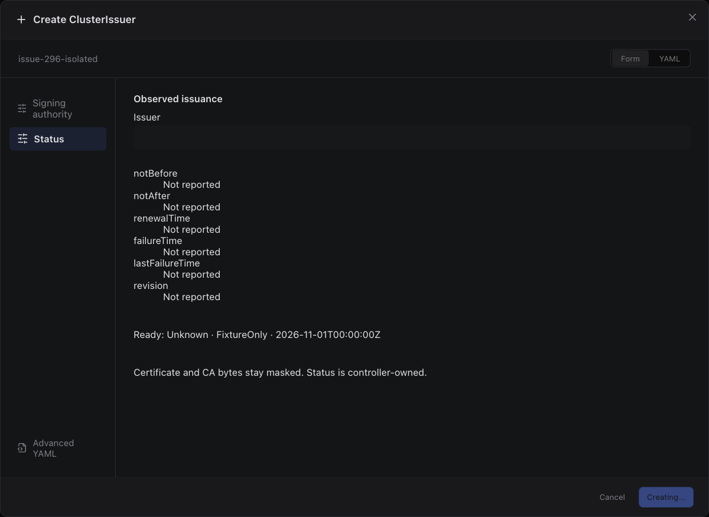

Sections, help, source, keyboard, narrow layout and boundary evidence

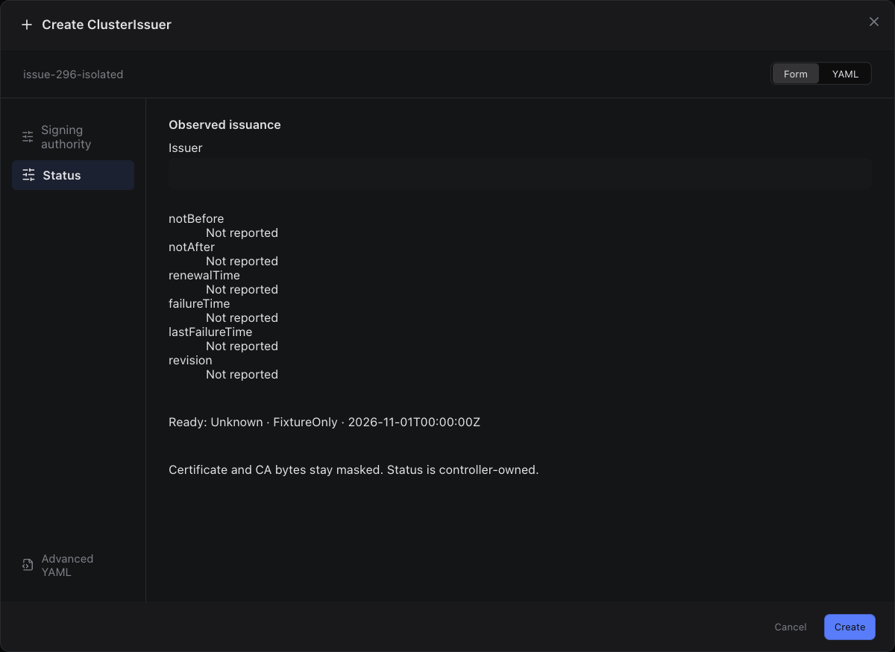

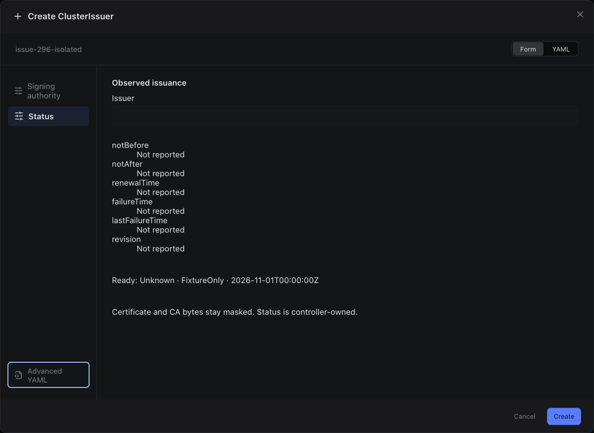

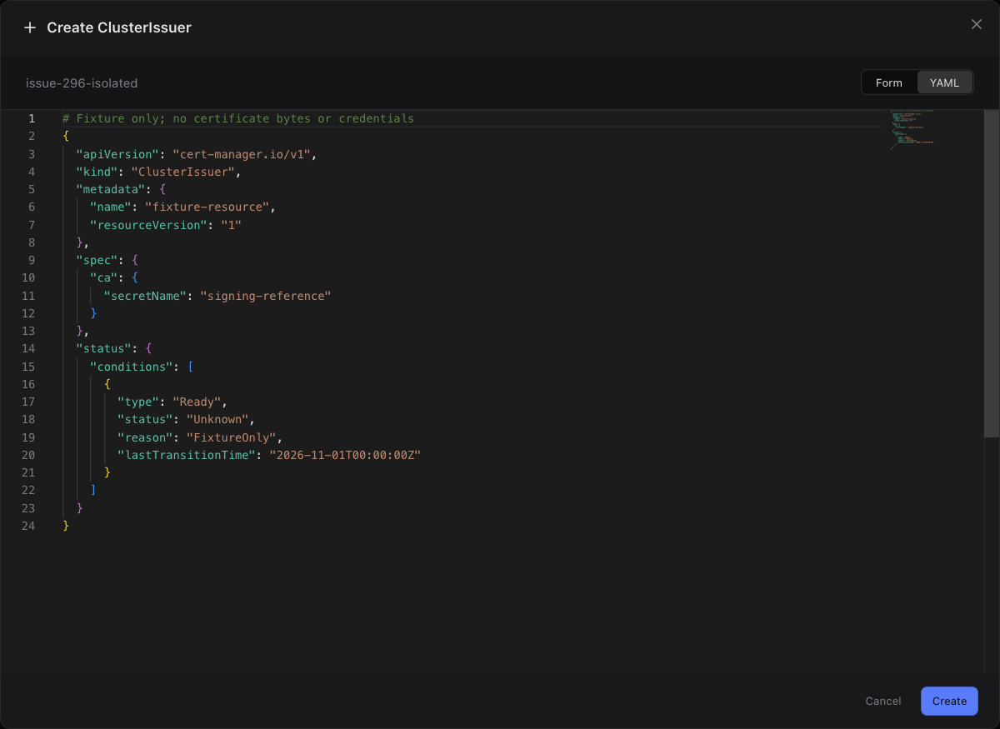

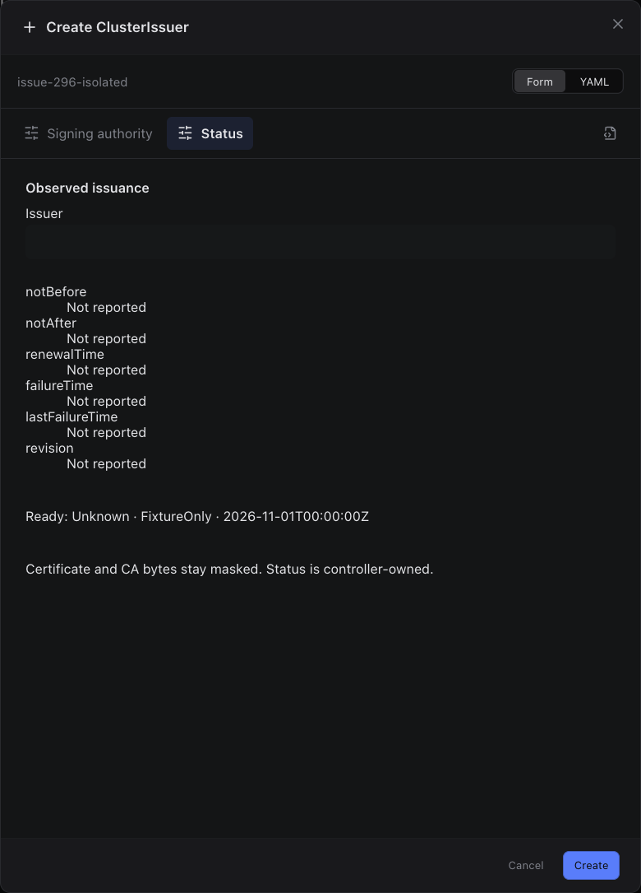

## edit

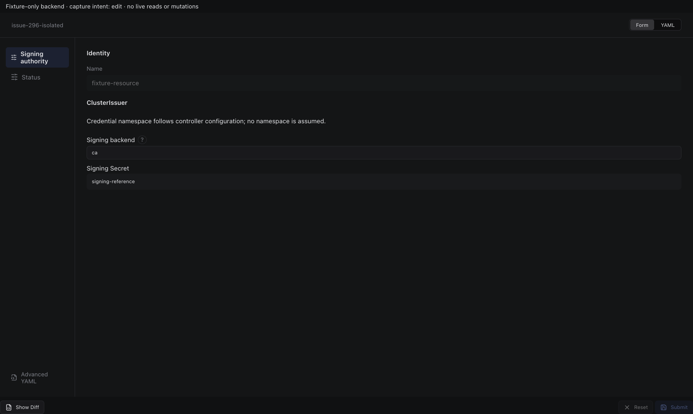

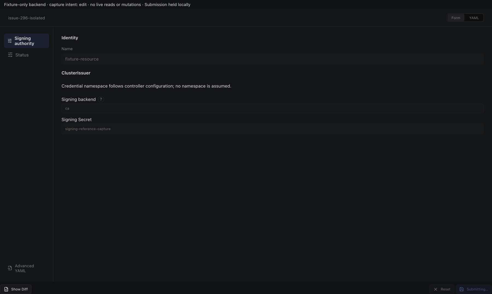

Sections, help, source, keyboard, narrow layout and boundary evidence

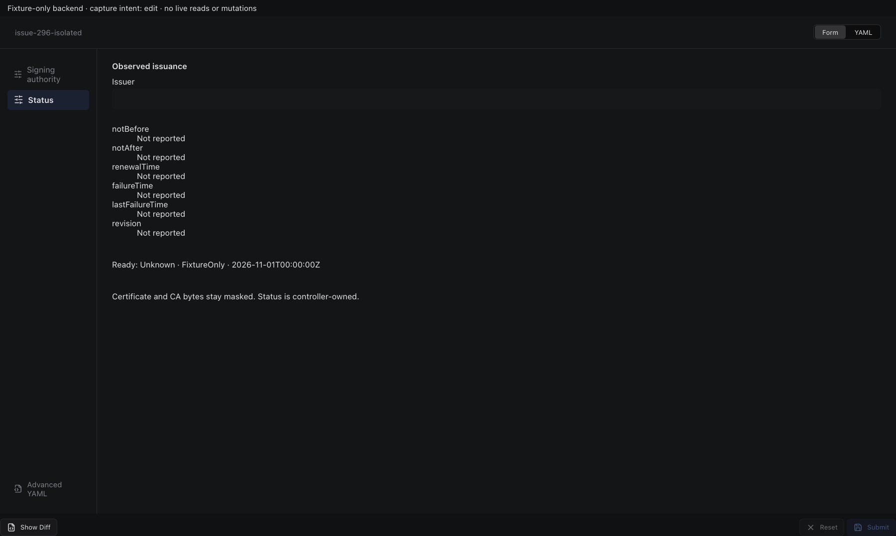

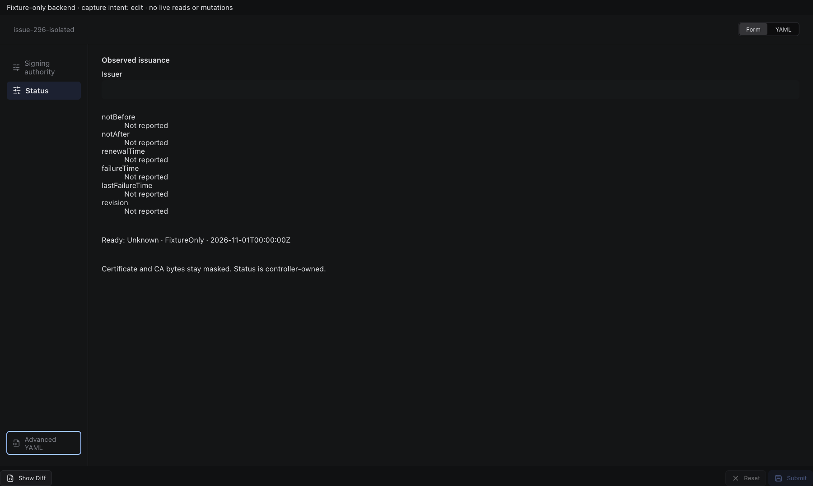

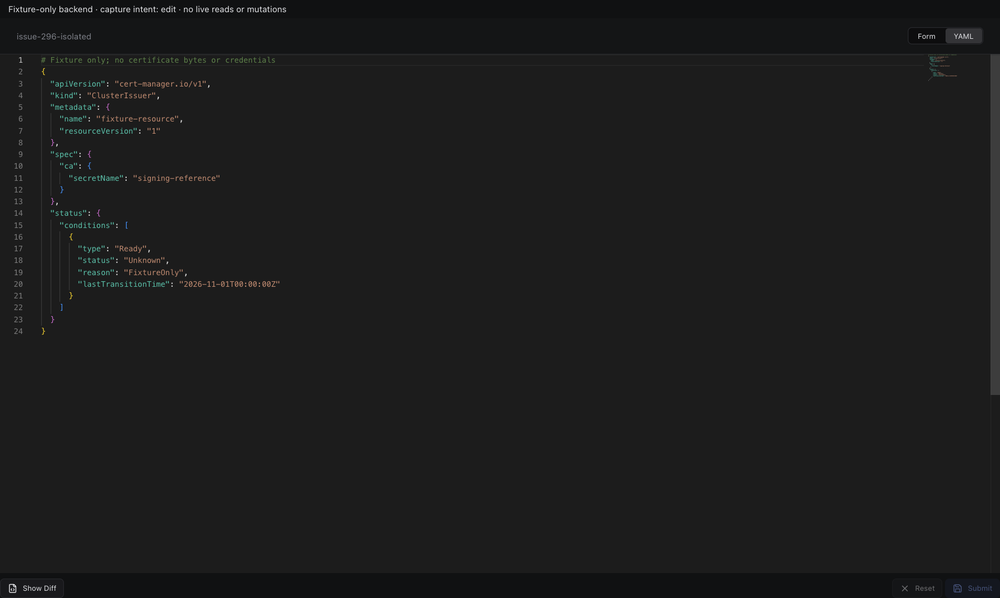

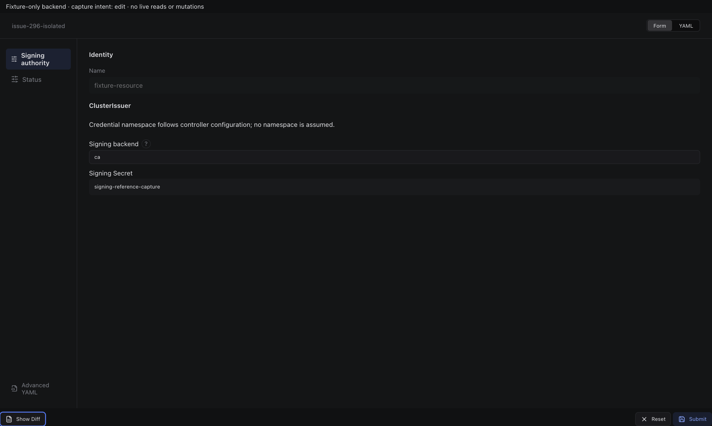

## inspect

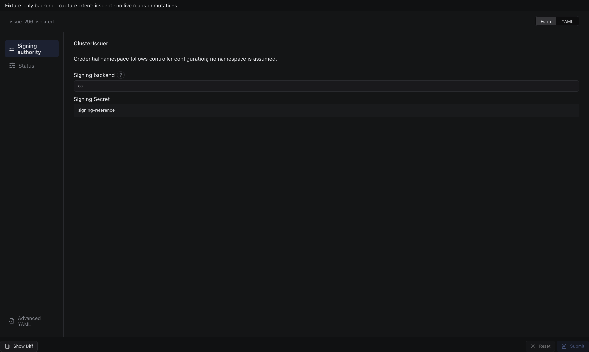

Sections, help, source, keyboard, narrow layout and boundary evidence

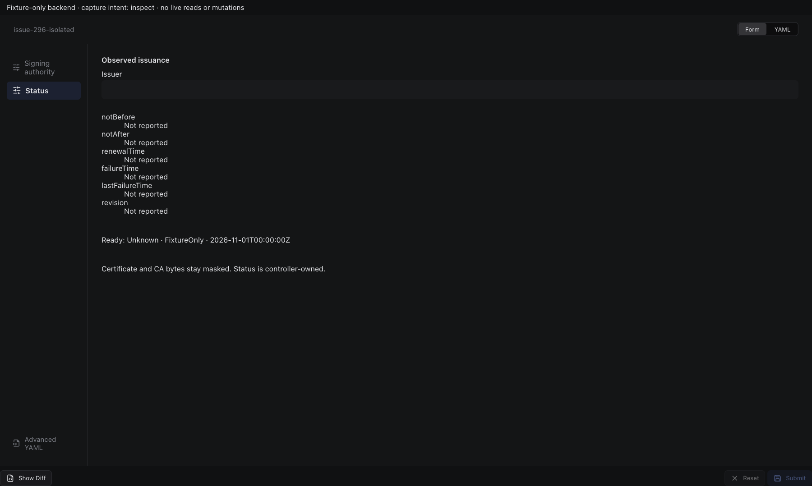

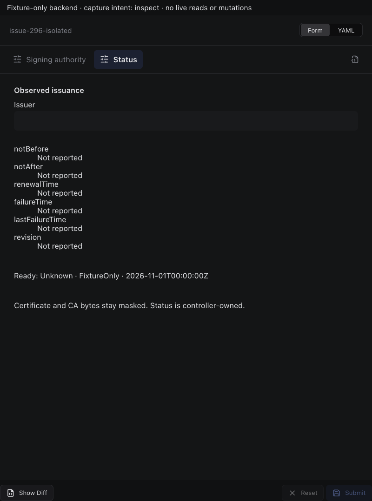

