# ServiceEntry

Actual production components with local fixture transport. No live resource reads or mutations. Creating/Submitting is held at the fixture boundary; denied, unavailable and immutable states are not presented as successful mutations.

Targets: `networking.istio.io/v1/serviceentries` (ServiceEntry, Namespaced) · `networking.istio.io/v1beta1/serviceentries` (ServiceEntry, Namespaced) · `networking.istio.io/v1alpha3/serviceentries` (ServiceEntry, Namespaced)
Ownership: declarative

## create

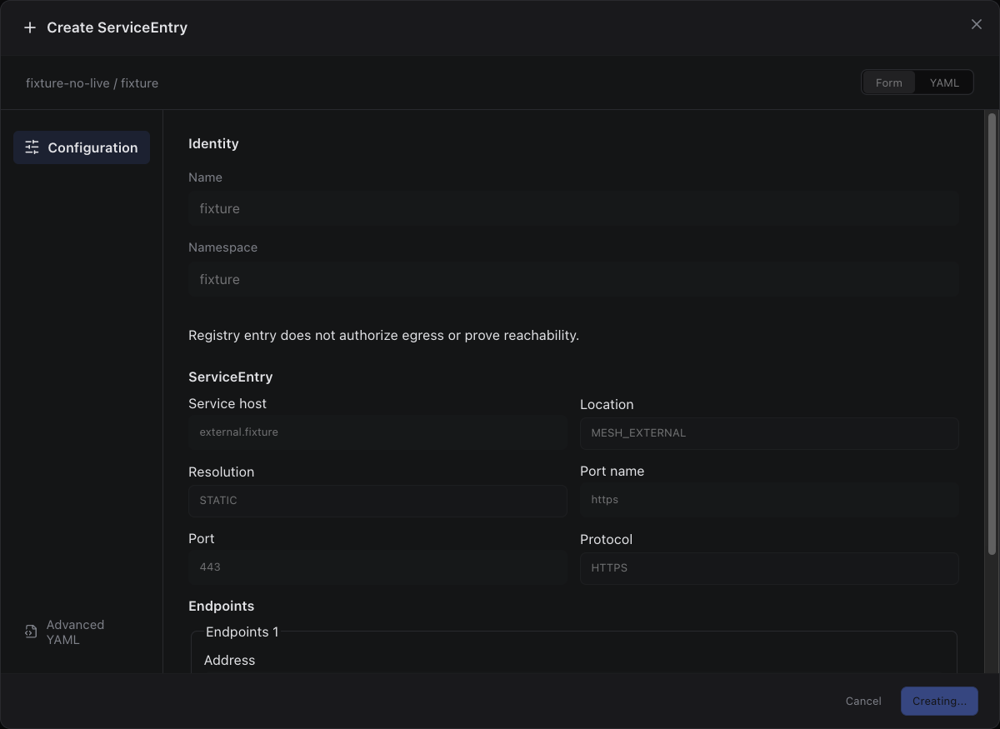

Sections, help, source, keyboard, narrow layout and boundary evidence

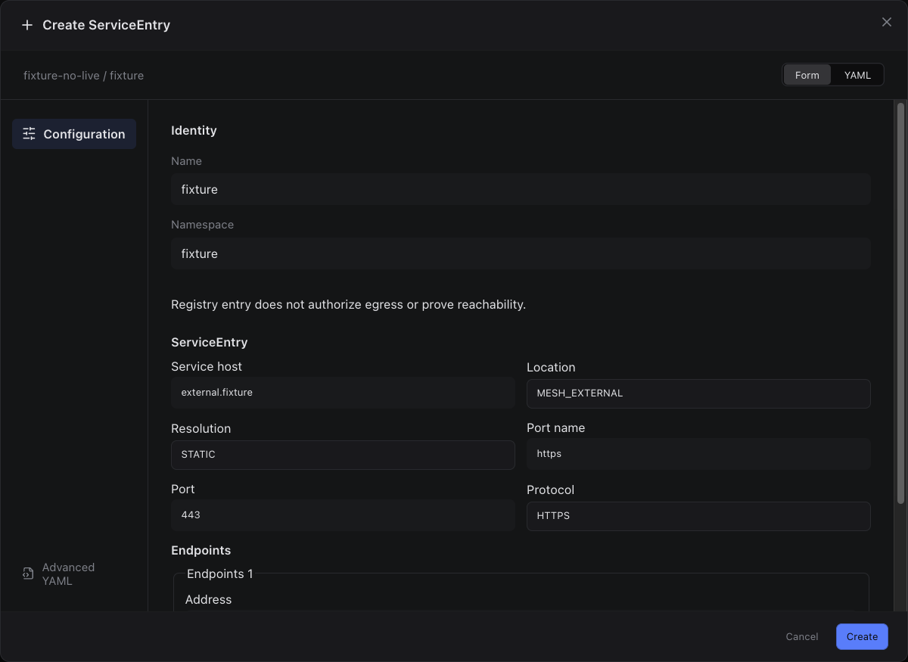

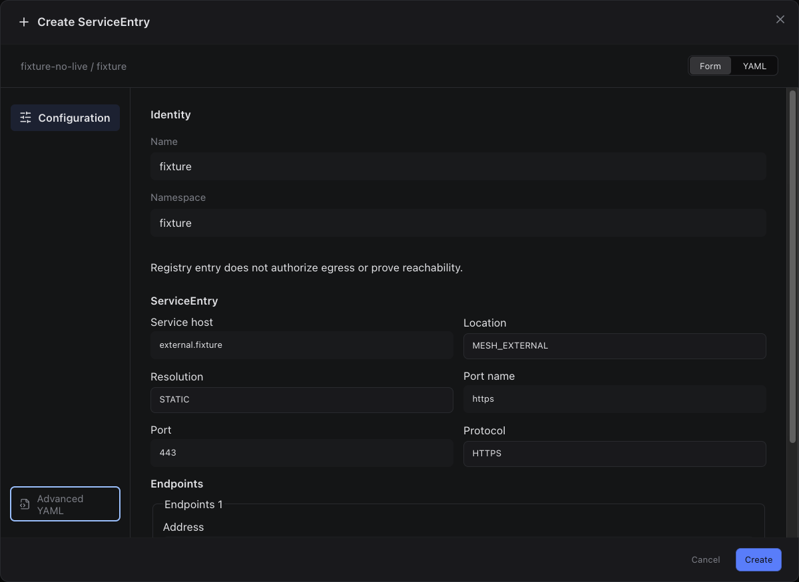

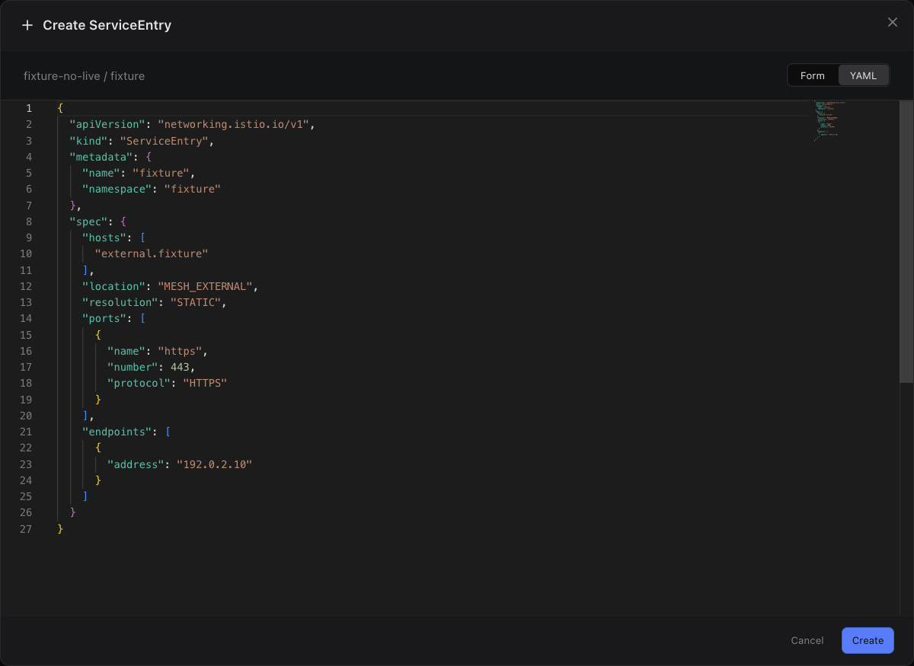

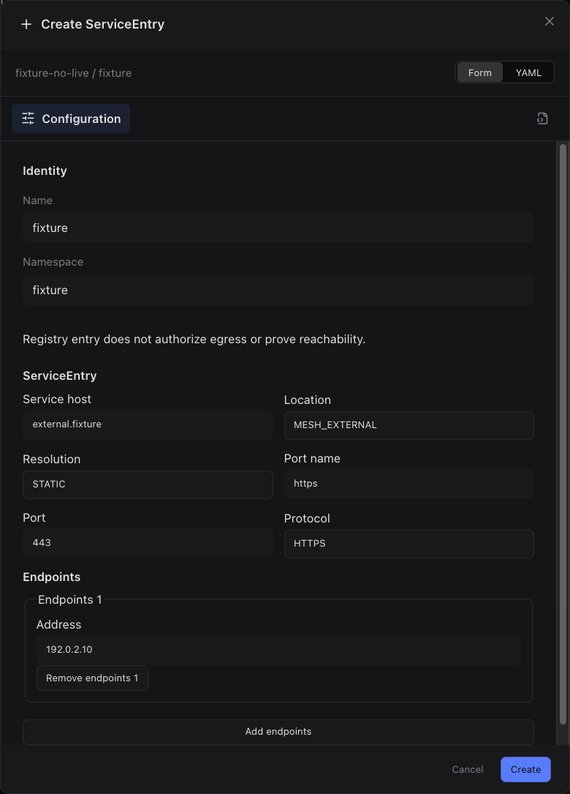

## edit

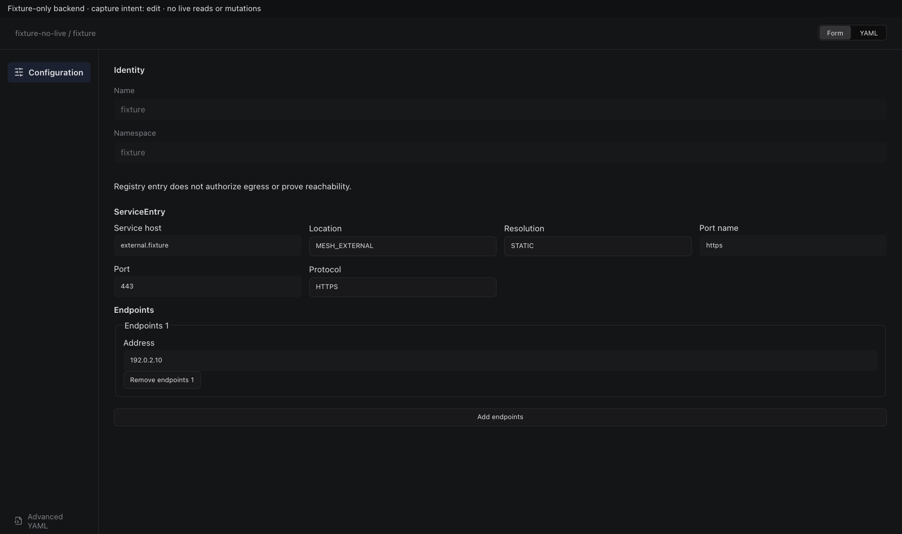

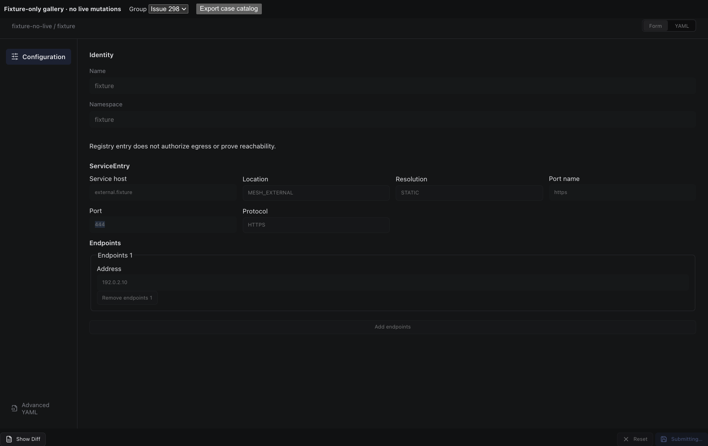

Sections, help, source, keyboard, narrow layout and boundary evidence

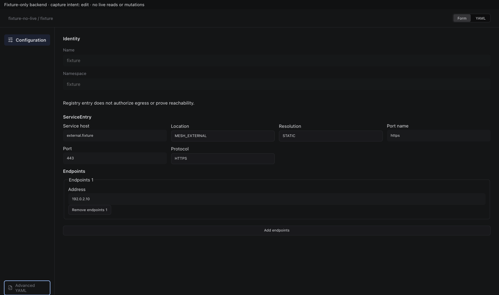

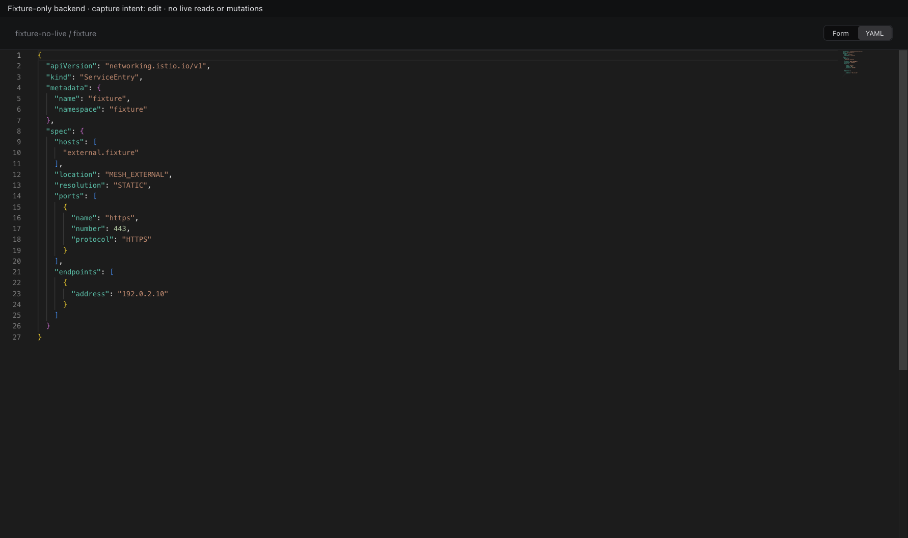

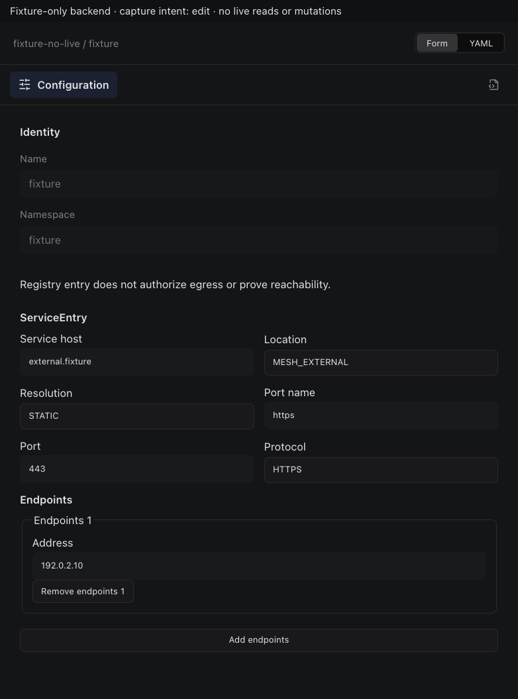

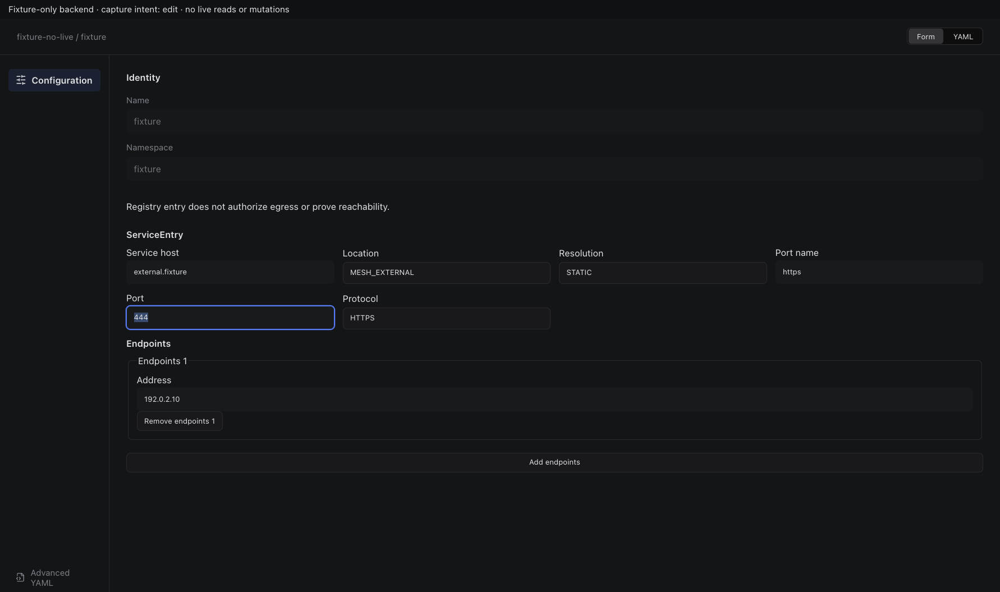

## inspect

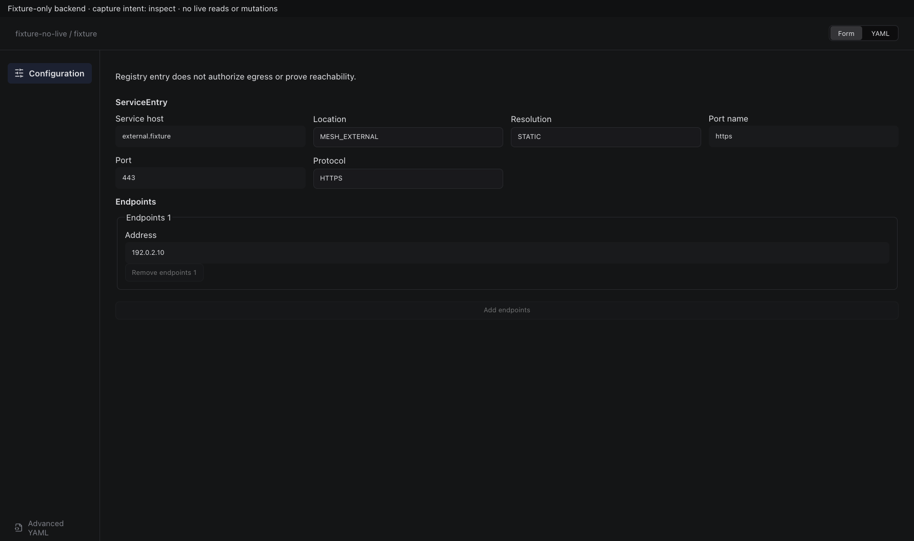

Sections, help, source, keyboard, narrow layout and boundary evidence

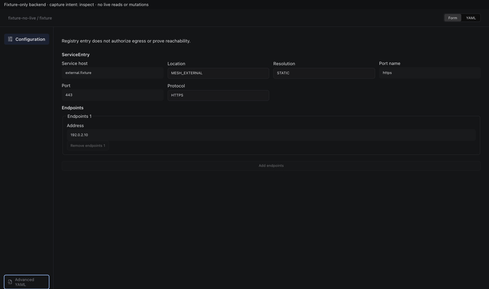

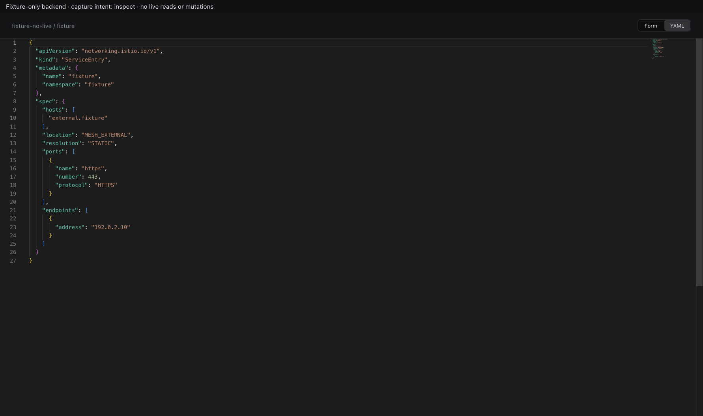

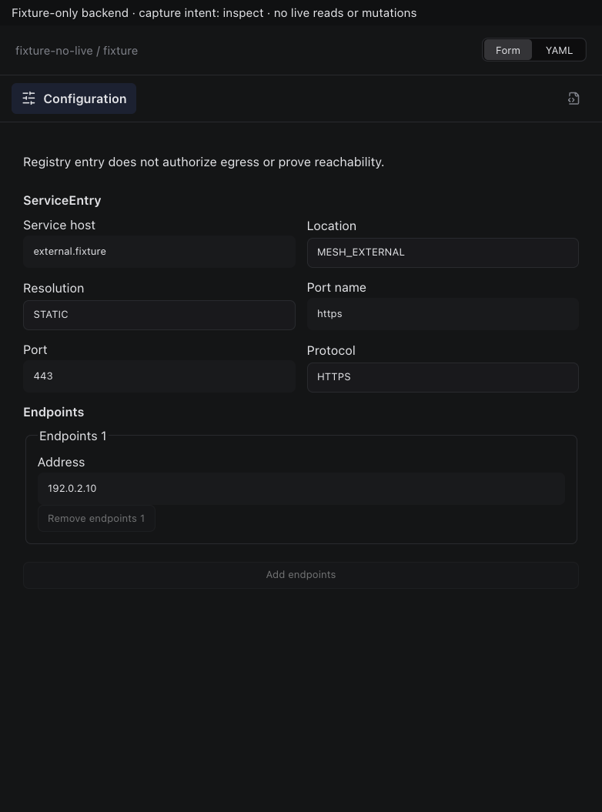

