# WorkloadEntry

Actual production components with local fixture transport. No live resource reads or mutations. Creating/Submitting is held at the fixture boundary; denied, unavailable and immutable states are not presented as successful mutations.

Targets: `networking.istio.io/v1/workloadentries` (WorkloadEntry, Namespaced) · `networking.istio.io/v1beta1/workloadentries` (WorkloadEntry, Namespaced) · `networking.istio.io/v1alpha3/workloadentries` (WorkloadEntry, Namespaced)
Ownership: conditional

## create

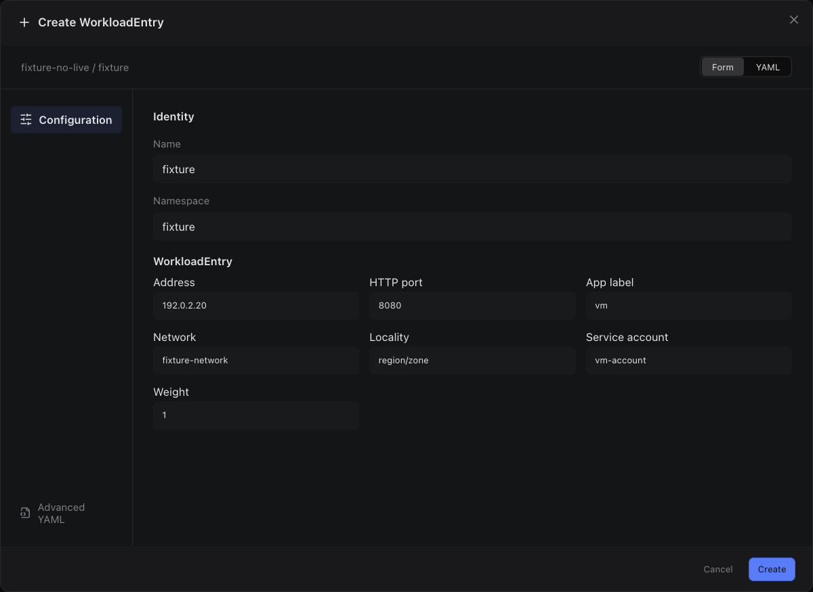

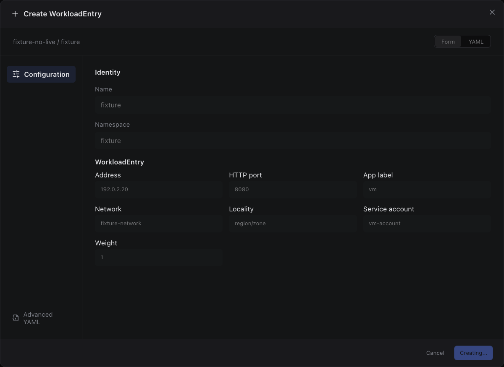

Sections, help, source, keyboard, narrow layout and boundary evidence

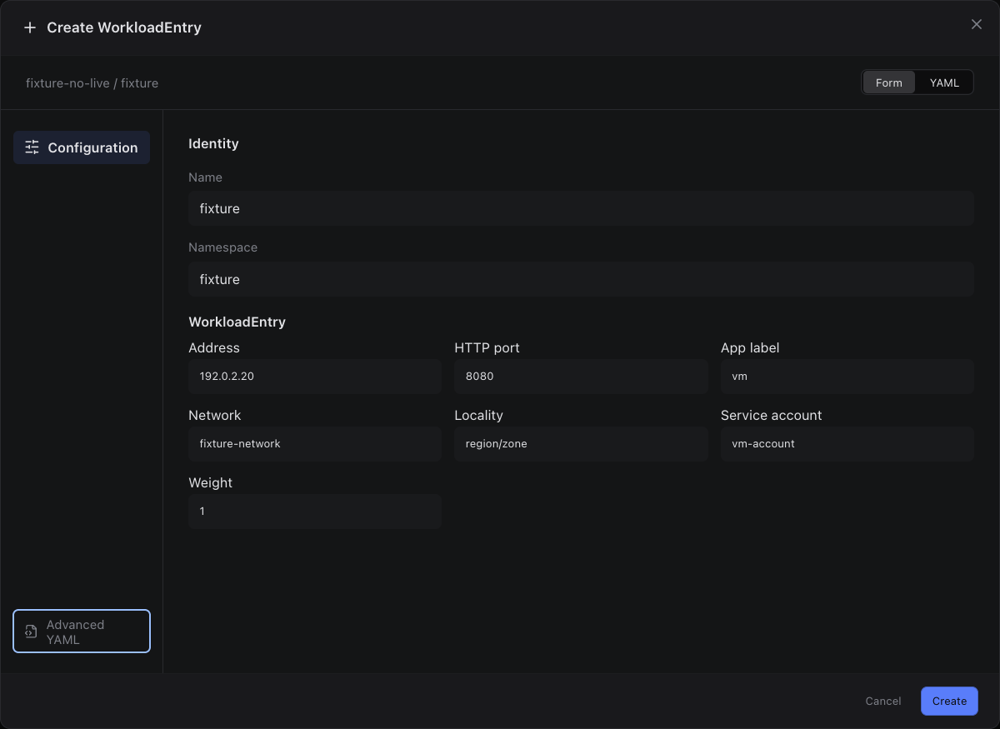

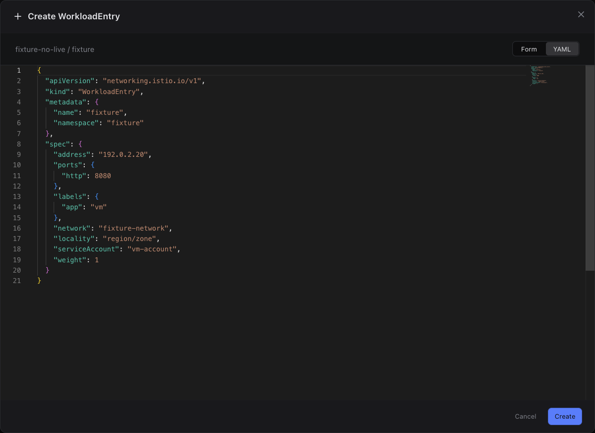

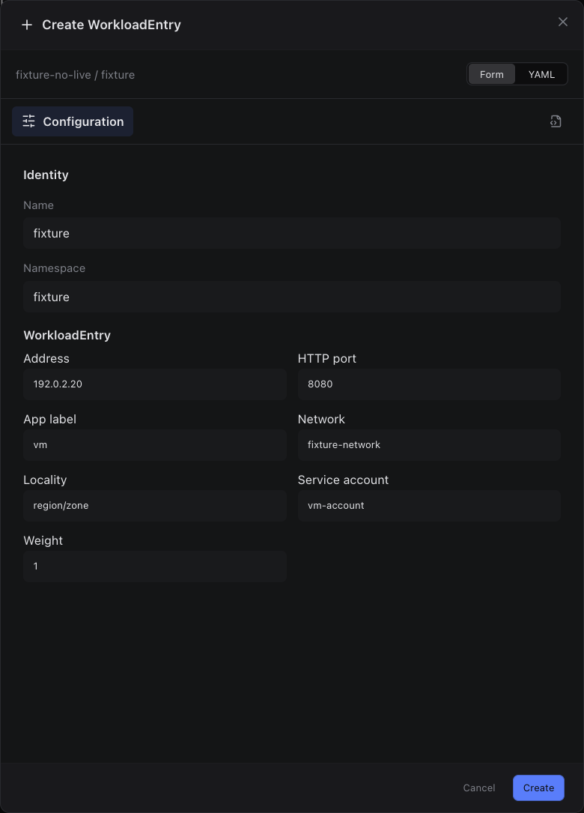

## edit

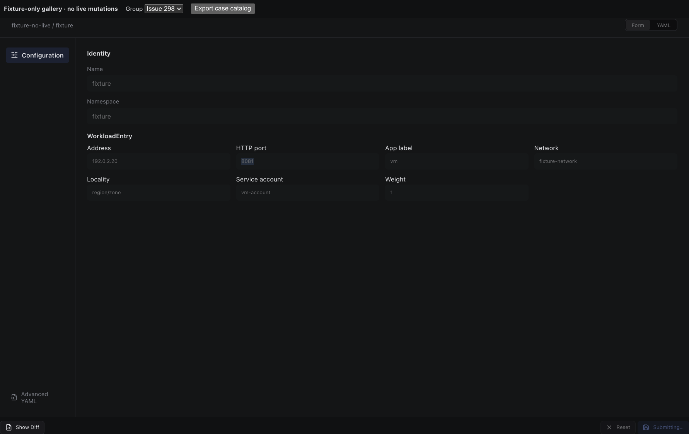

Sections, help, source, keyboard, narrow layout and boundary evidence

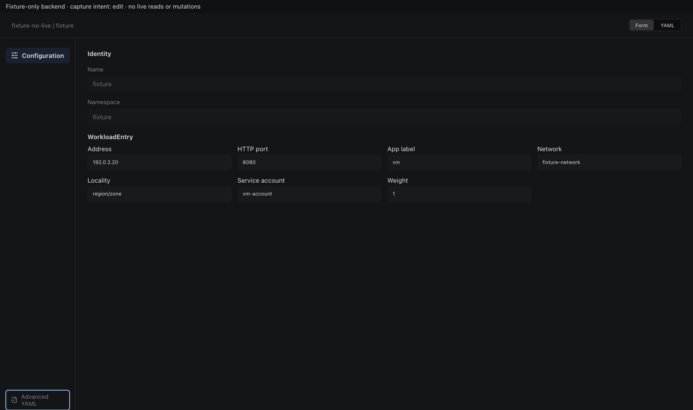

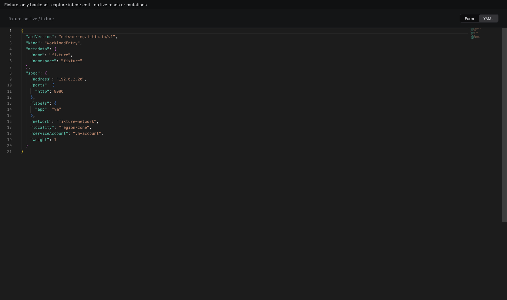

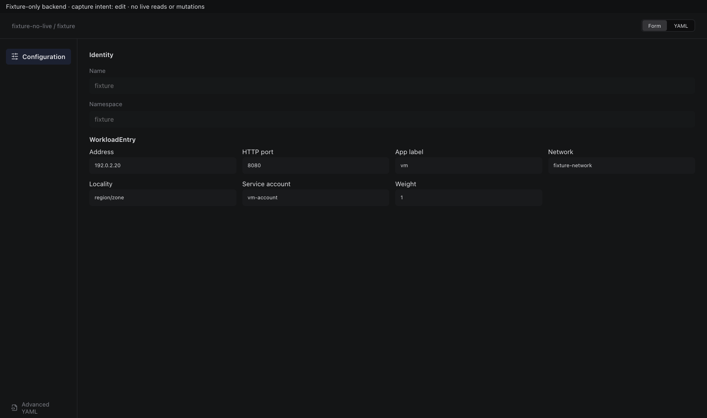

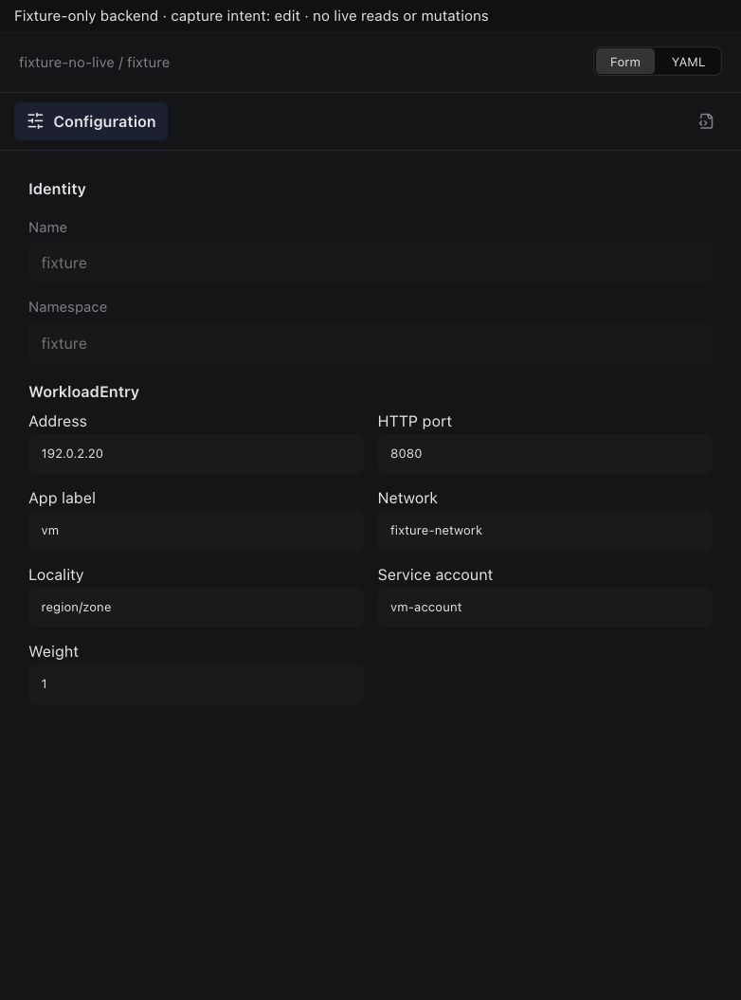

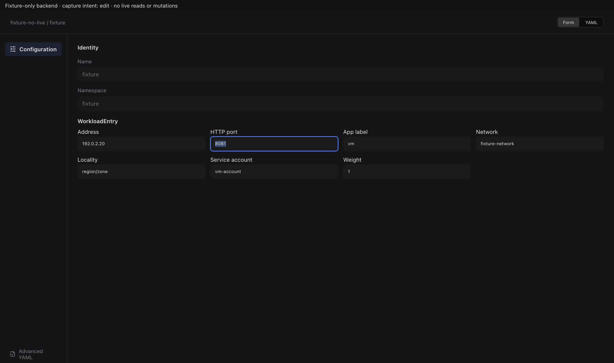

## inspect

Sections, help, source, keyboard, narrow layout and boundary evidence

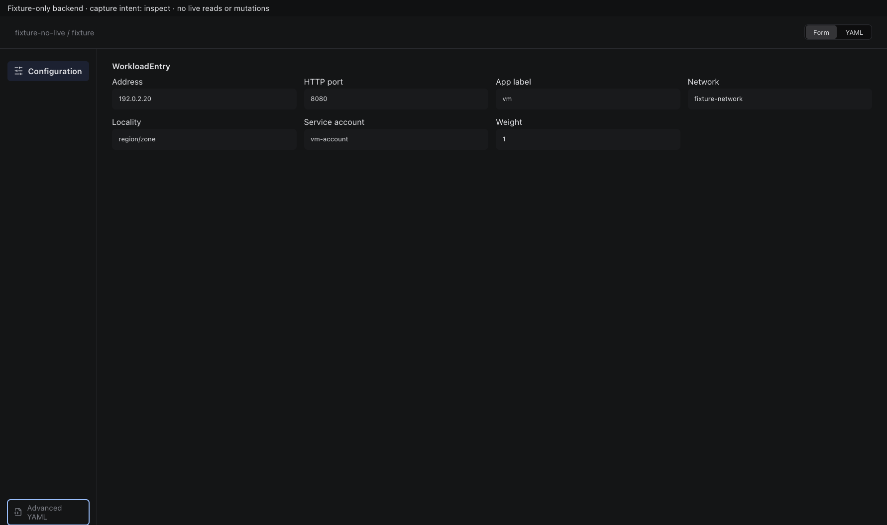

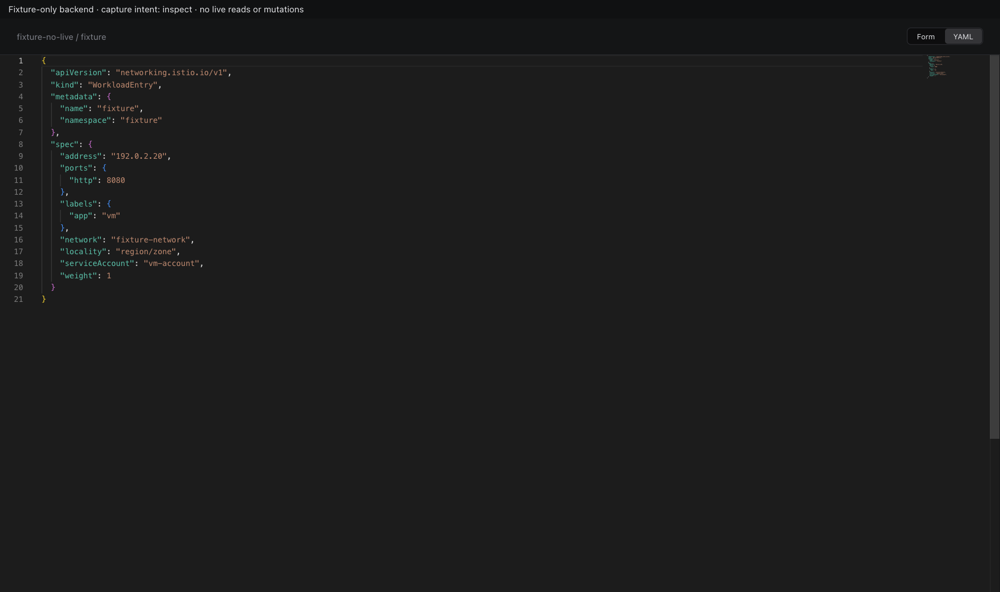

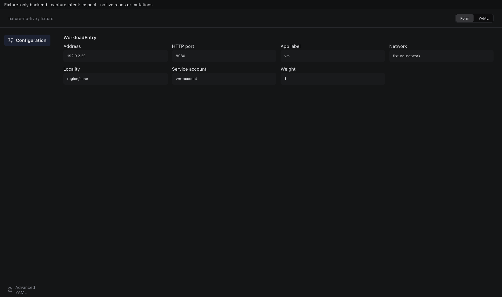

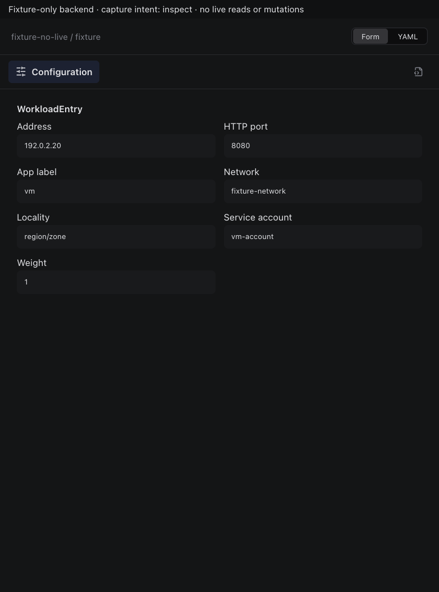

