# CiliumNode

Actual production components with local fixture transport. No live resource reads or mutations. Creating/Submitting is held at the fixture boundary; denied, unavailable and immutable states are not presented as successful mutations.

Targets: `cilium.io/v2/ciliumnodes` (CiliumNode, Cluster)
Ownership: controller

## inspect

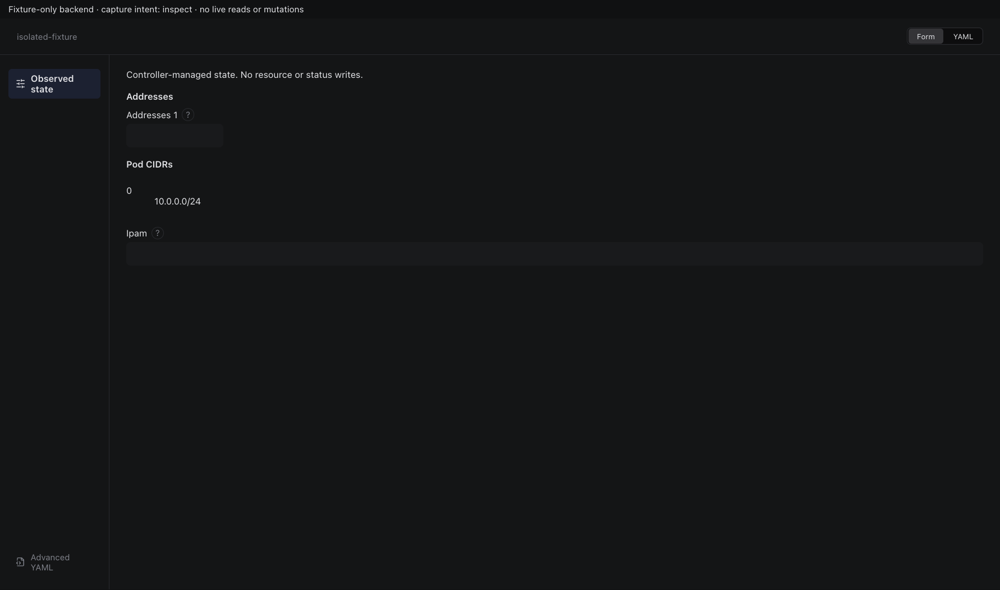

Sections, help, source, keyboard, narrow layout and boundary evidence

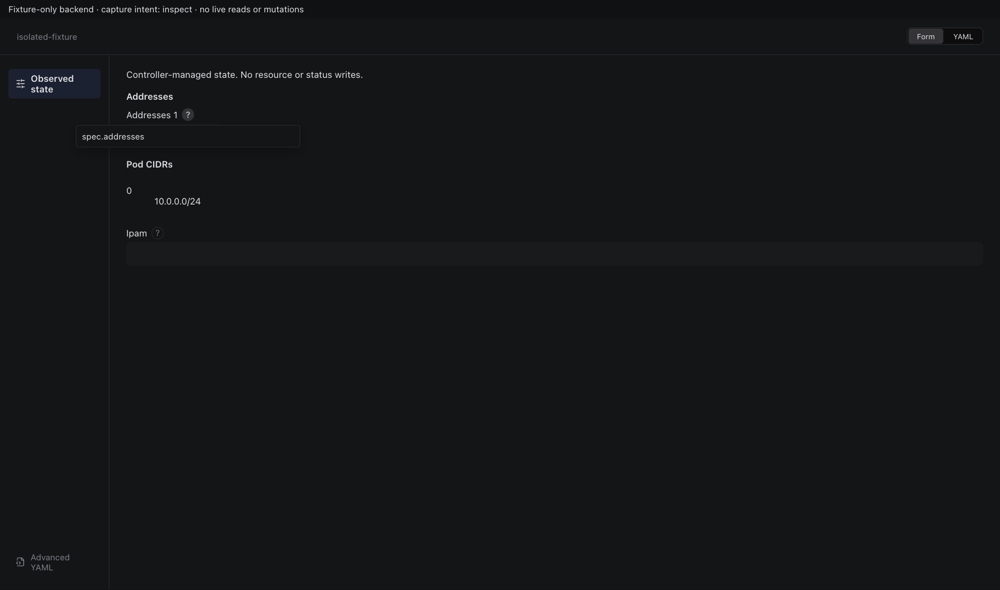

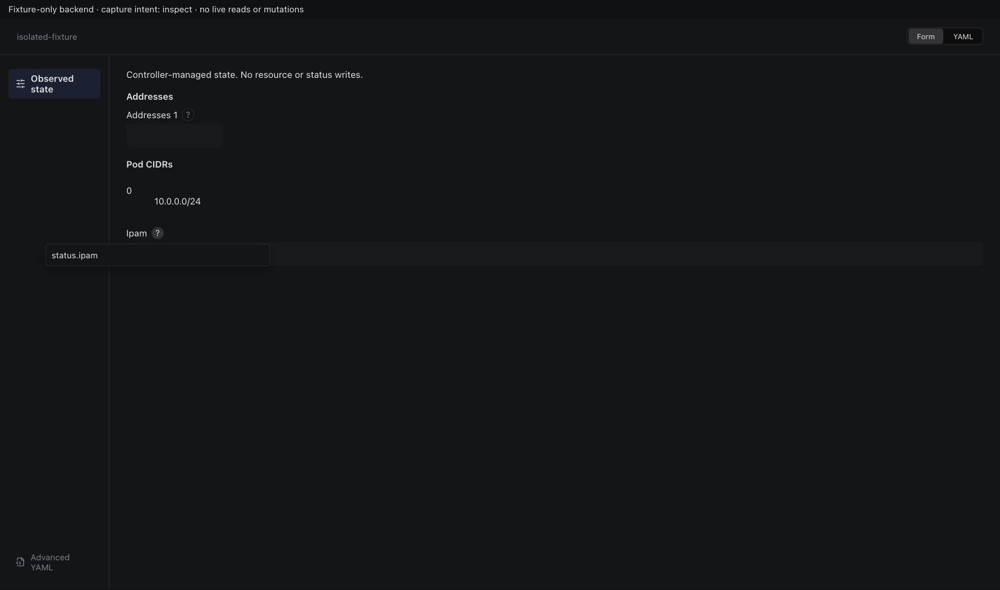

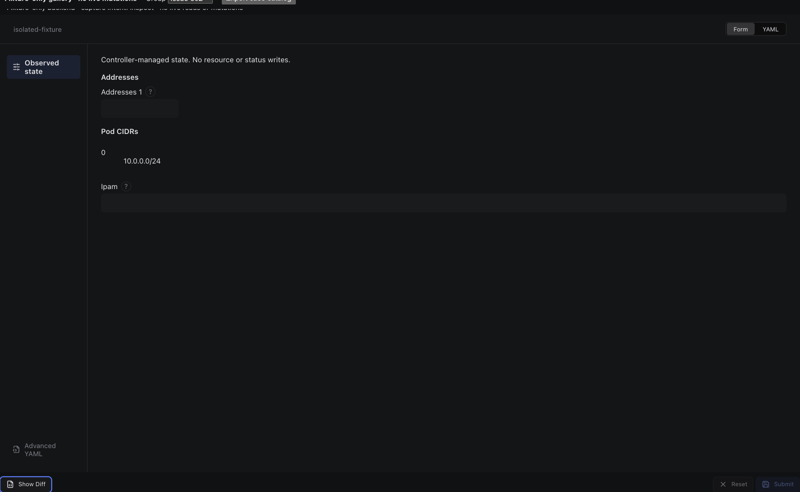

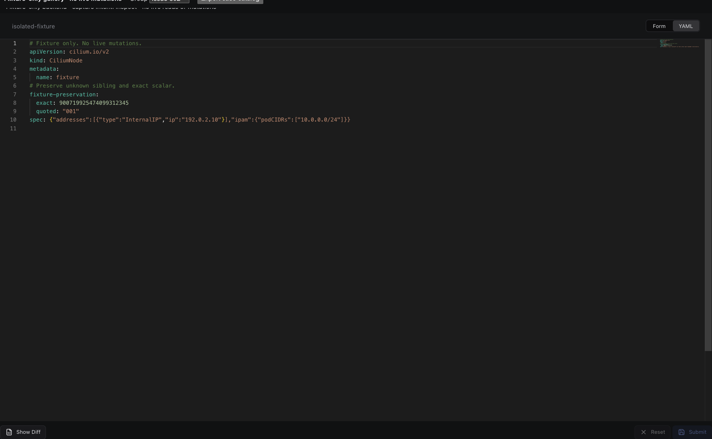

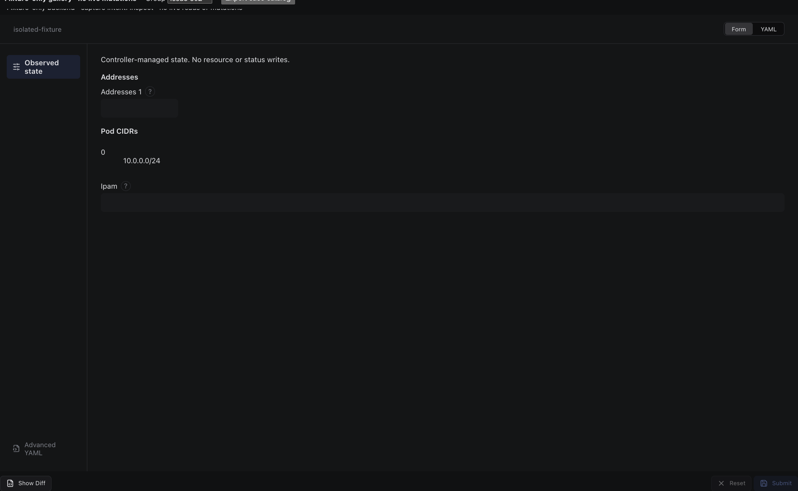

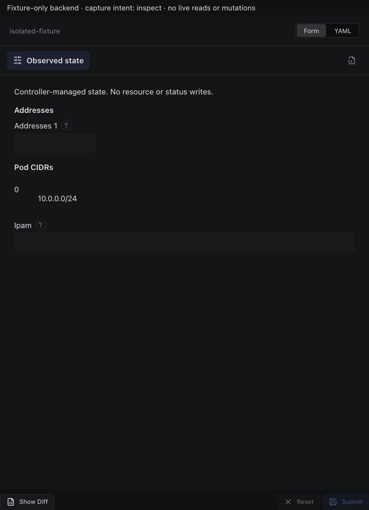

## edit

Sections, help, source, keyboard, narrow layout and boundary evidence

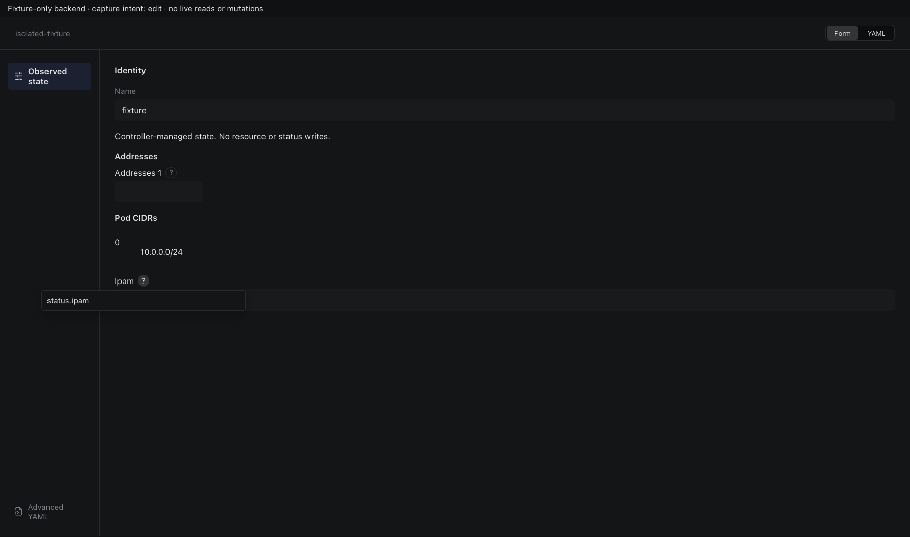

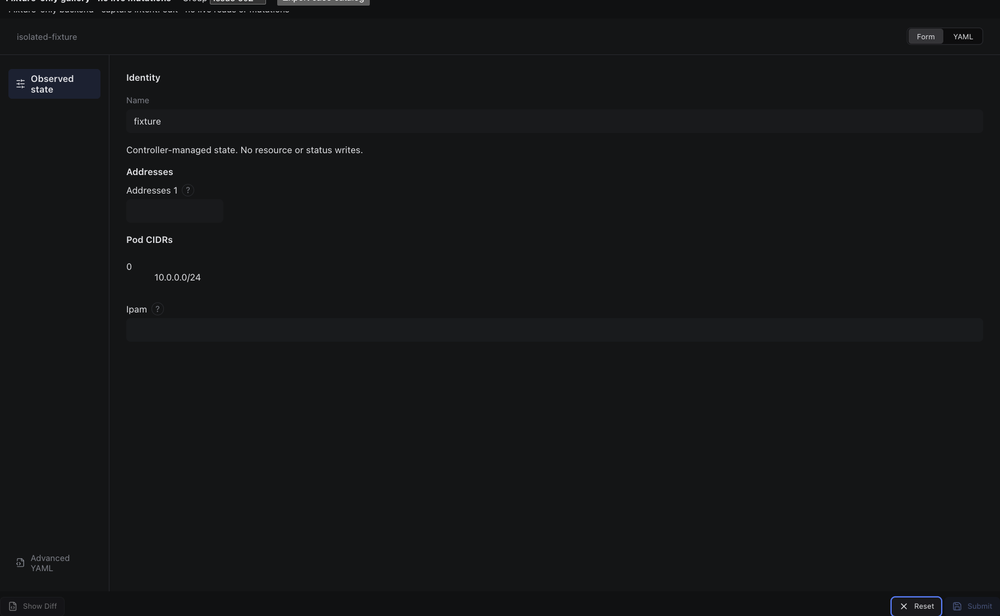

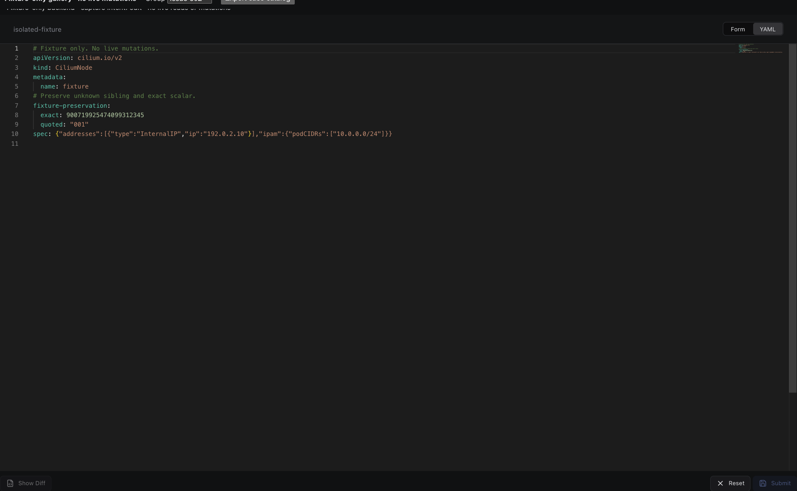

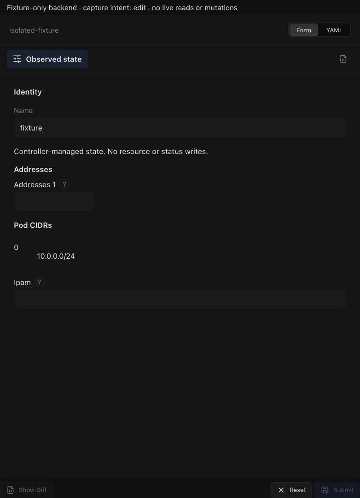

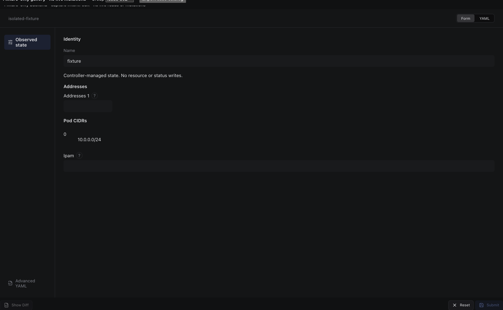

