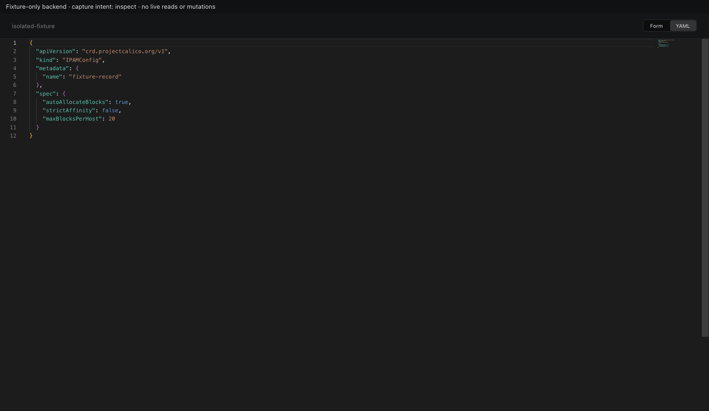
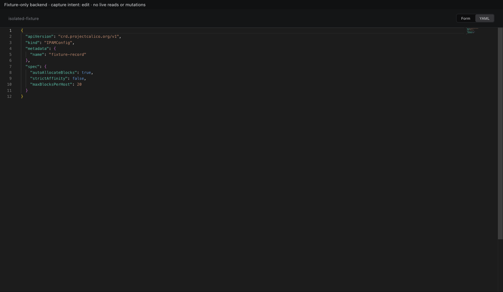

# IPAMConfig backing record

Actual production components with local fixture transport. No live resource reads or mutations. Creating/Submitting is held at the fixture boundary; denied, unavailable and immutable states are not presented as successful mutations.

Targets: `crd.projectcalico.org/v1/ipamconfigs` (IPAMConfig, Cluster)
Ownership: system

## inspect

Sections, help, source, keyboard, narrow layout and boundary evidence

## edit

Sections, help, source, keyboard, narrow layout and boundary evidence

