# Probe

Actual production components with local fixture transport. No live resource reads or mutations. Creating/Submitting is held at the fixture boundary; denied, unavailable and immutable states are not presented as successful mutations.

Targets: `monitoring.coreos.com/v1/probes` (Probe, Namespaced)
Ownership: declarative

## create

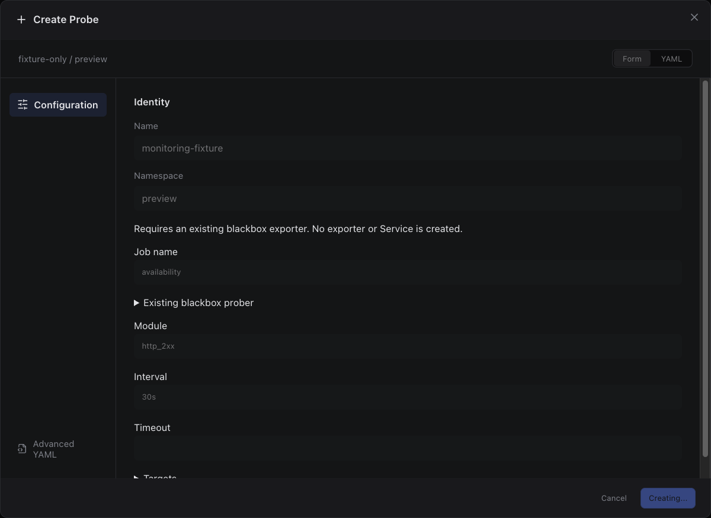

Sections, help, source, keyboard, narrow layout and boundary evidence

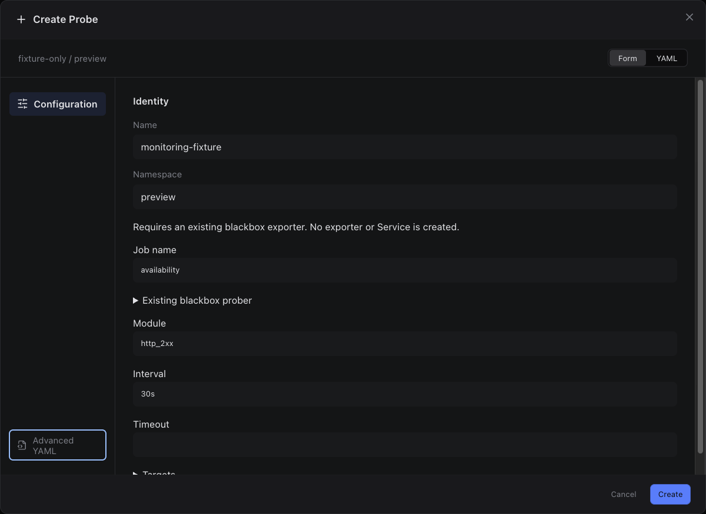

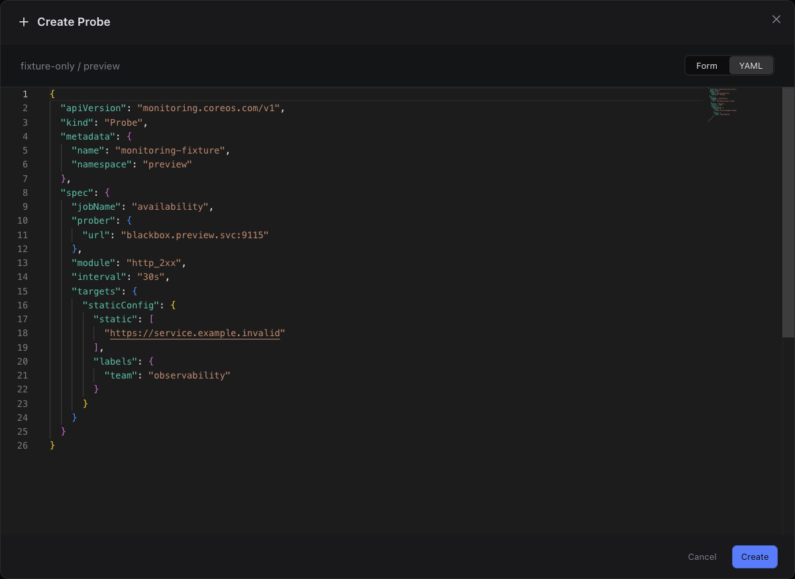

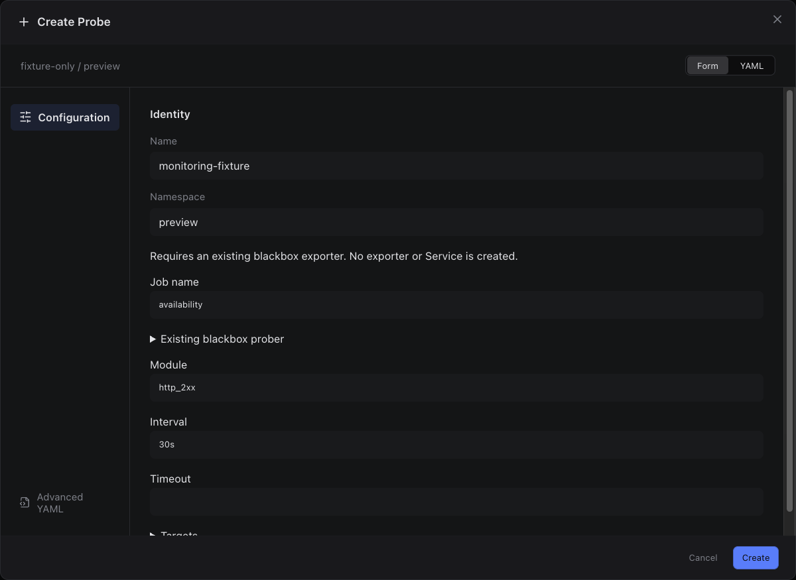

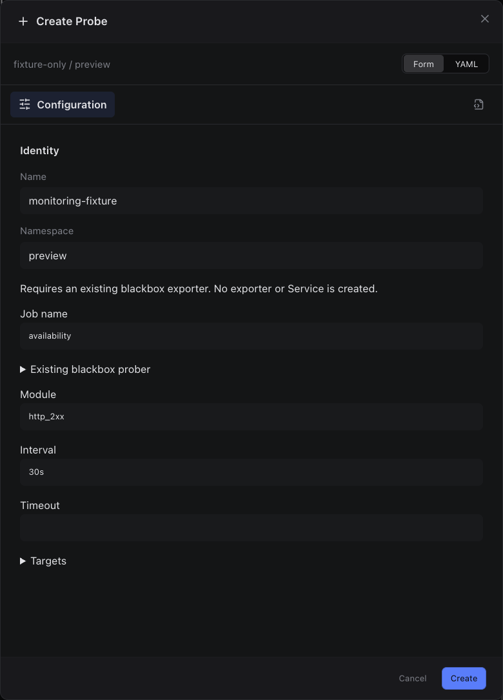

## edit

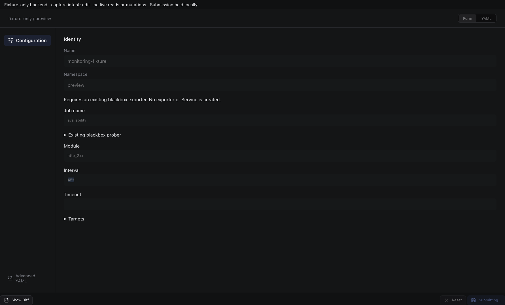

Sections, help, source, keyboard, narrow layout and boundary evidence

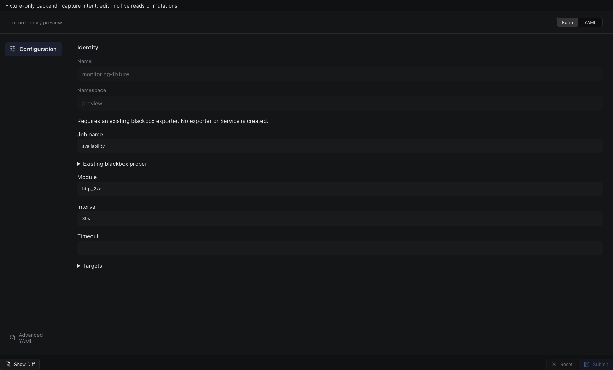

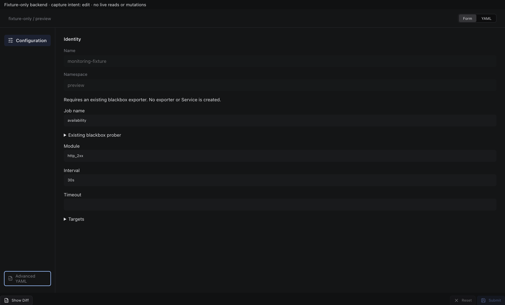

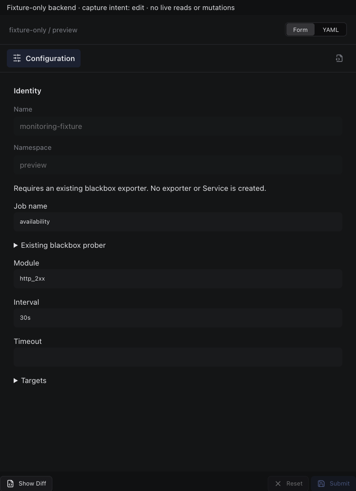

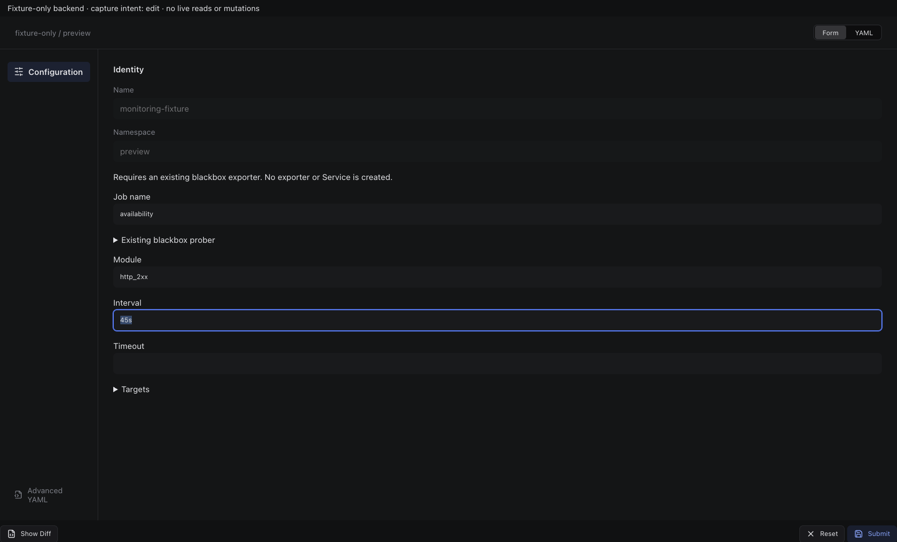

## inspect

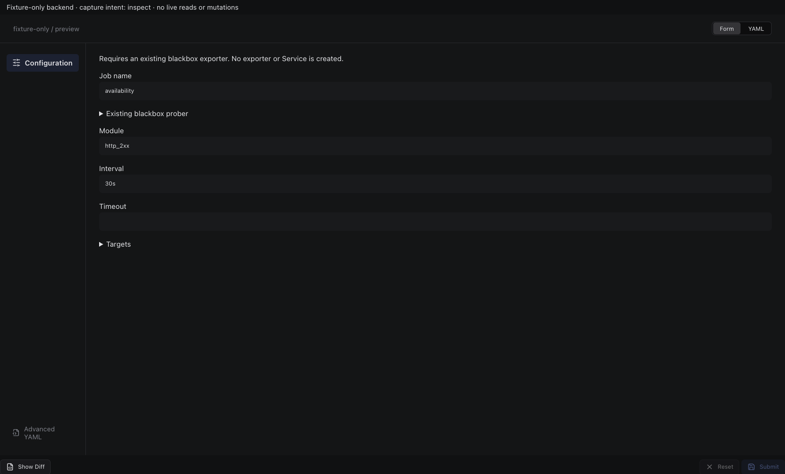

Sections, help, source, keyboard, narrow layout and boundary evidence

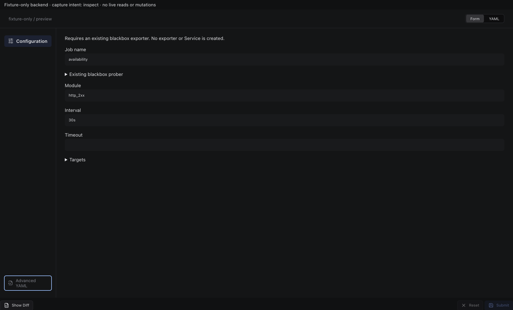

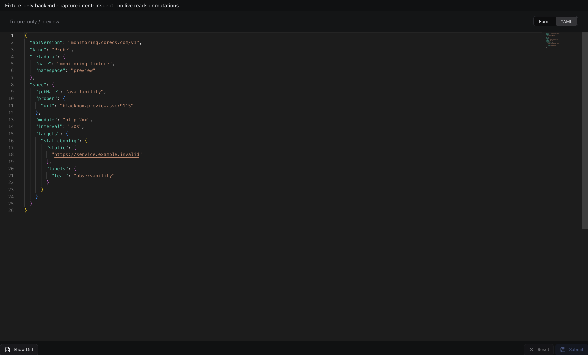

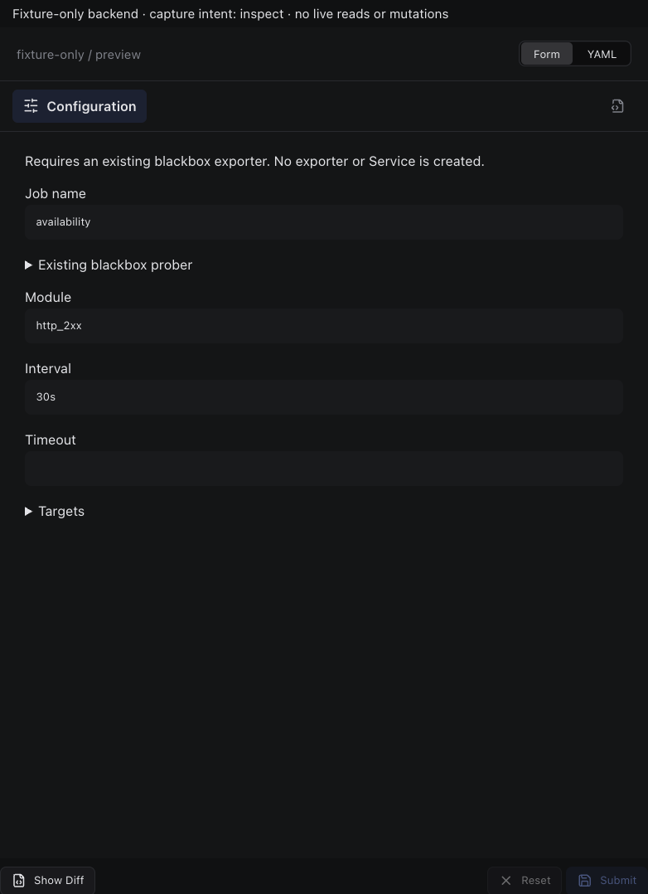

