# PrometheusRule

Actual production components with local fixture transport. No live resource reads or mutations. Creating/Submitting is held at the fixture boundary; denied, unavailable and immutable states are not presented as successful mutations.

Targets: `monitoring.coreos.com/v1/prometheusrules` (PrometheusRule, Namespaced)
Ownership: declarative

## create

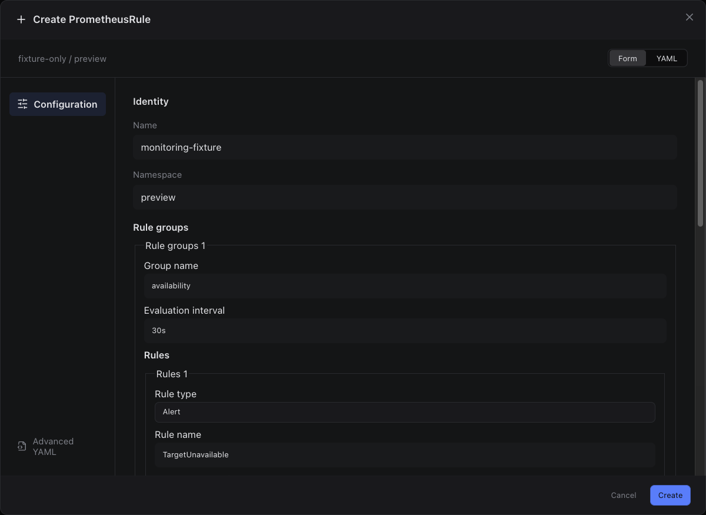

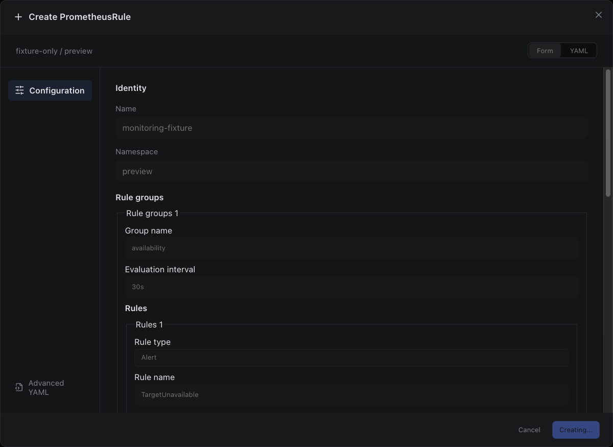

Sections, help, source, keyboard, narrow layout and boundary evidence

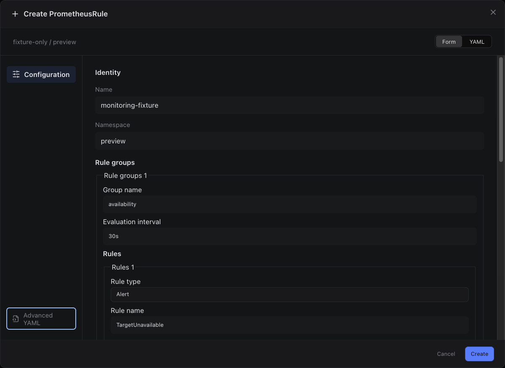

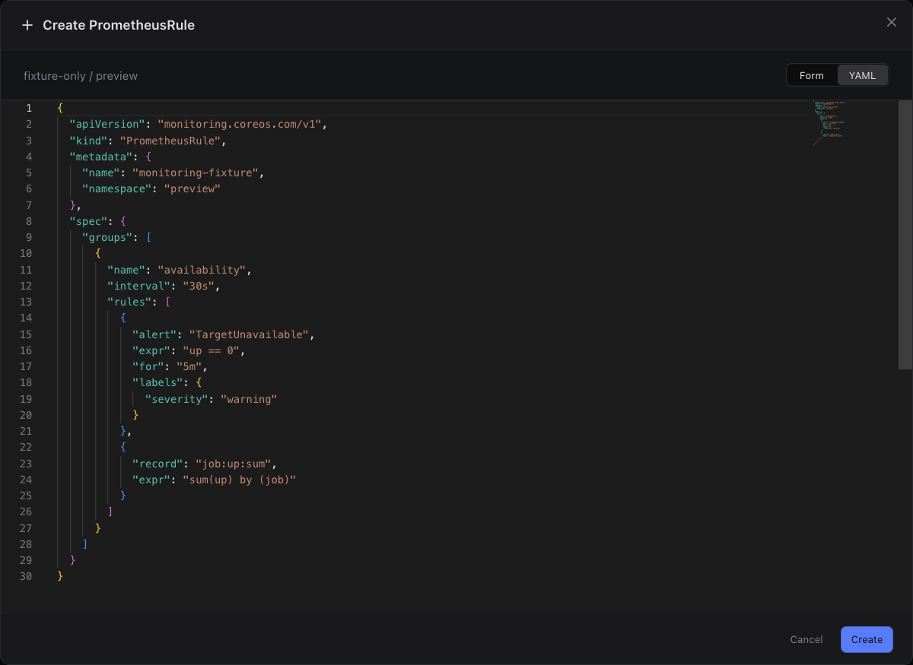

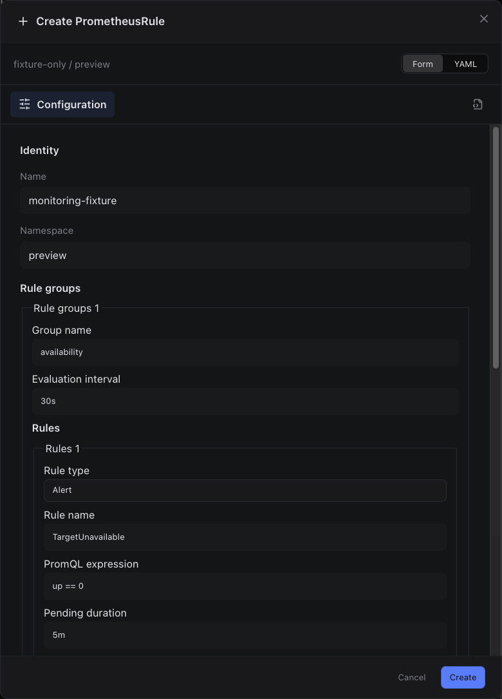

## edit

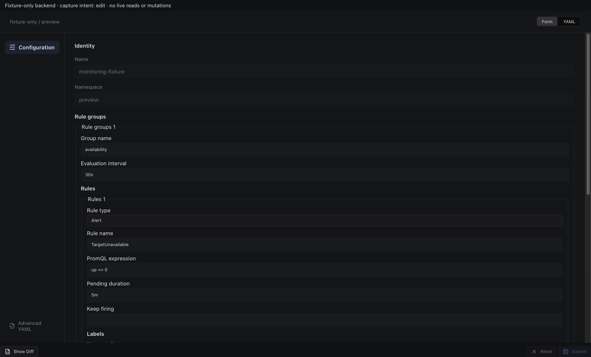

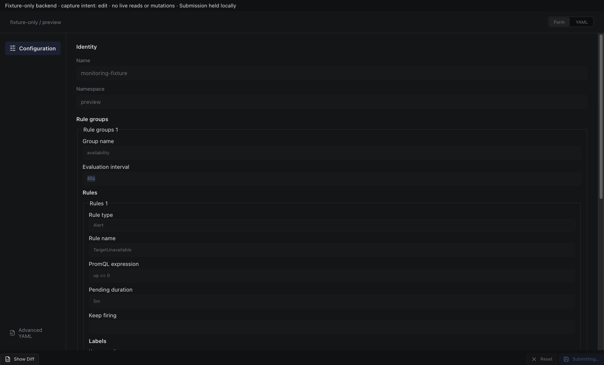

Sections, help, source, keyboard, narrow layout and boundary evidence

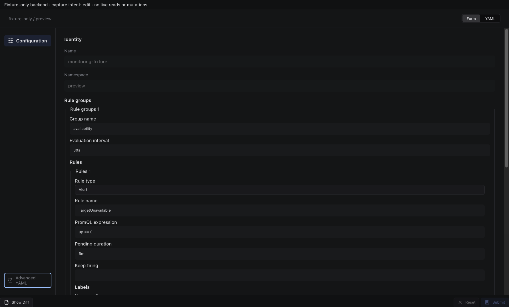

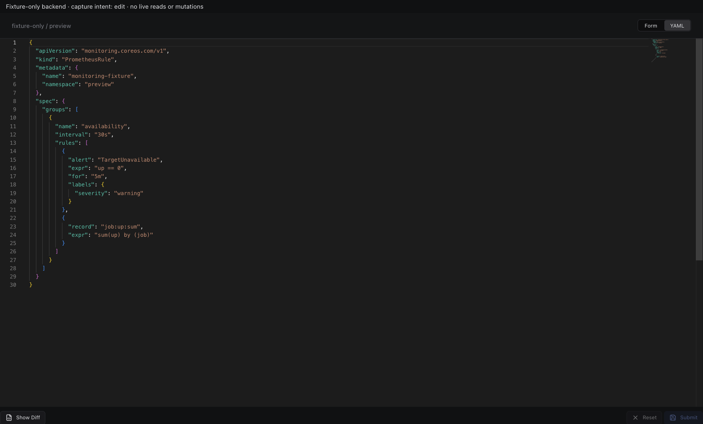

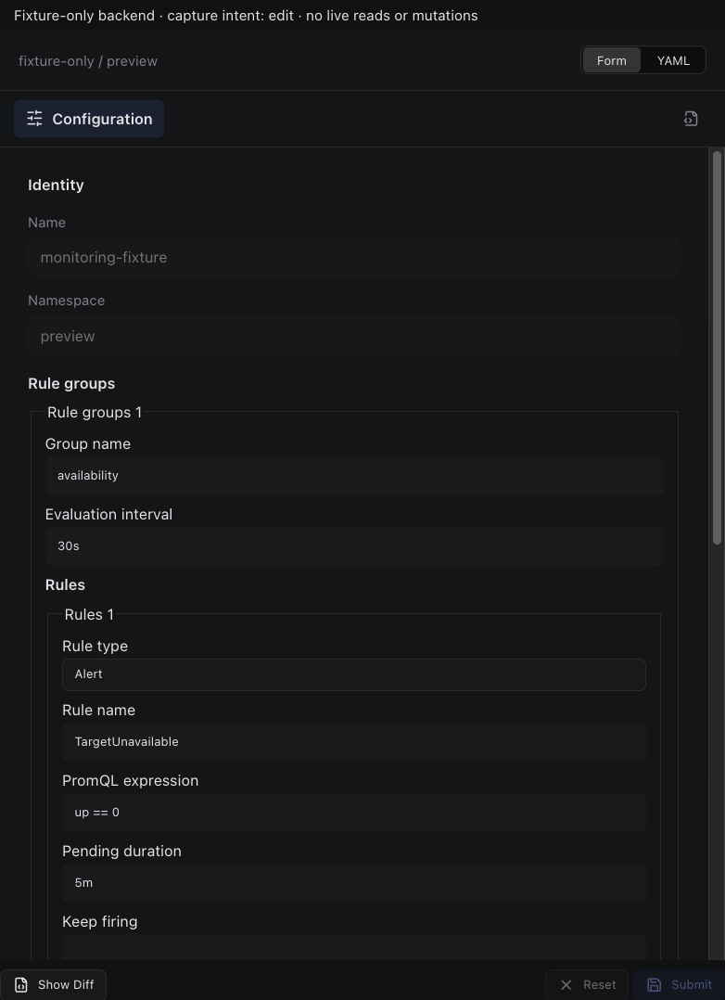

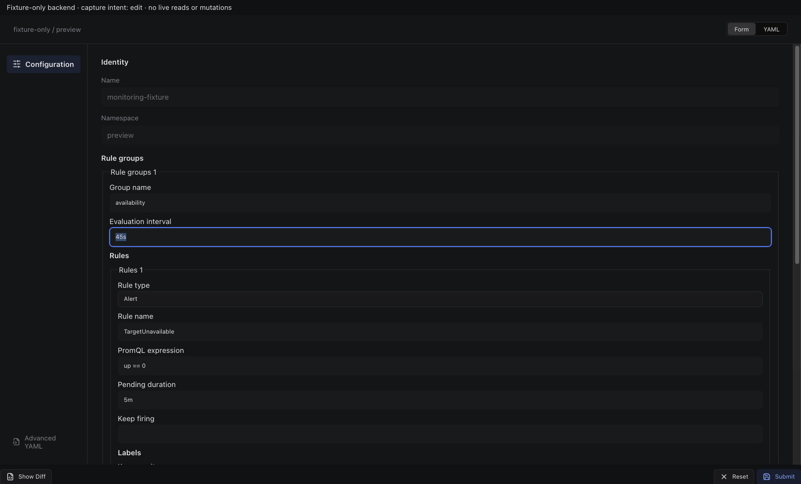

## inspect

Sections, help, source, keyboard, narrow layout and boundary evidence

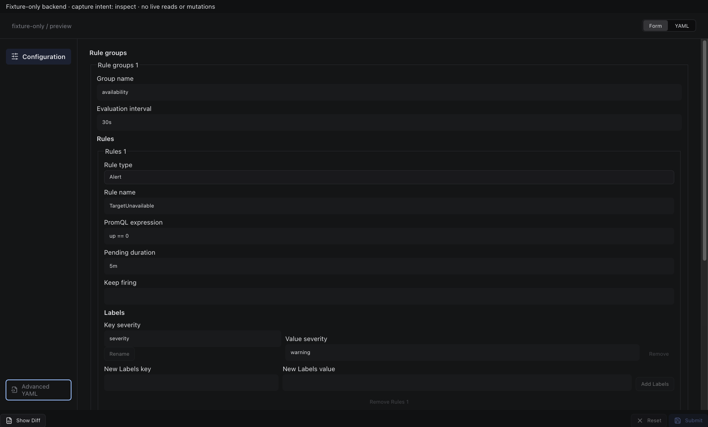

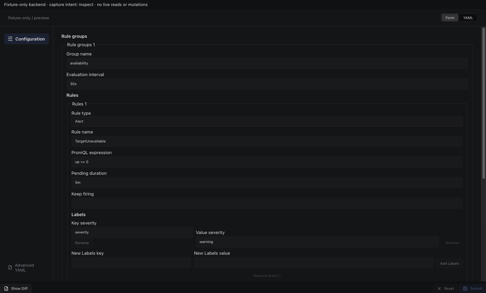

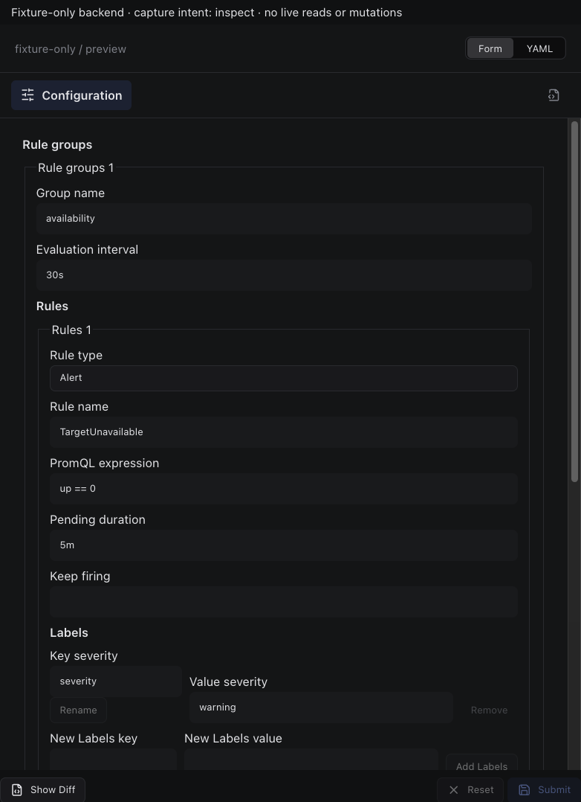

