# External Secrets · ClusterPushSecret

Actual production components with local fixture transport. No live resource reads or mutations. Creating/Submitting is held at the fixture boundary; denied, unavailable and immutable states are not presented as successful mutations.

Targets: `external-secrets.io/v1alpha1/clusterpushsecrets` (ClusterPushSecret, Cluster)
Ownership: declarative

## create

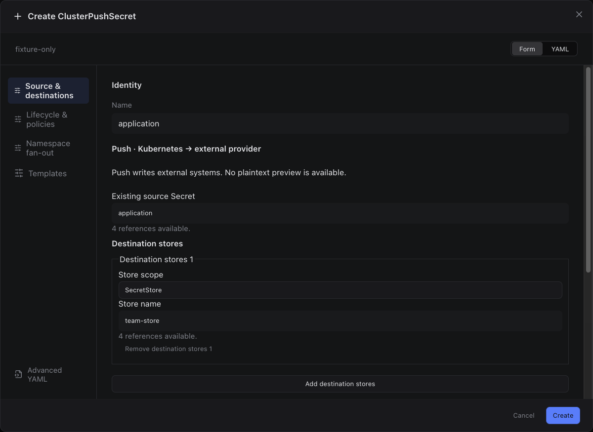

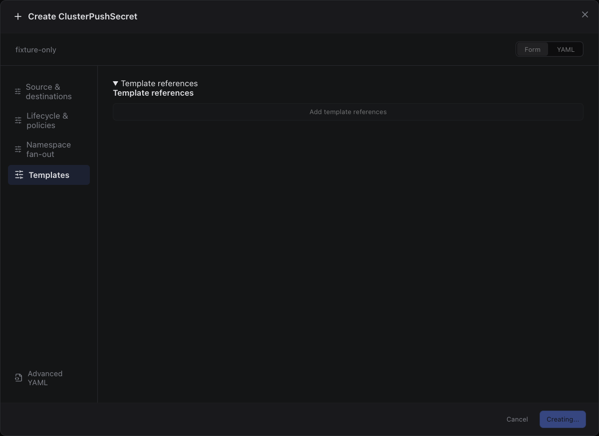

Sections, help, source, keyboard, narrow layout and boundary evidence

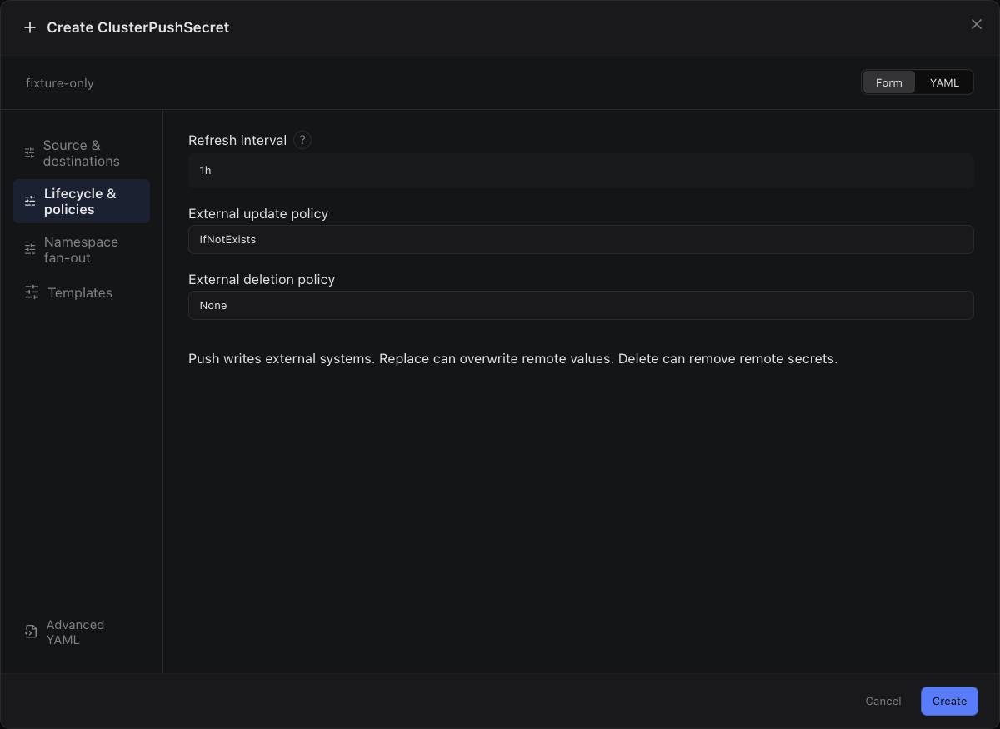

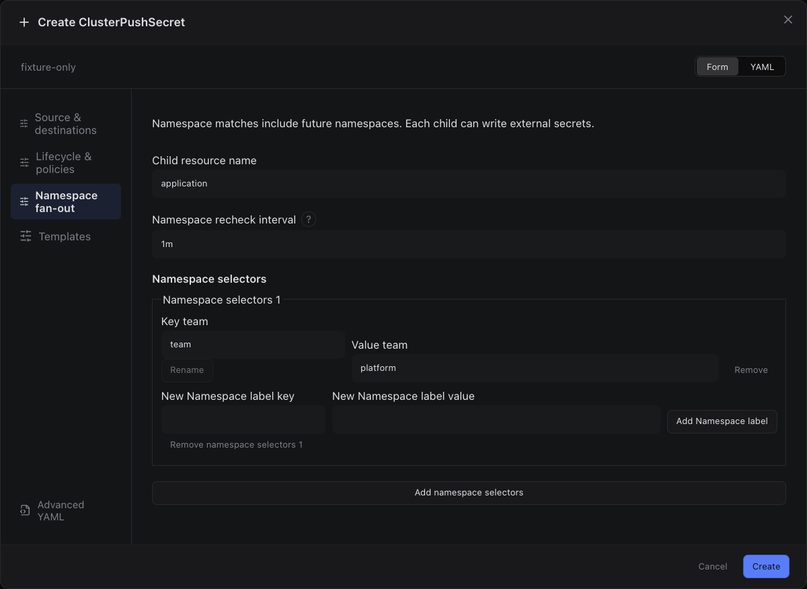

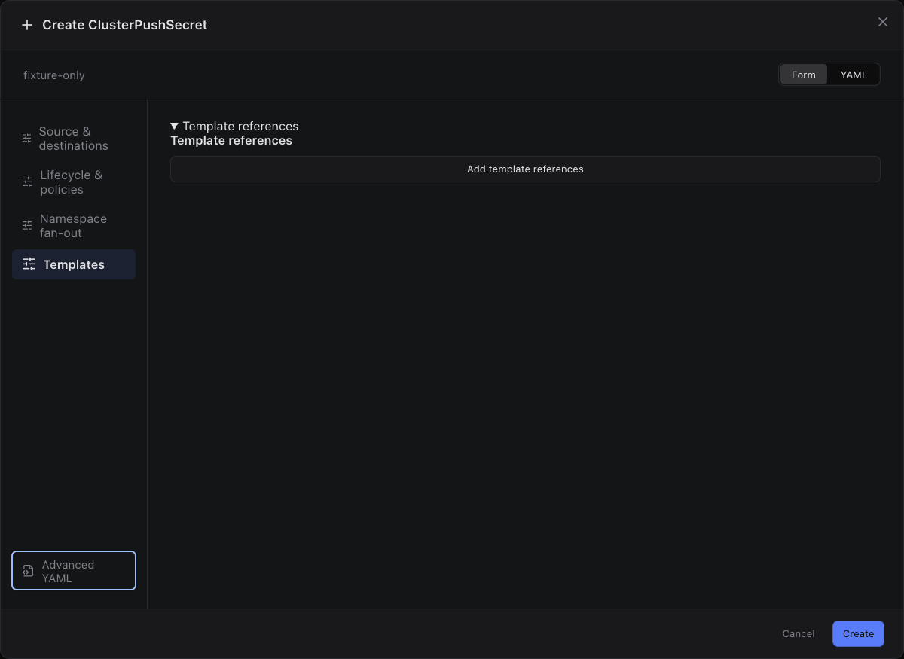

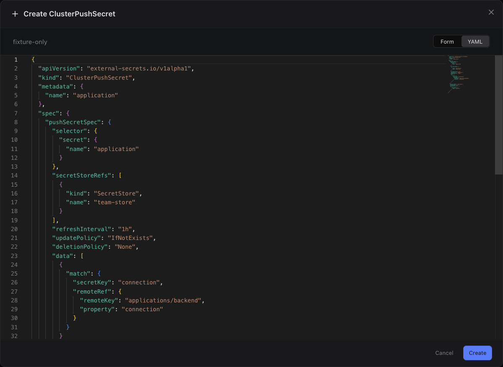

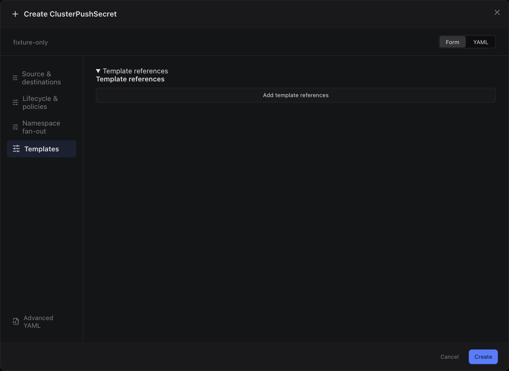

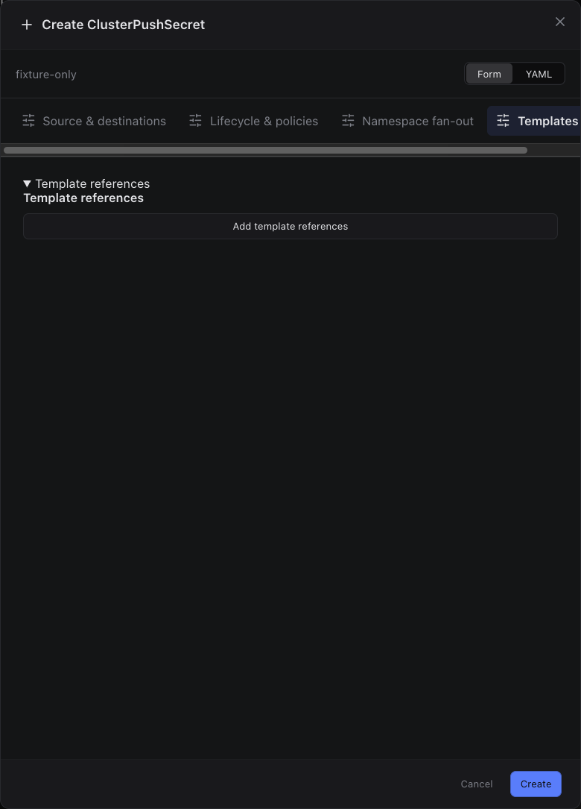

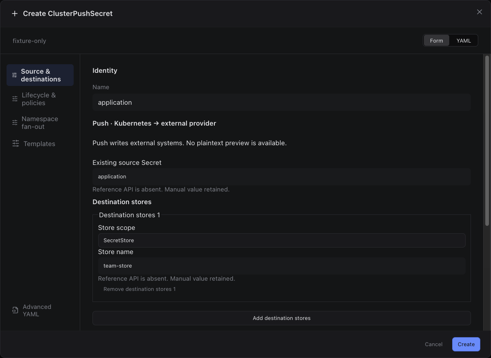

## edit

Sections, help, source, keyboard, narrow layout and boundary evidence

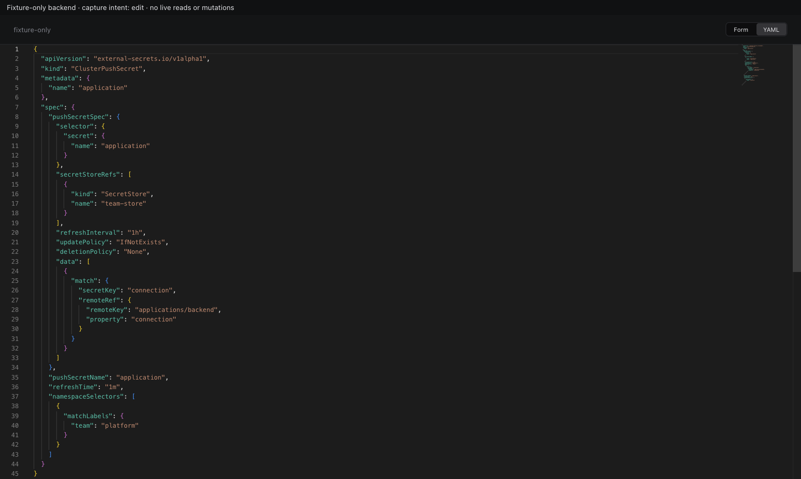

## inspect

Sections, help, source, keyboard, narrow layout and boundary evidence

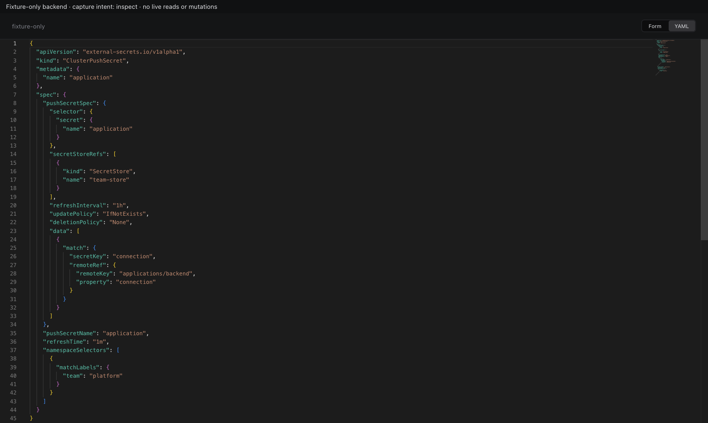

