# Crossplane Operation

Actual production components with local fixture transport. No live resource reads or mutations. Creating/Submitting is held at the fixture boundary; denied, unavailable and immutable states are not presented as successful mutations.

Targets: `ops.crossplane.io/v1alpha1/operations` (Operation, Cluster)
Ownership: conditional

## create

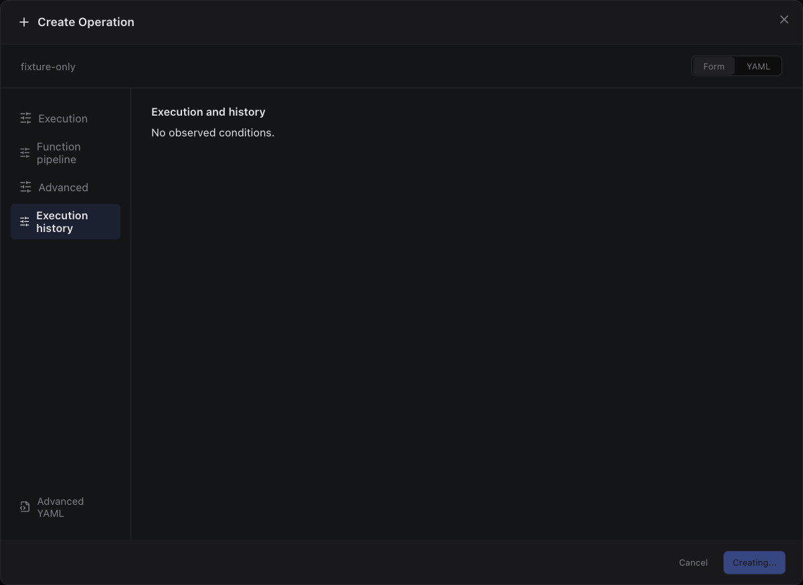

Sections, help, source, keyboard, narrow layout and boundary evidence

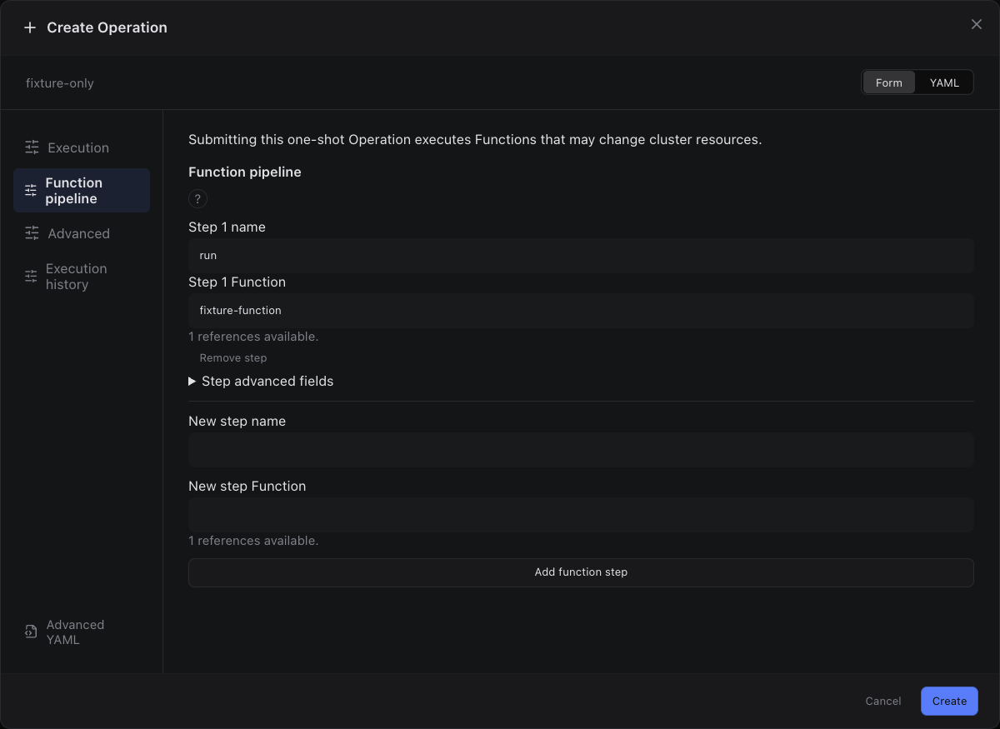

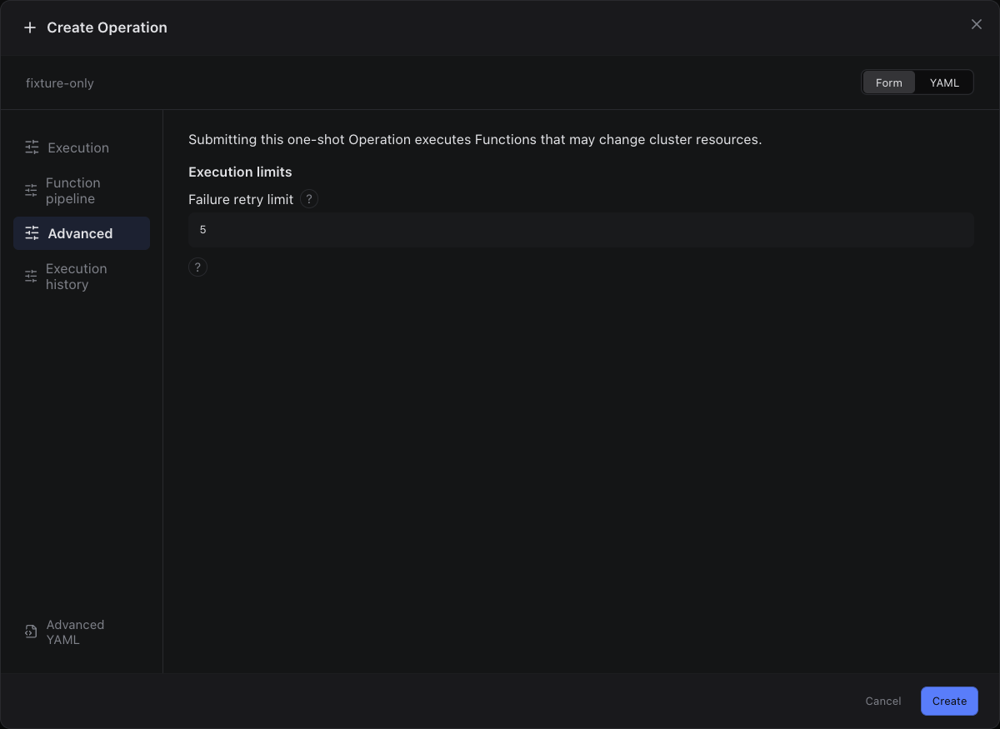

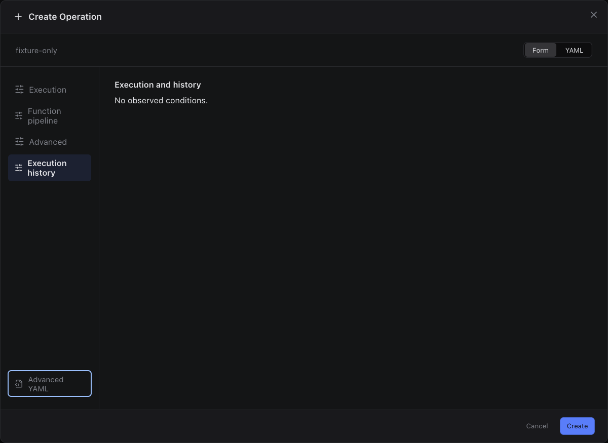

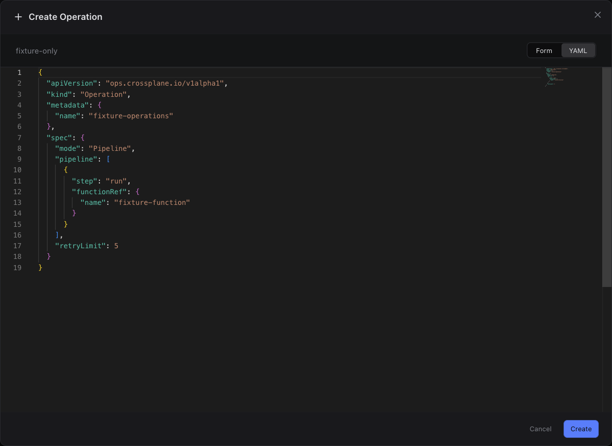

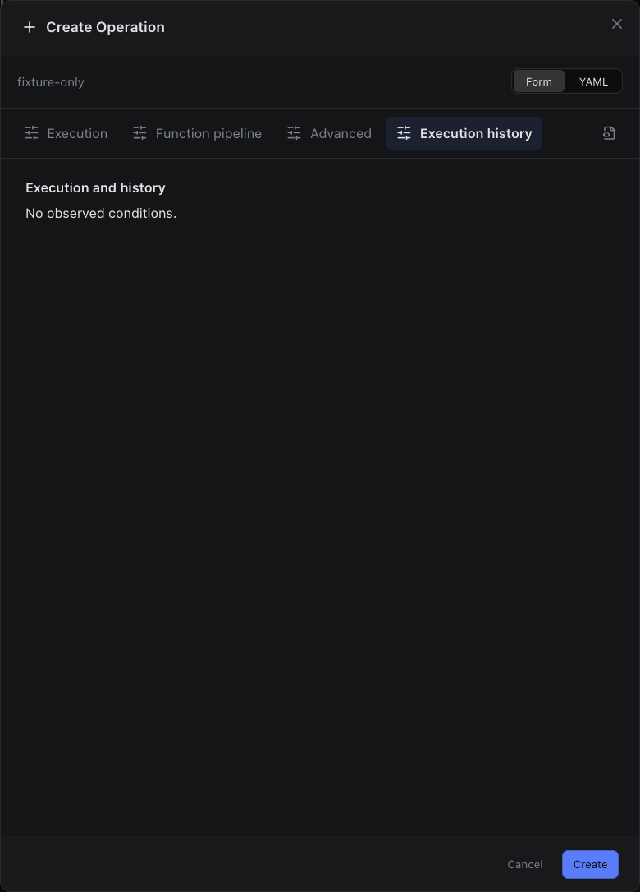

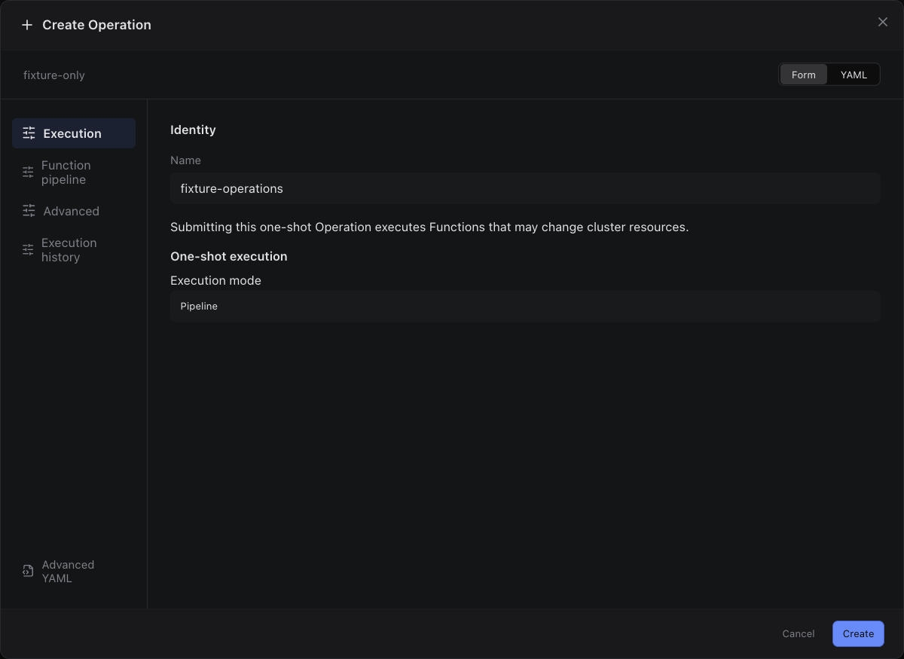

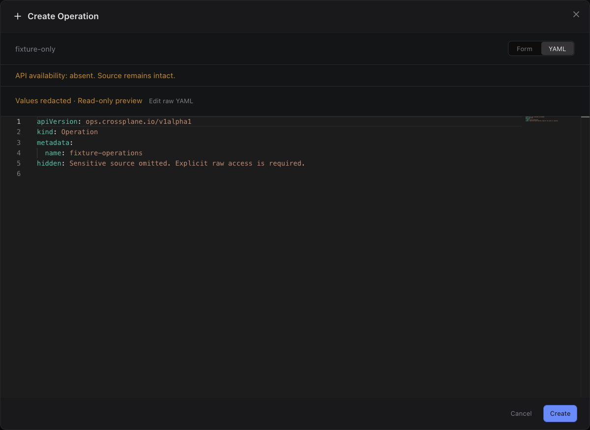

## edit

Sections, help, source, keyboard, narrow layout and boundary evidence

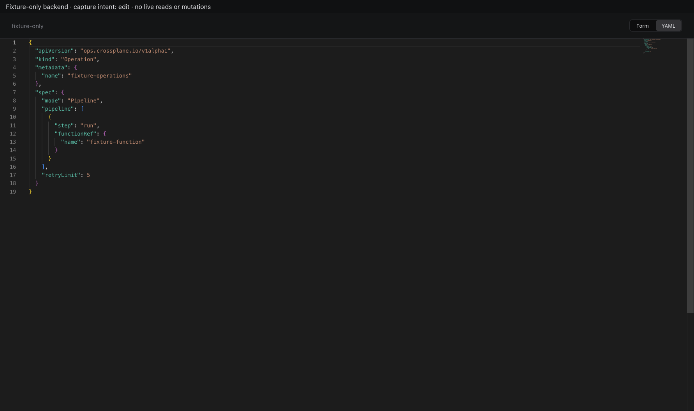

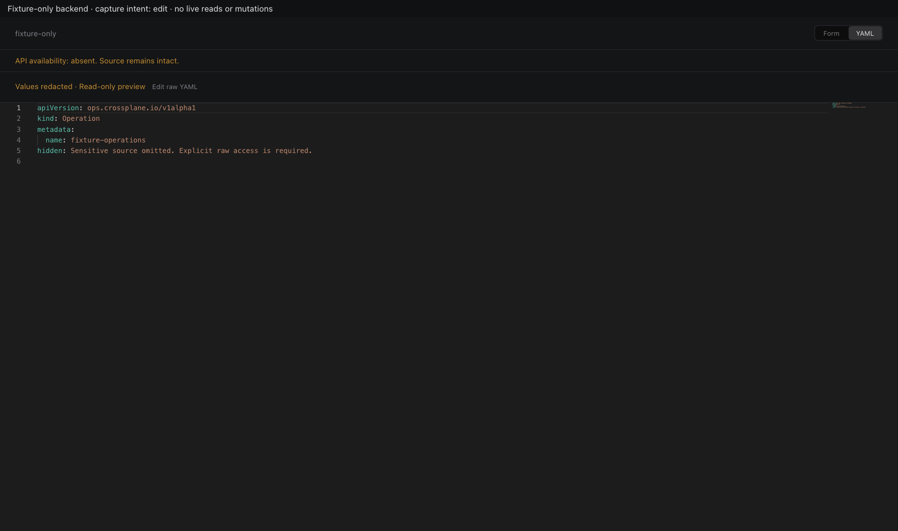

## inspect

Sections, help, source, keyboard, narrow layout and boundary evidence

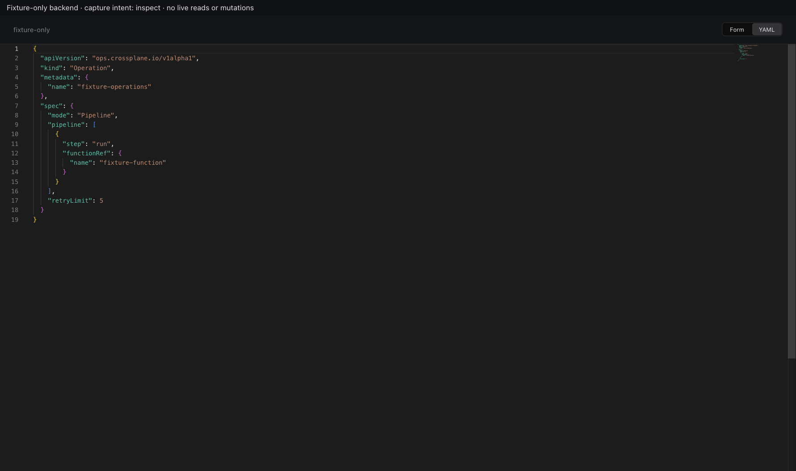

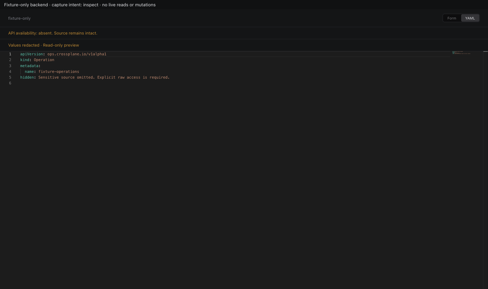

