# Kyverno PolicyException

Actual production components with local fixture transport. No live resource reads or mutations. Creating/Submitting is held at the fixture boundary; denied, unavailable and immutable states are not presented as successful mutations.

Targets: `kyverno.io/v2/policyexceptions` (PolicyException, Namespaced) · `kyverno.io/v2beta1/policyexceptions` (PolicyException, Namespaced)
Ownership: declarative

## create

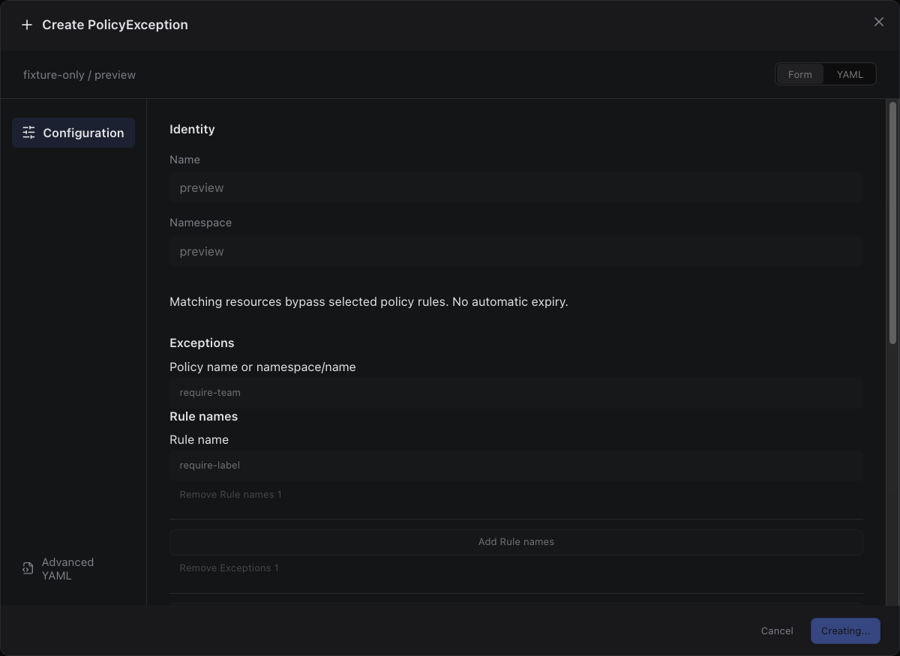

Sections, help, source, keyboard, narrow layout and boundary evidence

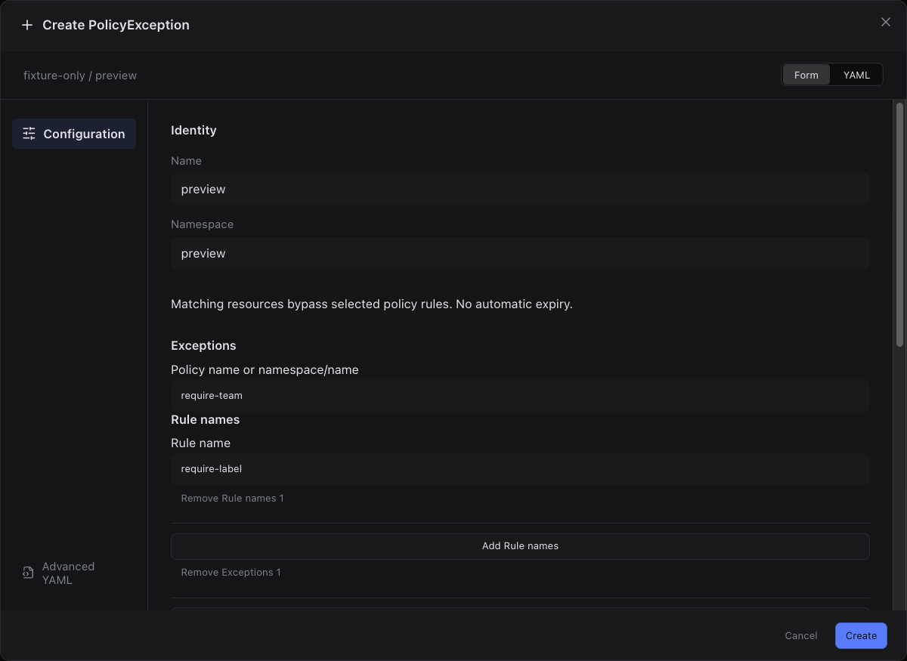

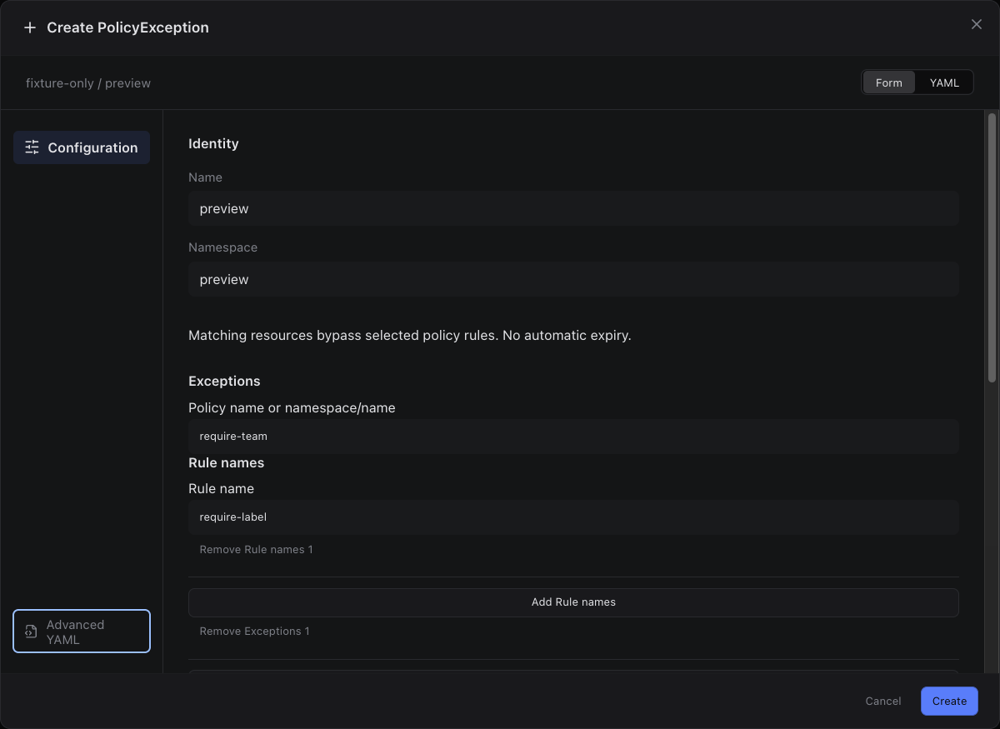

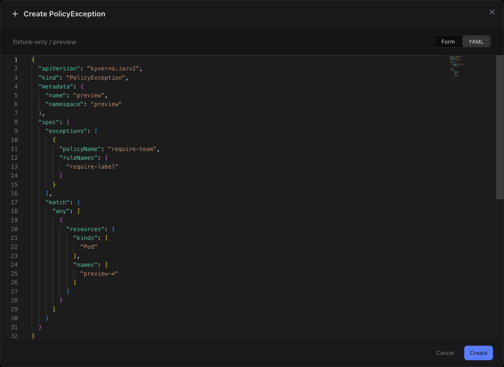

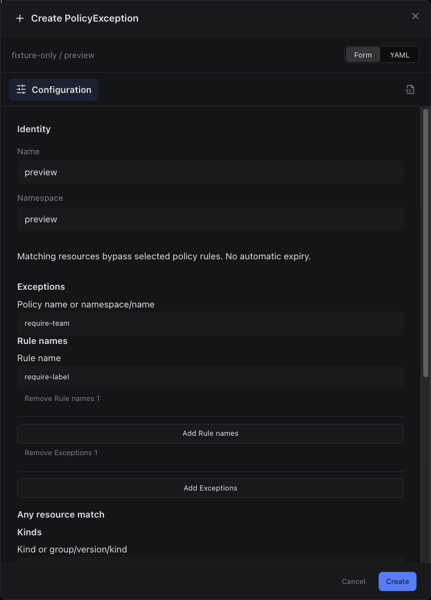

## edit

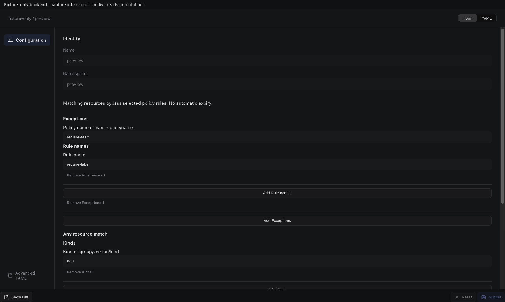

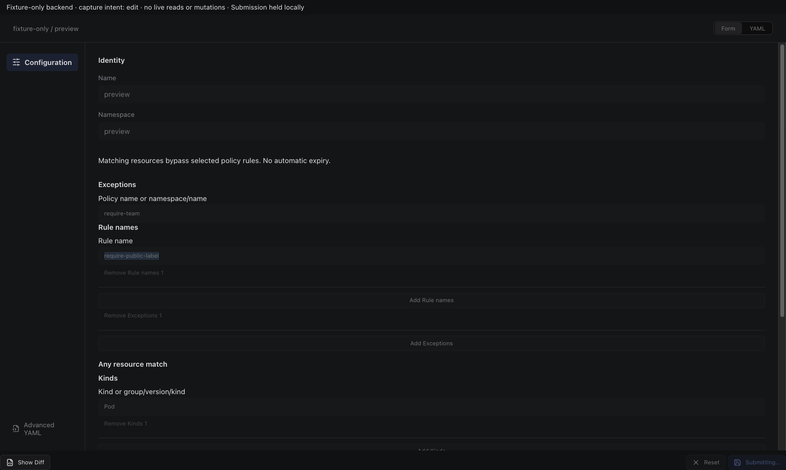

Sections, help, source, keyboard, narrow layout and boundary evidence

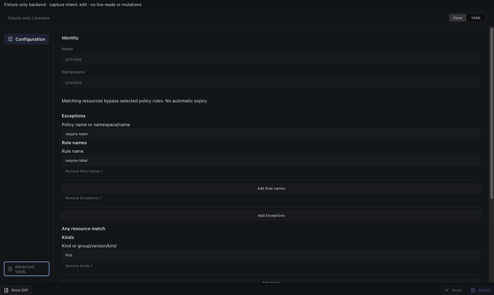

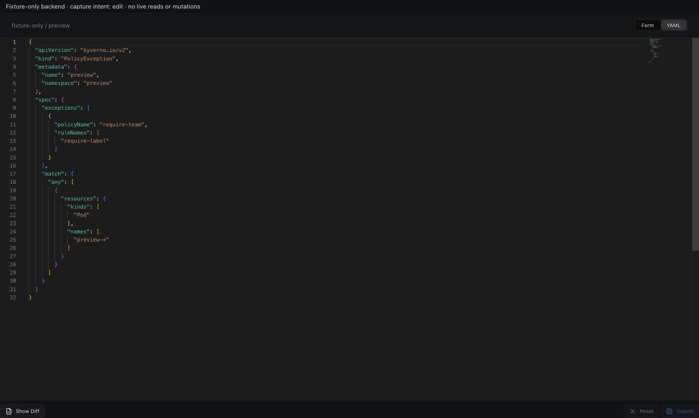

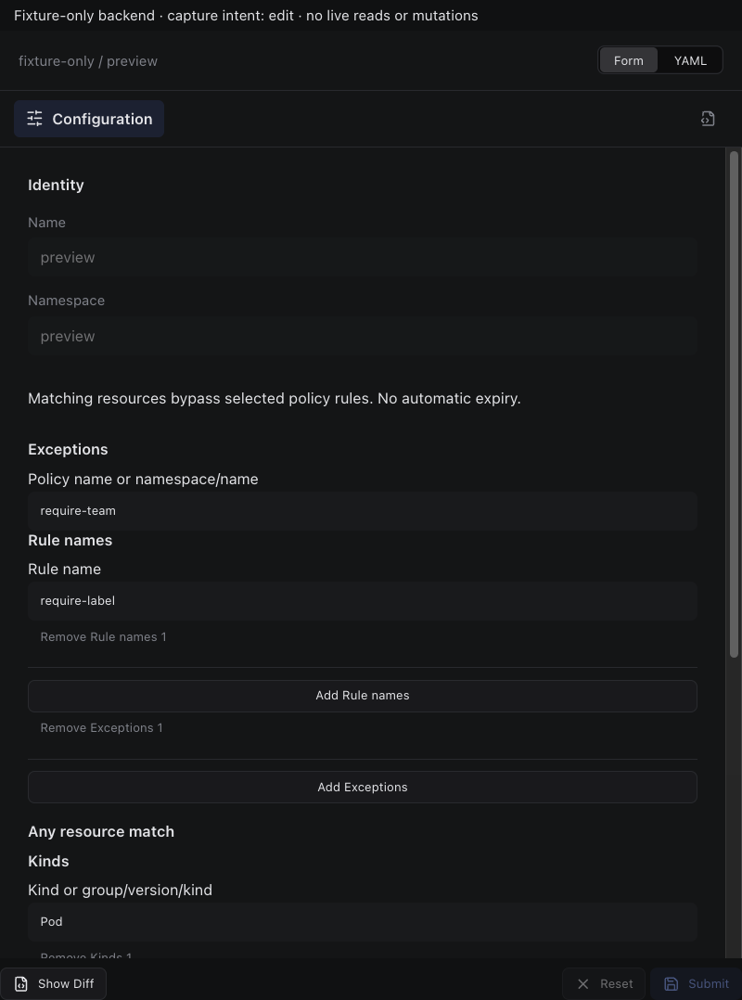

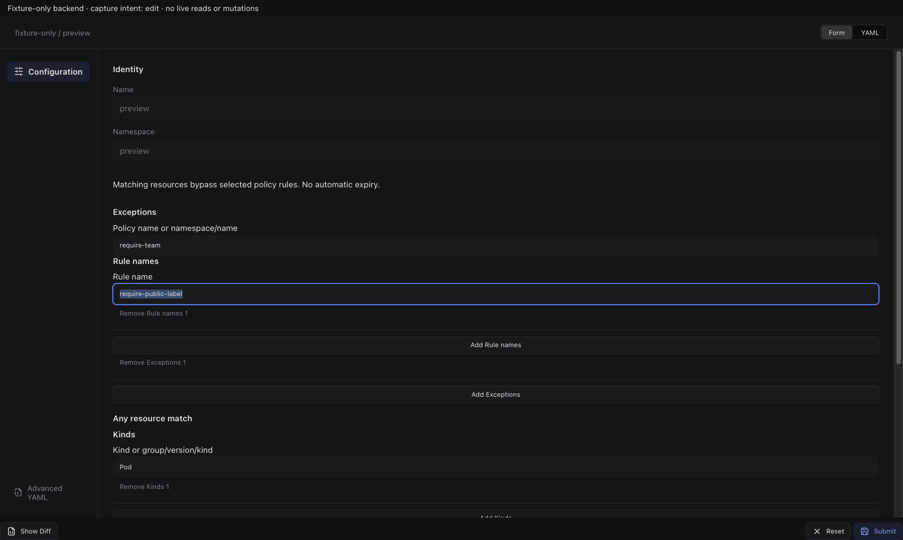

## inspect

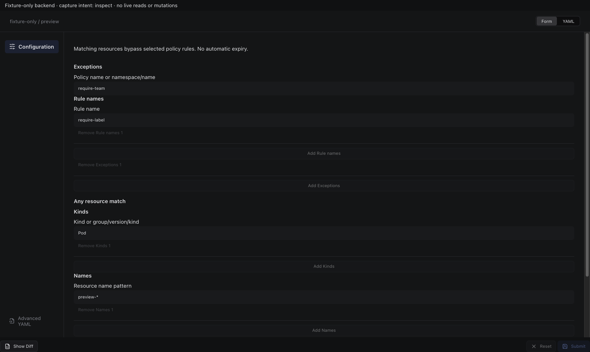

Sections, help, source, keyboard, narrow layout and boundary evidence

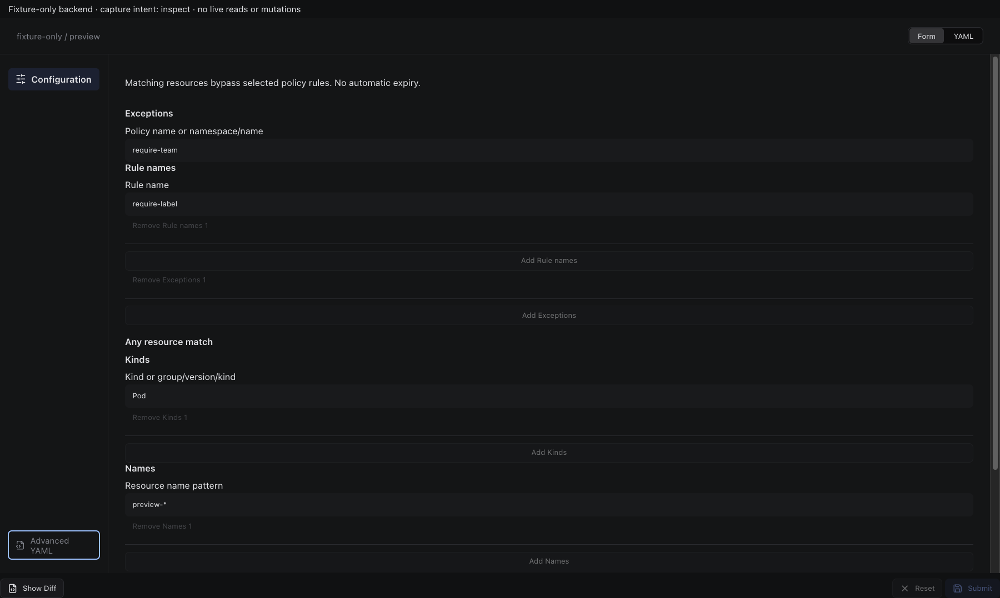

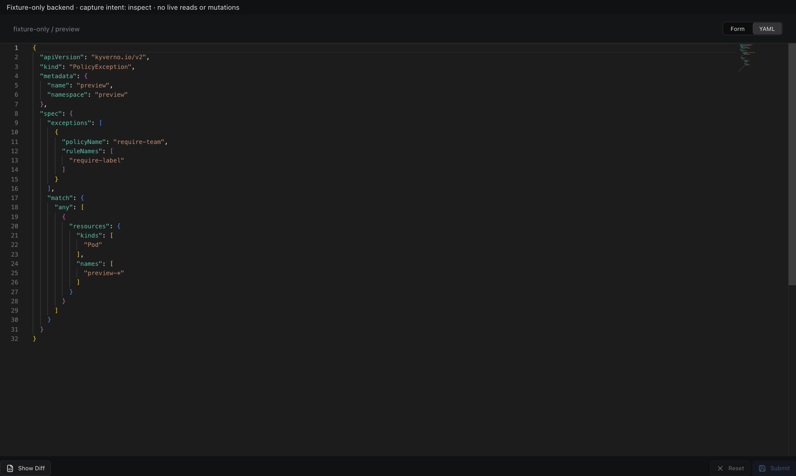

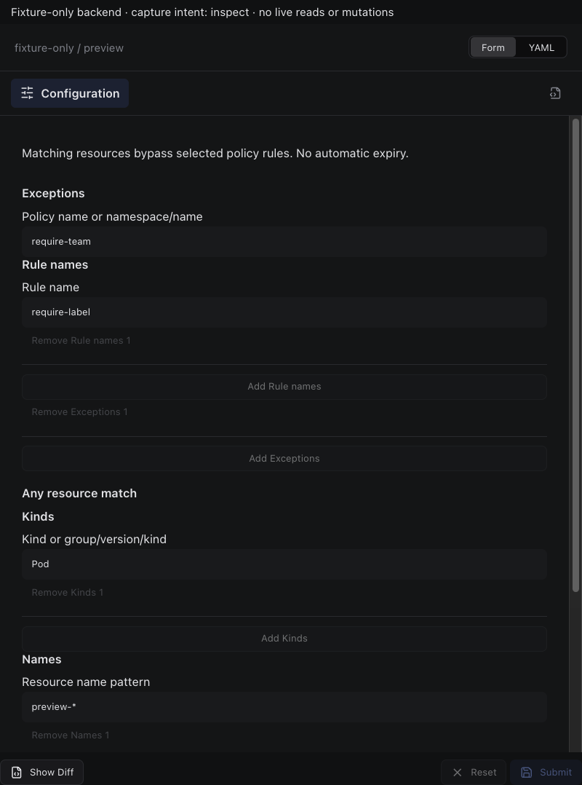

