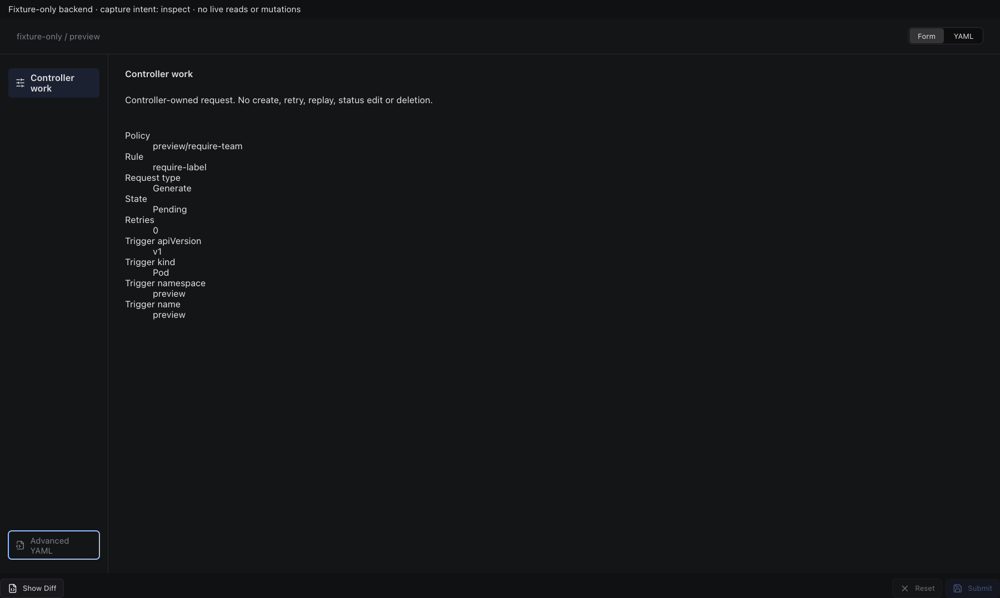
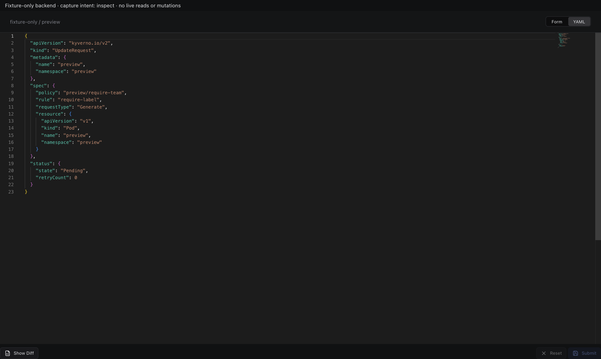
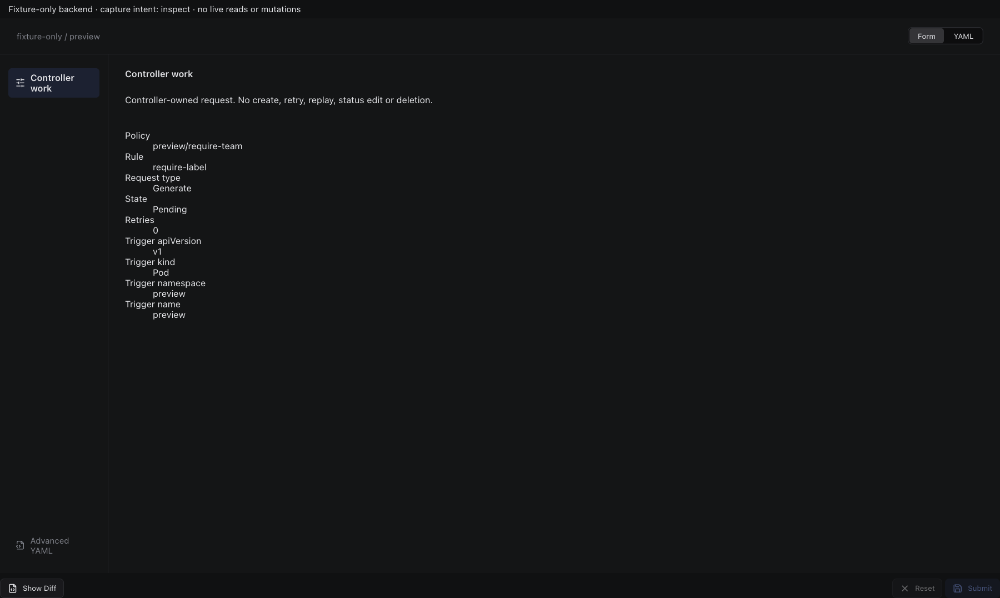
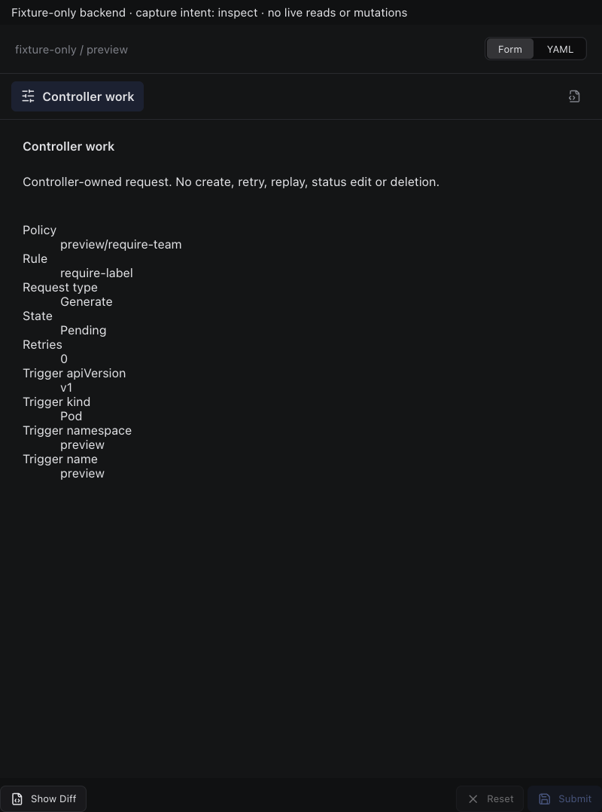

# Kyverno UpdateRequest

Actual production components with local fixture transport. No live resource reads or mutations. Creating/Submitting is held at the fixture boundary; denied, unavailable and immutable states are not presented as successful mutations.

Targets: `kyverno.io/v2/updaterequests` (UpdateRequest, Namespaced) · `kyverno.io/v1beta1/updaterequests` (UpdateRequest, Namespaced)
Ownership: controller

## inspect

Sections, help, source, keyboard, narrow layout and boundary evidence

