# Kyverno transient evidence

Actual production components with local fixture transport. No live resource reads or mutations. Creating/Submitting is held at the fixture boundary; denied, unavailable and immutable states are not presented as successful mutations.

Targets: `reports.kyverno.io/v1/ephemeralreports` (EphemeralReport, Namespaced) · `reports.kyverno.io/v1/clusterephemeralreports` (ClusterEphemeralReport, Cluster)
Ownership: controller

## edit

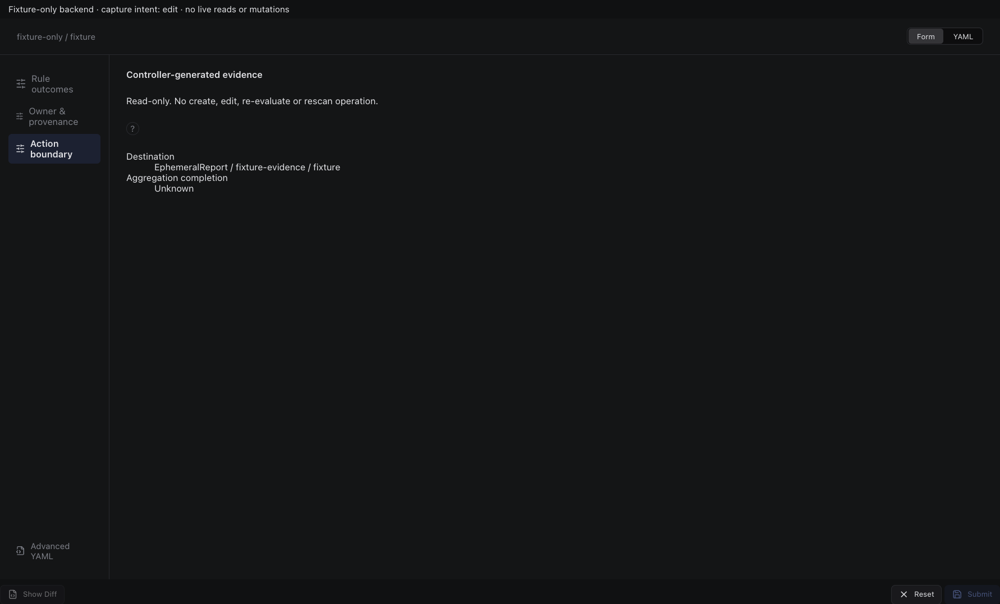

Sections, help, source, keyboard, narrow layout and boundary evidence

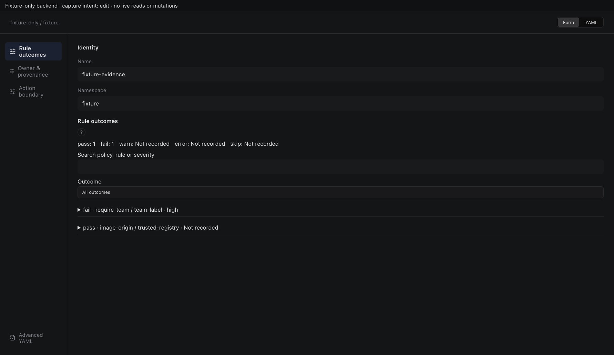

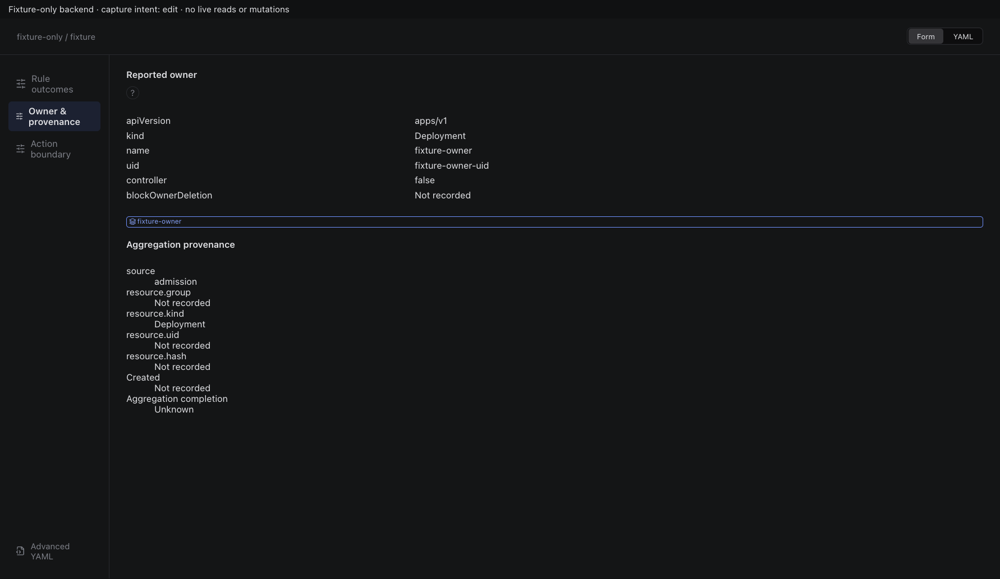

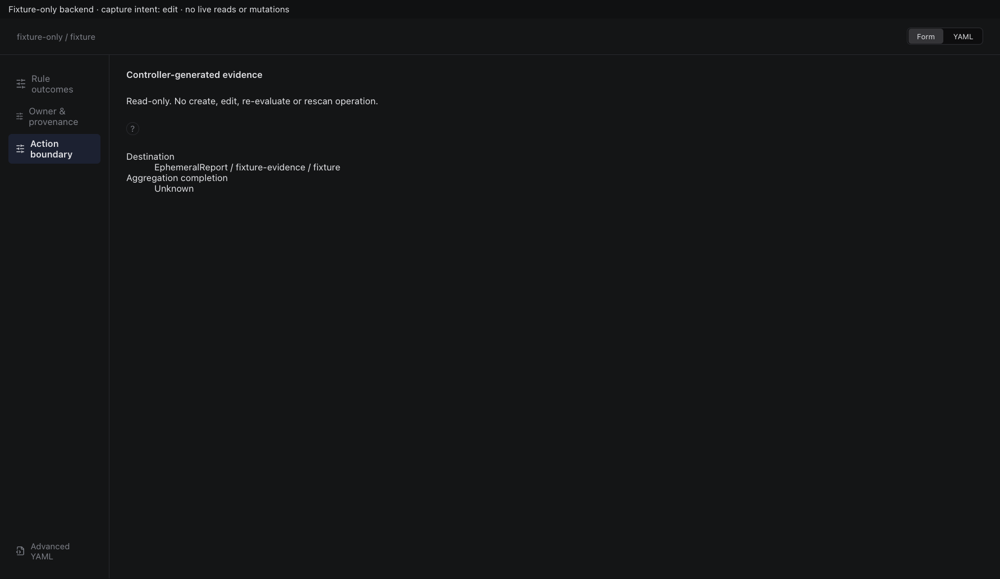

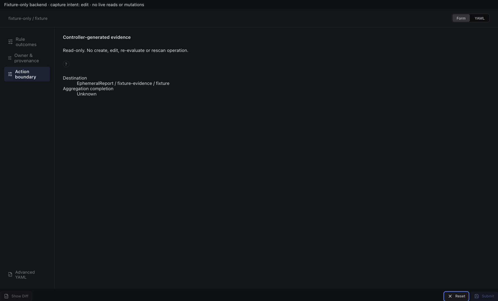

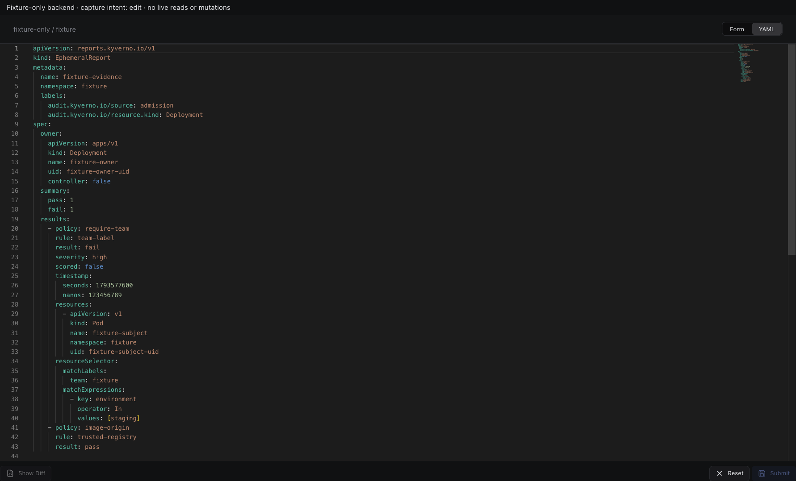

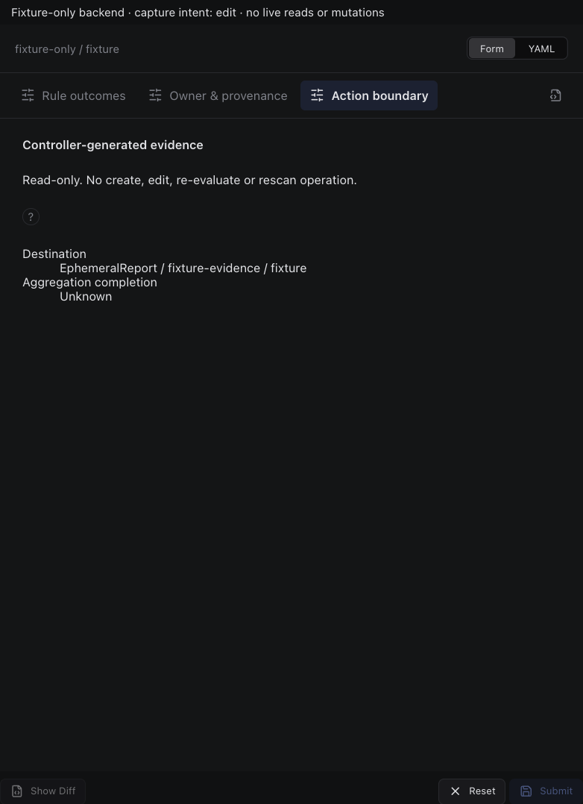

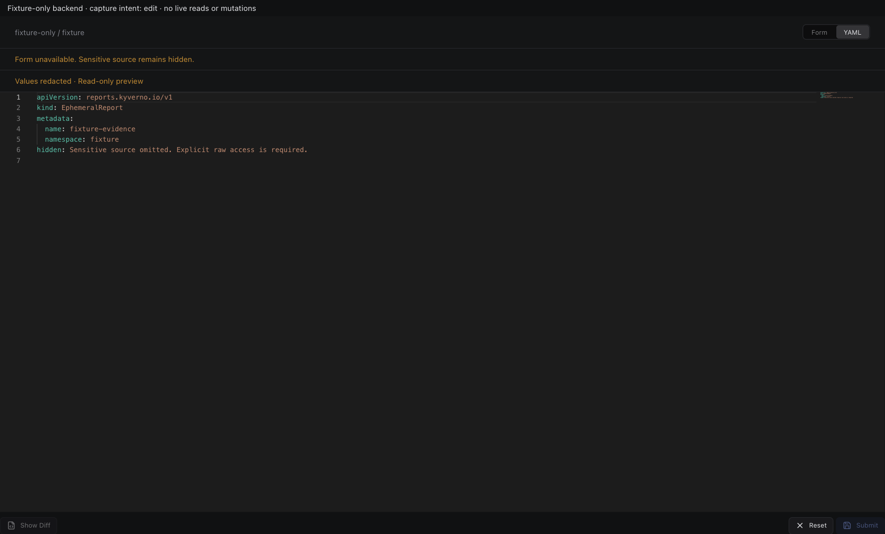

## inspect

Sections, help, source, keyboard, narrow layout and boundary evidence

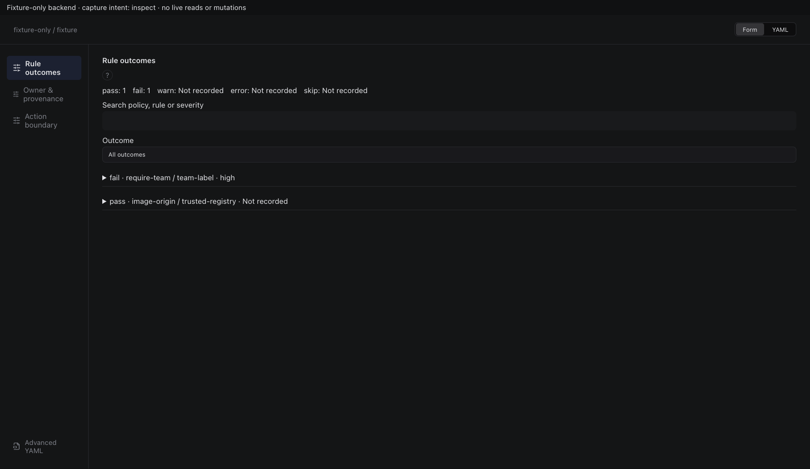

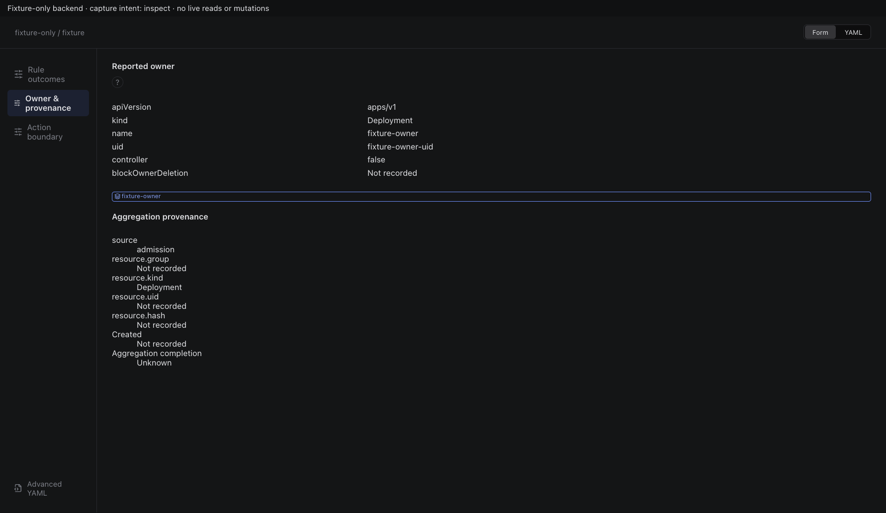

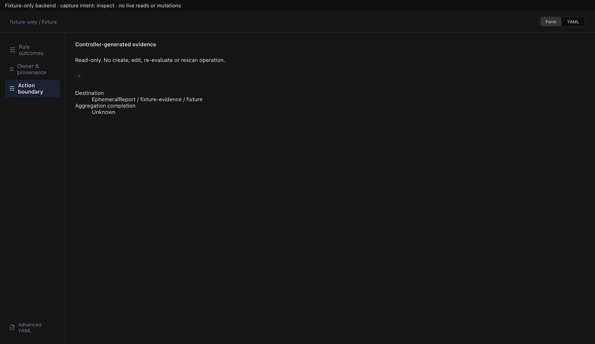

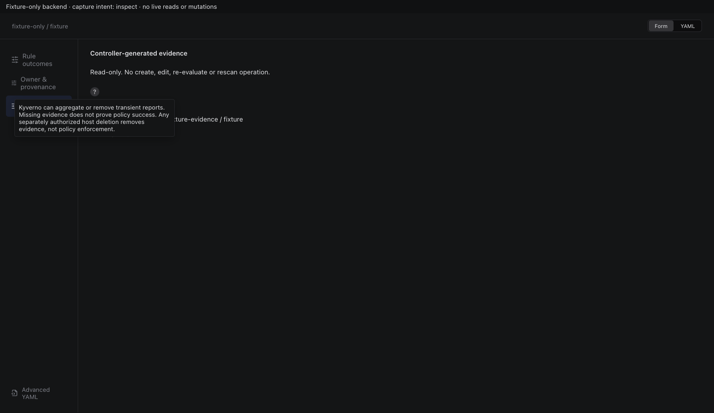

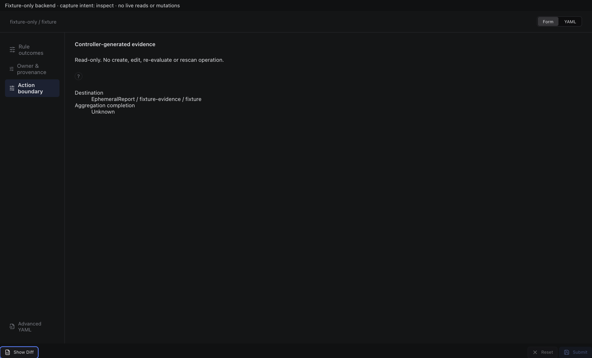

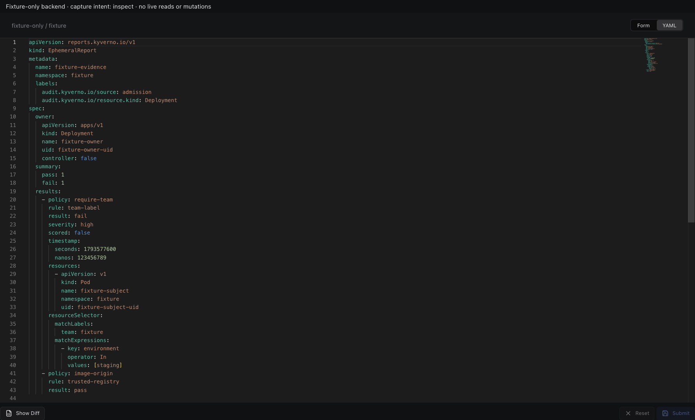

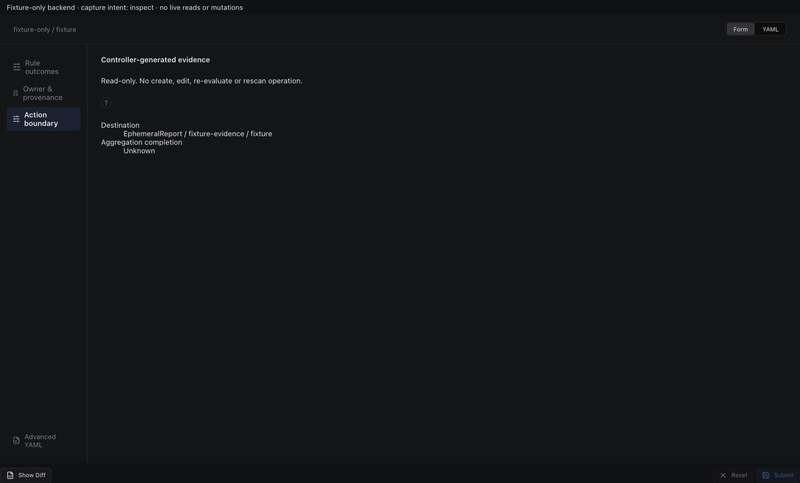

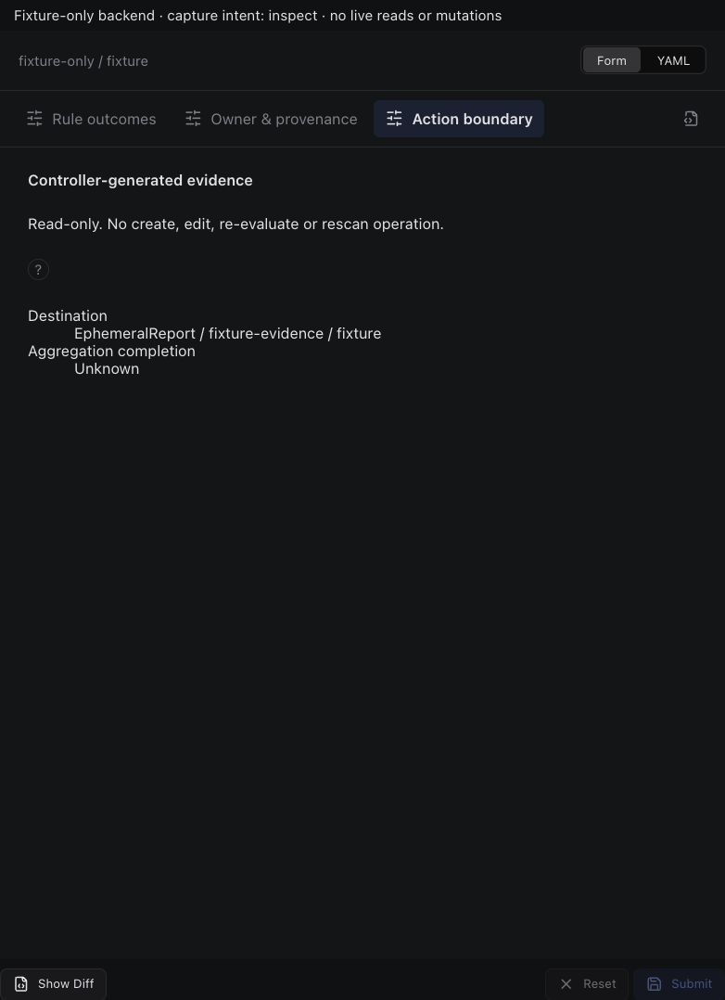

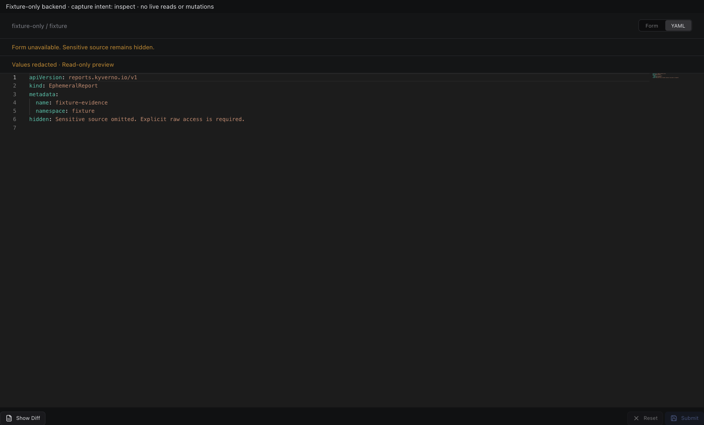

