# Policy report inspection

Actual production components with local fixture transport. No live resource reads or mutations. Creating/Submitting is held at the fixture boundary; denied, unavailable and immutable states are not presented as successful mutations.

Targets: `wgpolicyk8s.io/v1alpha2/policyreports` (PolicyReport, Namespaced) · `wgpolicyk8s.io/v1alpha2/clusterpolicyreports` (ClusterPolicyReport, Cluster)
Ownership: controller

## inspect

Sections, help, source, keyboard, narrow layout and boundary evidence

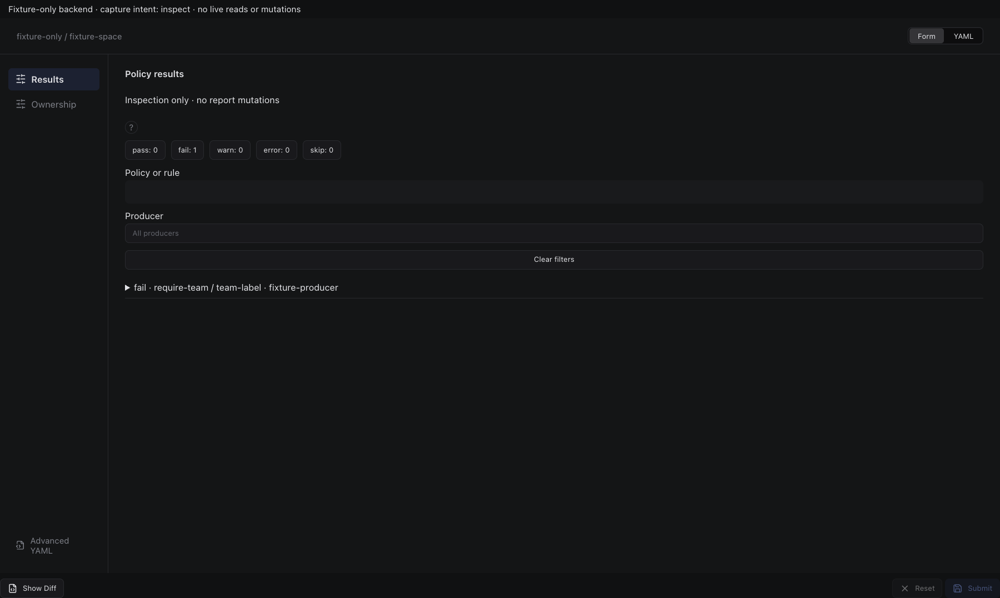

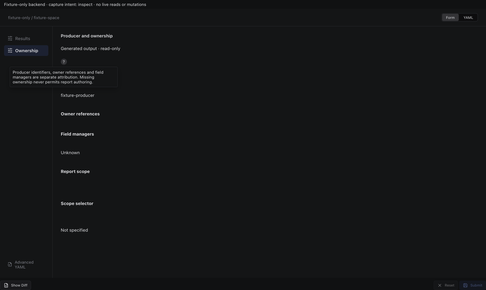

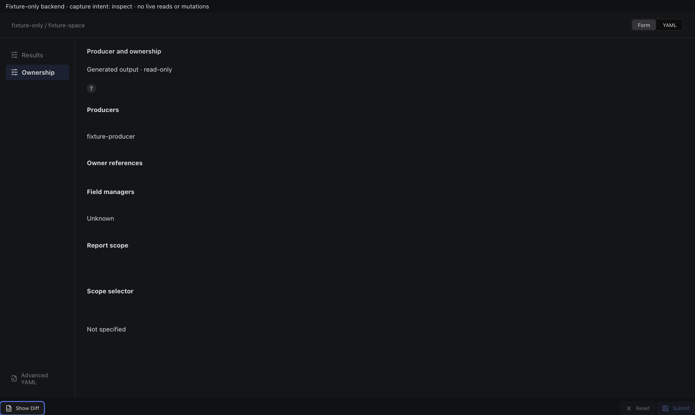

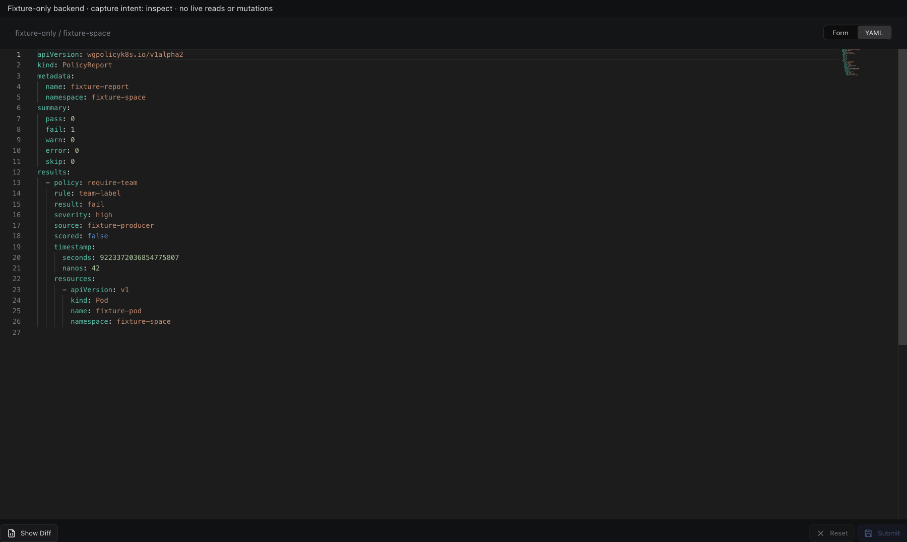

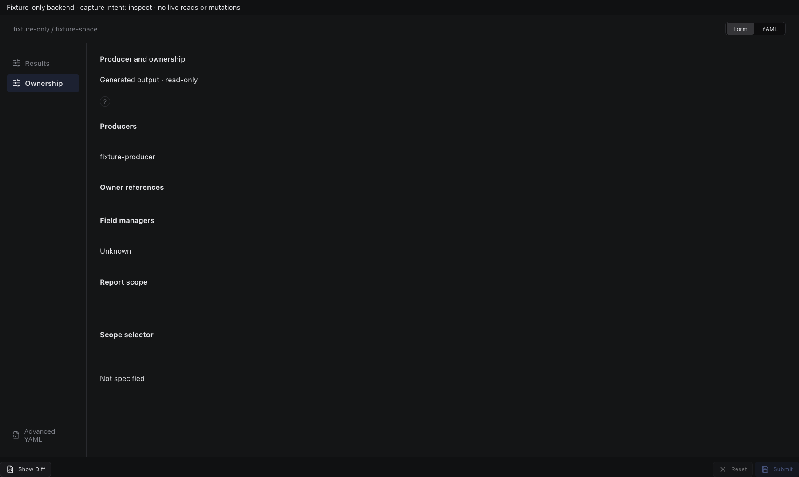

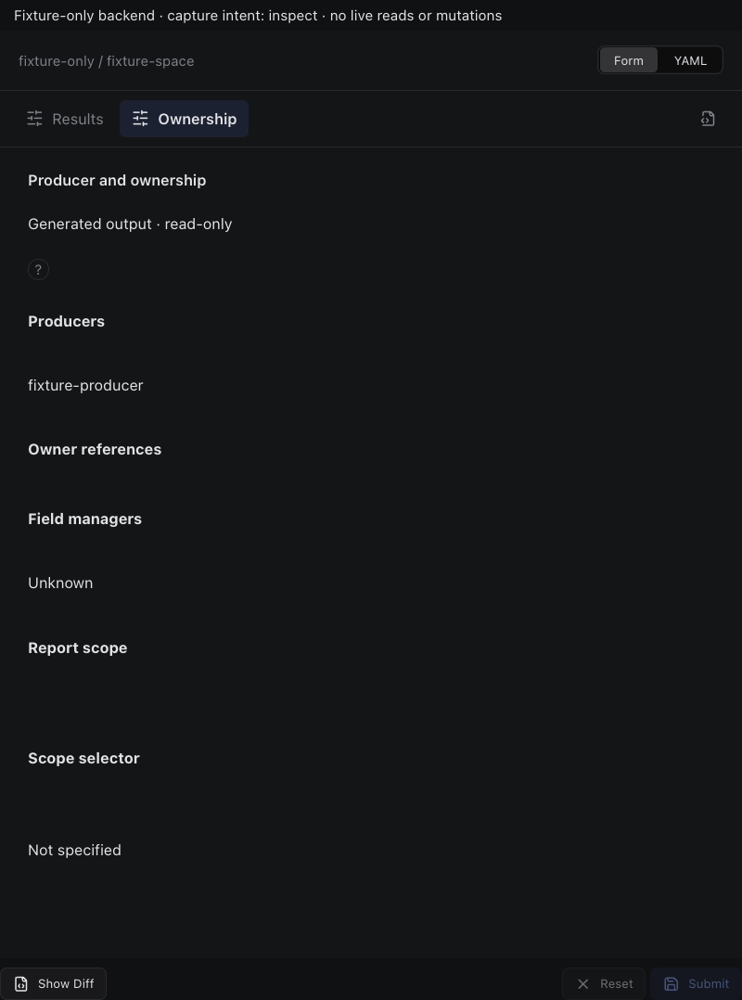

## edit

Sections, help, source, keyboard, narrow layout and boundary evidence

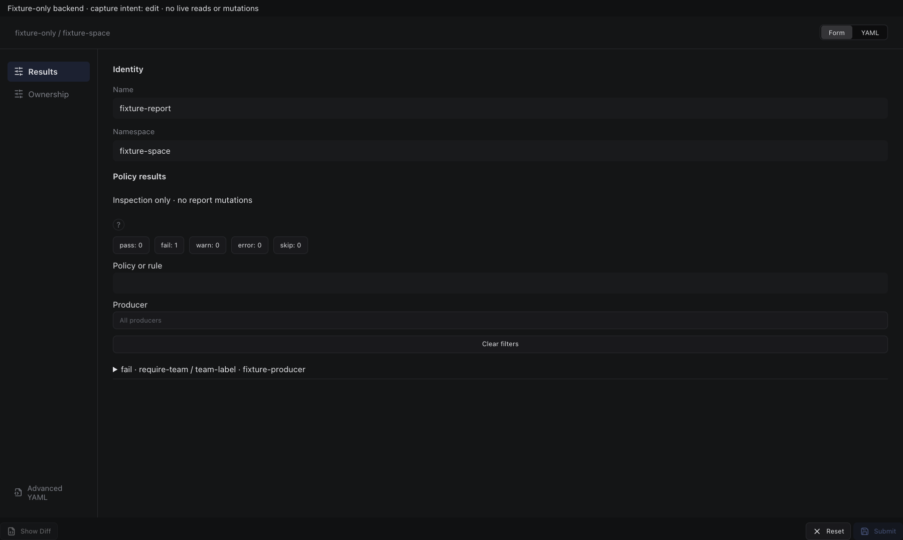

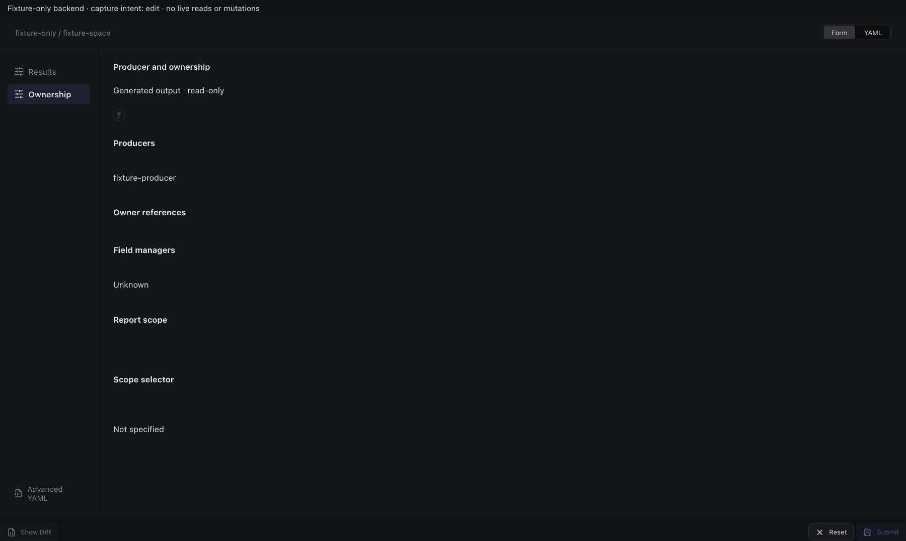

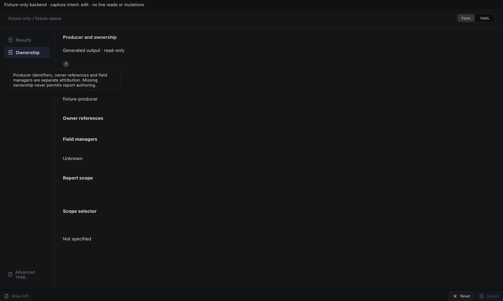

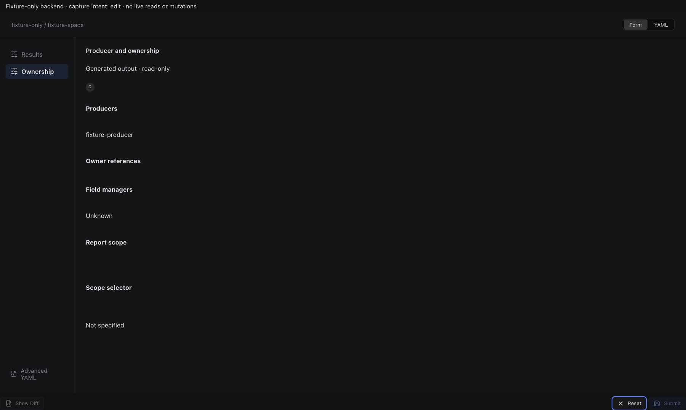

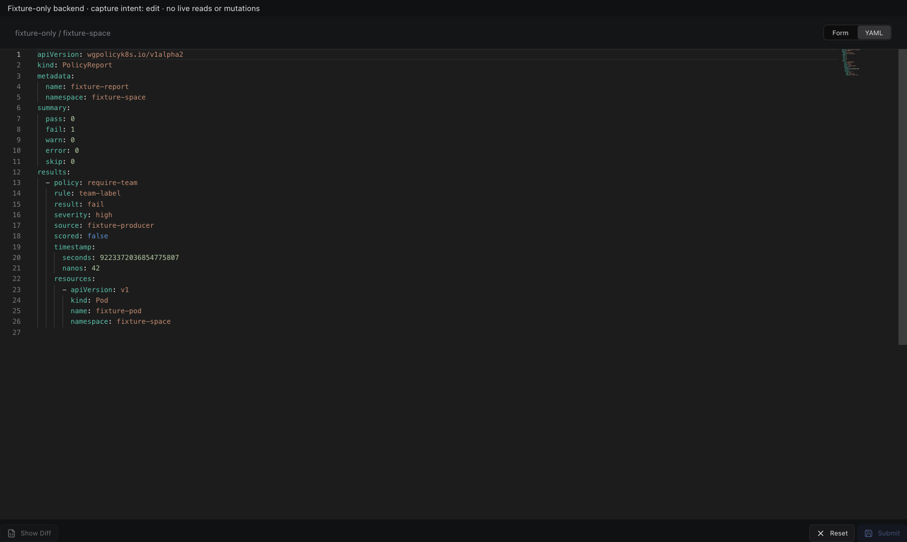

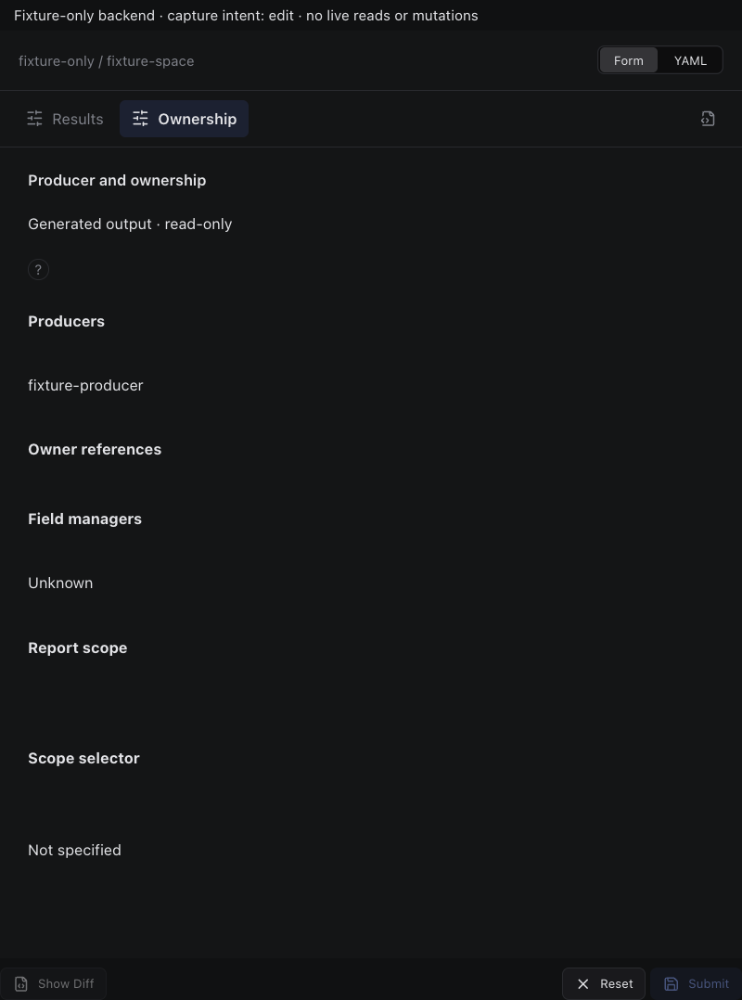

