# Strimzi Pod set inspection

Actual production components with local fixture transport. No live resource reads or mutations. Creating/Submitting is held at the fixture boundary; denied, unavailable and immutable states are not presented as successful mutations.

Targets: `core.strimzi.io/v1beta2/strimzipodsets` (StrimziPodSet, Namespaced)
Ownership: controller

## inspect

Sections, help, source, keyboard, narrow layout and boundary evidence

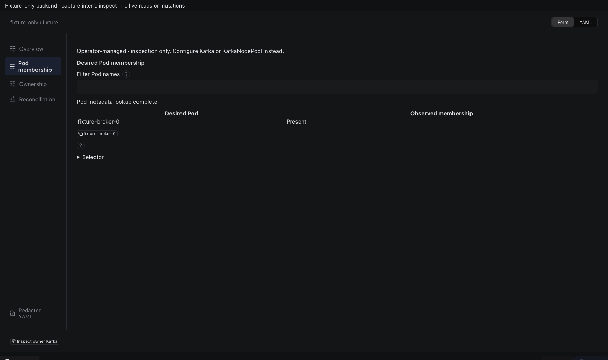

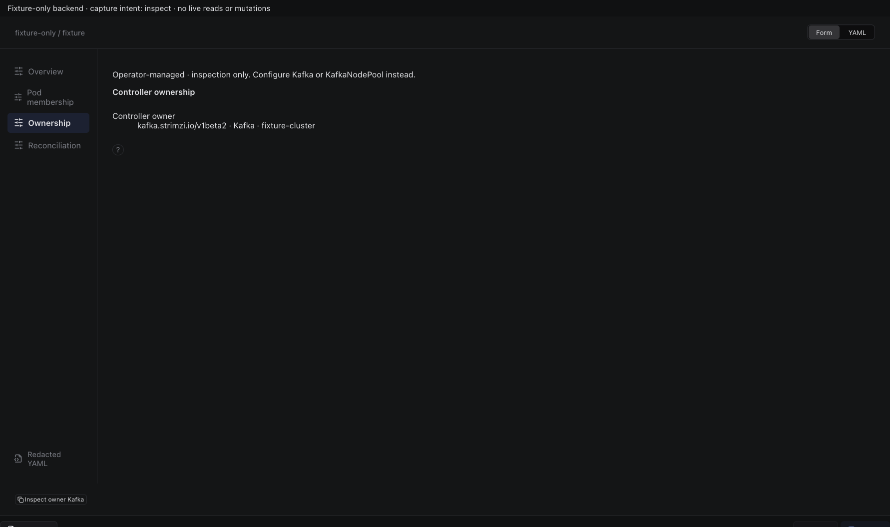

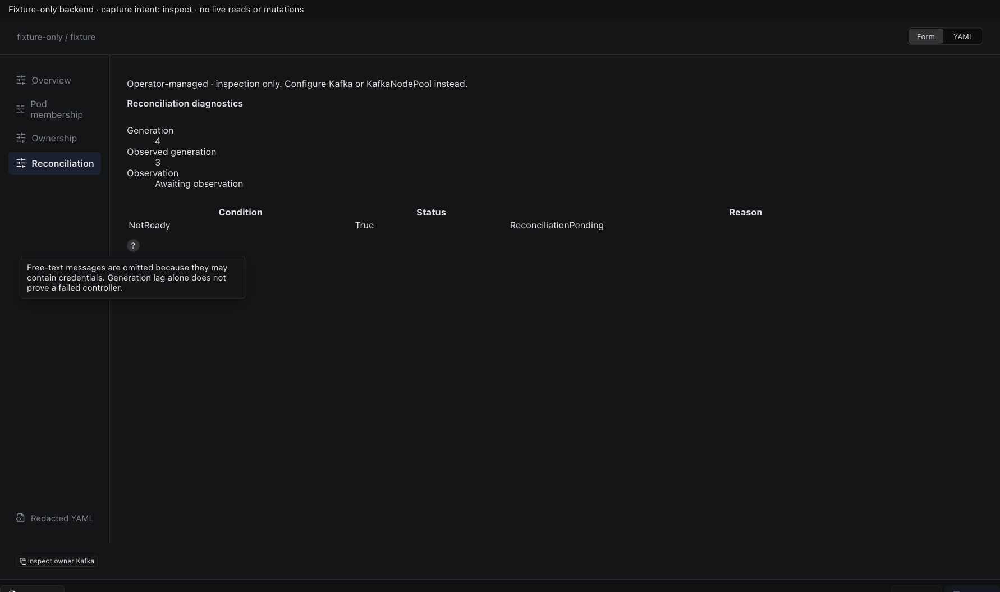

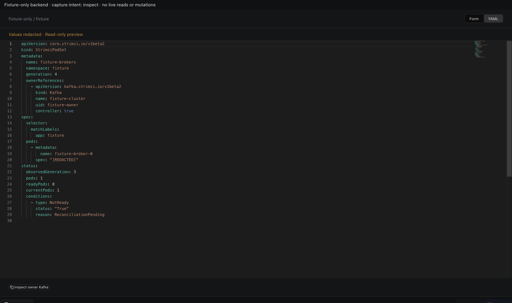

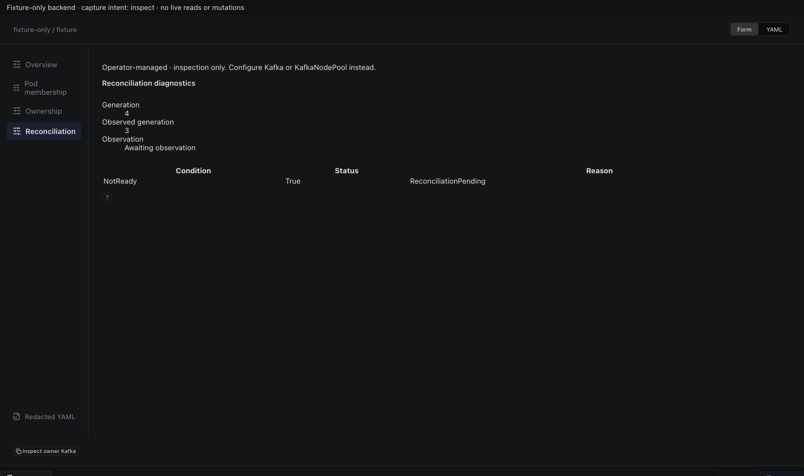

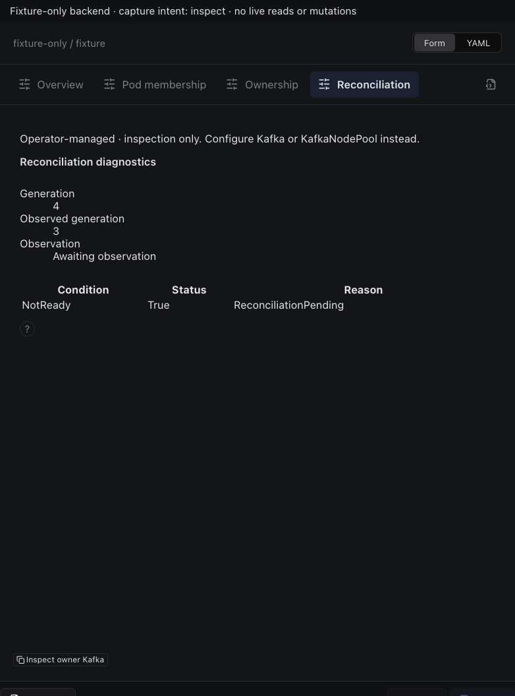

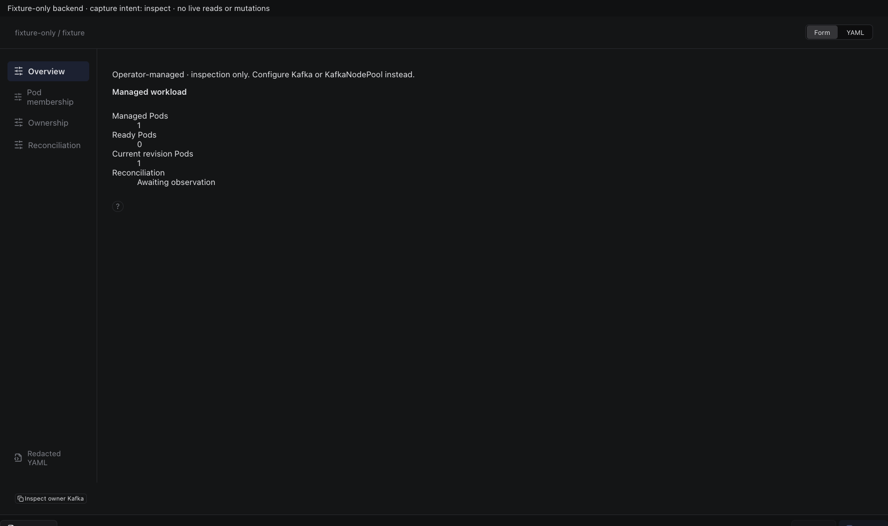

## edit

Sections, help, source, keyboard, narrow layout and boundary evidence

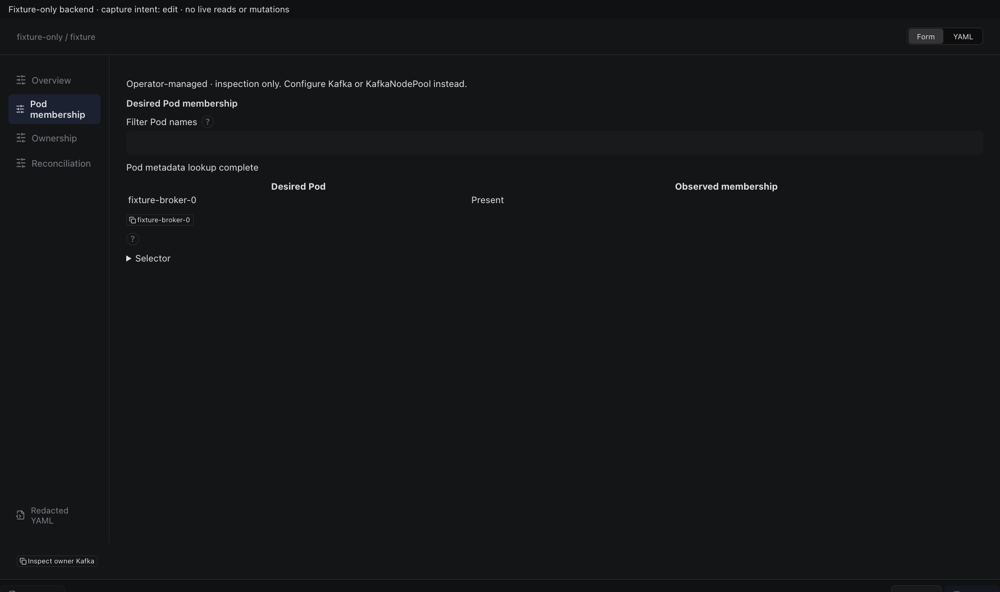

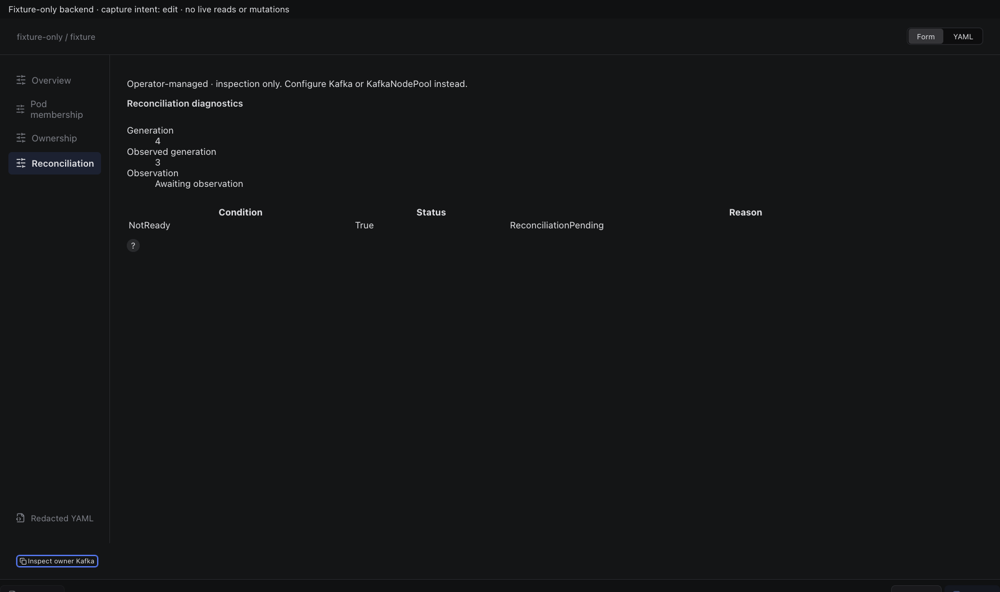

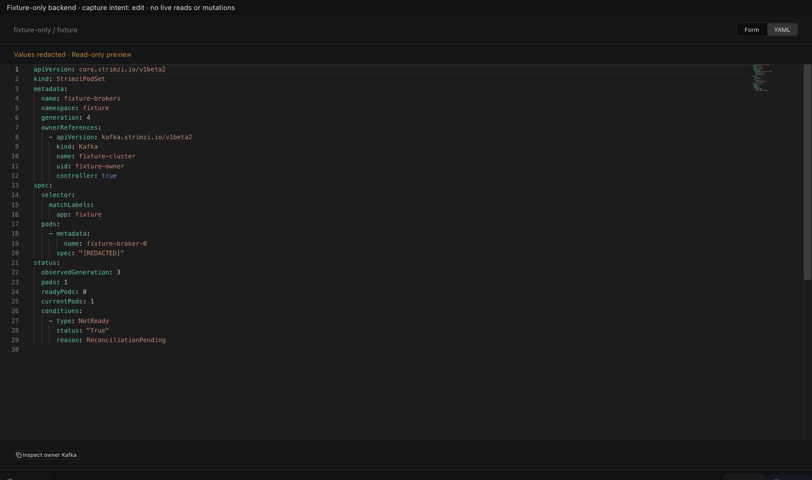

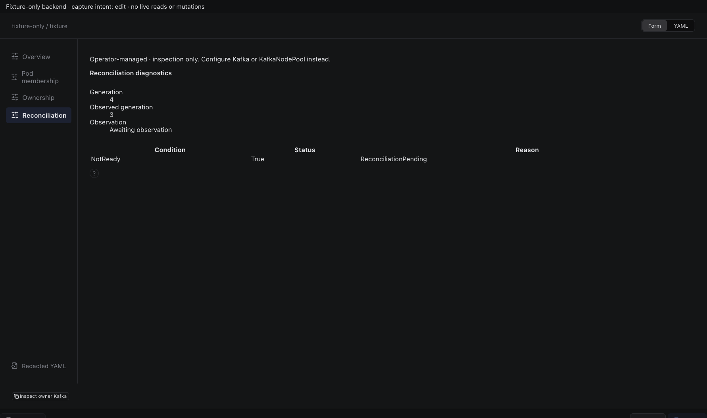

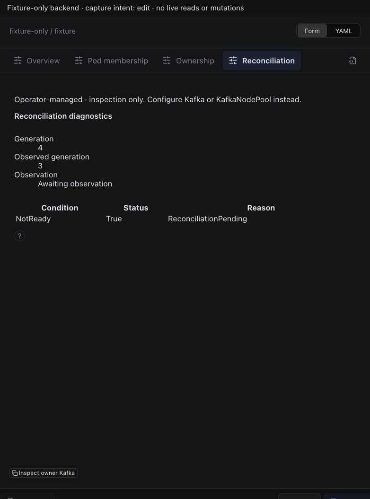

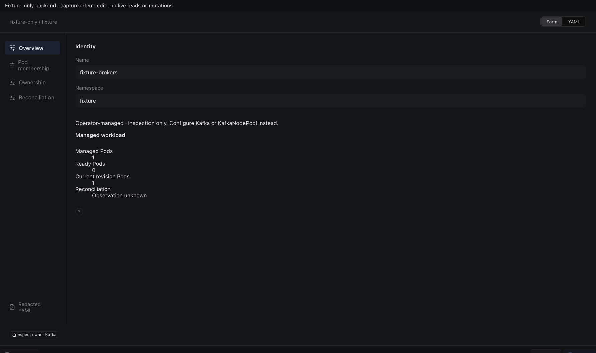

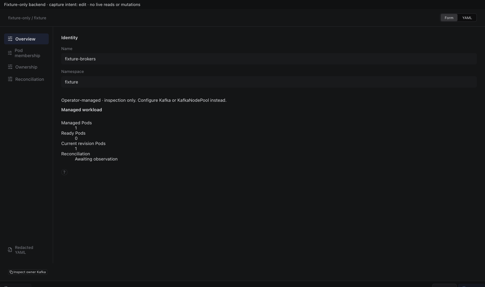

